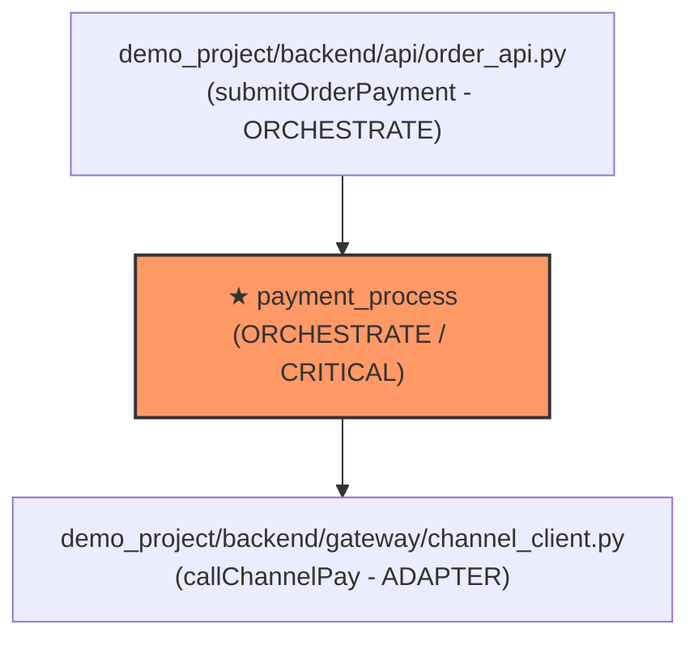

# 方法设计规范：payment_process

## 1. 基础与位置画像 (Location & Profile)
- **所属层次**：领域核心层（Domain Layer）
- **所属模块**：`payment`（支付核心模块）
- **文件路径**：`demo_project/backend/payment_service.py`
- **代码定位**：第 `11` 行，共 `58` 行（行范围：`11-68`）
- **方法签名**：`exception payment_process(input_data, output_data, context, isolate, metrics, recall)`
- **方法类型**：`ORCHESTRATE`（业务逻辑编排）
- **功能描述**：校验支付入参、扣减用户账户资金，并向渠道网关发起同步扣款请求

---

## 2. 特征与属性契约 (Attributes Contract)
- **改动敏感度**：`CRITICAL`
- **改动敏感理由**：涉及真实资金账户扣减与第三方支付渠道通信，若流程顺序错乱或异常捕获不当将造成重复扣款、资金单边账等严重事故。
- **副作用类型**：`EXTERNAL_IO`
- **具体副作用**：通过网络调用三方支付网关（Mock 超时渠道）、修改输出容器 `output_data`、记录度量指标 `metrics`。

---

## 3. 指导测试范围与策略 (Test Guidance & Scope)
- **测试文件**：`demo_project/test/_01_method_test/`
- **测试级别**：`INTEGRATION`（编排层用例测试）
- **覆盖约束**：100% 分支覆盖率。必须覆盖正常支付成功、参数缺失拒绝、非法金额拒绝以及网关超时异常分支。
- **跑测执行命令**：`python3 -m unittest discover -s tests`（当前 Demo 工程测试套件）
- **上下文限制指令**：AI 仅允许读取 `payment_service.py` 第 11-68 行及相关测试脚本，**严禁加载无关模块与文档**。

---

## 4. 以本方法为中心的依赖拓扑图 (Ego Dependency Graph)

---

## 5. 六元组入参与出参规范 (Six-Tuple Specification)

### 5.1 input 入参规范
| 字段路径 | 类型 | 取值范围 / 格式 | 可空 | 描述 |
|---|---|---|---|---|
| `payment.order_id` | String | 业务订单号 | 否 | 待支付订单号 |
| `payment.amount` | Decimal | (0, +∞) | 否 | 支付金额，必须大于 0 |
| `payment.channel` | String | `ALIPAY`, `WECHAT`, `TIMEOUT_CHANNEL` | 是 | 支付渠道，默认 ALIPAY |

### 5.2 output 出参规范
| 字段路径 | 类型 | 取值范围 / 格式 | 可空 | 描述 |
|---|---|---|---|---|
| `payment.id` | String | 流水号 `pay_...` | 否 | 支付流水唯一标识 |
| `payment.status` | String | `SUCCESS` | 否 | 支付成功状态 |

### 5.3 context 上下文依赖
| 字段路径 | 类型 | 描述 |
|---|---|---|
| `context.last_exception` | Object | 异常现场挂载对象（含 code, msg, retryable, details） |

### 5.4 isolate 隔离约束
| 字段路径 | 类型 | 约束说明 |
|---|---|---|
| `isolate.tenant_id` | String | 租户安全隔离标识 |

---

## 6. 衍生方法规范 (Derivatives: Compensate / Fallback)

### 6.1 事务补偿方法 (Compensate Method)
- **方法名称**：`payment_process_compensate`
- **代码定位**：`demo_project/backend/payment_service.py` 第 70-85 行
- **触发条件**：分布式事务下游失败或渠道扣款超时需要回滚。
- **补偿动作**：解冻用户账户资金，标记流水状态为 `COMPENSATED_FAILED`。

### 6.2 异常降级方法 (Fallback Method)
- **方法名称**：`payment_process_fallback`
- **代码定位**：`demo_project/backend/payment_service.py` 第 88-102 行
- **触发条件**：网关持续熔断且不可重试。
- **降级动作**：将订单推入异步对账重试队列 `QUEUED_FOR_RECONCILIATION`。

---

## 7. 历史修改与演变记录 (Structured Changelog)

##### `2026-10-14` `[TASK-PAY-001]`
- **需求背景**：实现标准支付编排与超时异常熔断机制。
- **修改原因**：初始化六元组支付核心服务，并提供沙箱超时测试支持。
- **技术原理**：采用六元组标准化入参/出参容器，针对超时异常注入可重试标示 `retryable: true`，并在 finally 中记录精确毫秒耗时。
