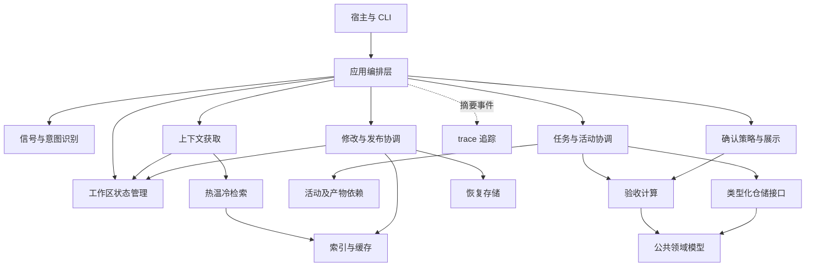
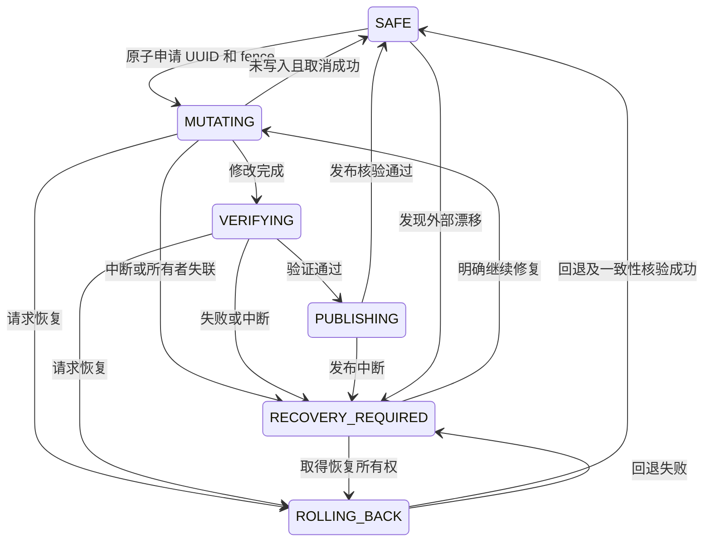

> 历史资料：保留原始设计或验证结论，不代表当前版本状态。

# hs-dev-skill 整体设计

状态：目标设计，待审阅。日期：2026-10-18。

## 1. 目标与边界

hs-dev-skill 是以安全版本为基础、以活动依赖推进任务、以有效证据完成验收的开发协作体系。活动由 A～H 地图组织；确认采用 mute、activity、stage 三种模式；trace 是独立的可选追踪开关，可与任一确认模式组合。数据采用冷热温分层，恢复数据独立存储。

本 Skill 统一管理经过自身入口的工作流、读取、修改、索引发布与恢复。UUID 用于协调修改流程；其他工具直接修改文件时，通过变化检测发现并重新核验。

| 质量目标 | 设计要求 |
|---|---|
| 执行效果 | 信号不足交模型决策；后续活动使用有效上游结果；修改不误伤无关验收 |
| 执行速度 | 稳定版本复用核验证书；按修改集合更新索引；同次操作共享核验结果 |
| token 效率 | 按需加载唯一规则源；上下文按任务目标选片段；恢复数据不提供给模型 |
| 输出可读性 | 起始 banner；面向人的结果说明；统一验收展示；机器 JSON 保持独立 |
| 代码可读性 | 具名类型、清晰依赖方向、薄 CLI；规则单源、模块职责明确 |
| 可恢复性 | 修改先取得所有权和恢复依据；撤销不直接等于安全；中断可识别、可恢复 |

不以减少文件数、缩短代码行数作为单独目标；以消除多份权威事实、减少无效读取和降低理解成本为目标。

## 2. 总体结构与依赖方向



各模块为进程内 Python 模块，默认不增加后台进程。常驻检索服务按需启用，CLI 与服务共享同一套规则及存储协议。

| 模块 | 职责 | 不承担 |
|---|---|---|
| workspace | 状态、UUID、操作代次、读取凭据、等待与恢复入口 | 业务验收是否通过 |
| intent | 信号提取、候选评分、置信度、模型兜底 | 授权修改或解除安全门禁 |
| tasks | 任务生命周期、活动选择与推进、完成事件 | 直接渲染 UI、操作索引表 |
| dependencies | 上游基线、产物依赖、影响传播 | 按全局代次撤销全部验收 |
| context | 定位、读取、筛选、装配必要上下文 | 自动修复索引、读取恢复历史 |
| indexing | 文件目录、内容索引、符号、关系、分层缓存 | 权威业务结论、任务审批 |
| acceptance | 对清单、产物、证据及决定计算验收结果 | 调用任务编排服务反向保存任务 |
| confirmation | 按模式判断确认点、解释用户决定、组织材料 | 伪造人工确认、重复询问有效决定 |
| changes | 修改、验证、发布的流程协调 | 自行定义业务标准 |
| recovery | 私有快照、操作日志、恢复执行 | 面向模型的检索与上下文供应 |
| presentation | banner、摘要、材料卡、JSON 序列化 | 修改领域状态 |
| trace | 可选结构化事件、链路关联、耗时与诊断摘要 | 恢复依据、验收证据、业务状态决定 |

任务包含活动执行与验收记录。应用层加载任务及验收输入，调用验收计算，再通过仓储保存结果；验收模块不反向导入任务编排模块。

## 3. Skill 进入流程

第一项工程操作必须是工作区安全状态检查，不能先读取可能正在变化的业务材料。

1. 检查安全状态、当前操作与发布版本；无初始化记录时标为 UNINITIALIZED，不误认为安全。
2. 展示一次 Skill banner；如果等待或待恢复，banner 同时展示该状态。banner 不需要读取业务正文。
3. 正在修改或回退：等待稳定状态；超过本次等待预算返回 WAITING 和操作信息，不擅自清锁。
4. 中断或外部漂移：进入恢复决策，不将等待当作恢复。
5. 安全后识别意图，并分别判断任务连续性与授权范围。
6. 咨询只获取上下文；继续复用任务；新任务按实际影响选择活动。
7. 修改时取得 UUID 与操作代次，完成受管修改、验证和发布。
8. 活动或阶段到达完成条件后，由确认模块按模式处理；任务结束时统一核对既有有效结果。

示例 banner：`hs-dev-skill | 版本 <实际版本> | 场景：整体设计 | 模式：stage`。任务 ID 只在已有或实际创建任务后显示。每个逻辑执行入口显示一次，不随底层每次命令重复打印；JSON 模式将身份信息放入结构化 meta，stdout 不夹杂文本 banner。

## 4. 工作区安全状态管理

### 4.1 三种概念分离

| 概念 | 判断内容 |
|---|---|
| 安全状态 | 代码、文档、索引是否属于已验证的可读取版本，是否有修改正在进行 |
| 任务状态 | 工作是否未完成、执行中、待确认、完成或回退 |
| 验收状态 | 某范围基于其输入、结果和证据是否仍有效 |

未完成任务可以有安全的已发布版本；安全不代表允许另建冲突任务，也不代表产品验收通过。

### 4.2 状态与记录

工作区协调状态独立存放于本地 SQLite。使用短事务完成申请和状态转换；绝不在整个模型执行期间持有 SQLite 写事务。操作日志在实际写文件前持久化。

`WorkspaceState`：workspace_id、status、published_revision、active_operation_id、fence、owner、heartbeat_at、dirty_scope、recovery_required、schema_version。

`OperationPermit`：operation_id（UUID）、fence（单调递增整数）、task_id、base_revision、owner、participants、scope、created_at。

UUID 是工作身份，fence 防止已撤销的旧流程再次通过受管写入。两者都不扩大宿主权限。协调状态、运行记录和业务内容分区，不能因记录心跳或确认就递归触发业务索引发布。

| 状态 | 含义 | 普通上下文读取 |
|---|---|---|
| UNINITIALIZED | 尚无可验证发布基线 | 不提供“安全”保证 |
| SAFE | 当前版本经核验且无在途修改 | 获取读取凭据后允许 |
| MUTATING | 修改所有者持有 UUID | 等待 |
| VERIFYING | 运行验证及发布检查 | 等待 |
| PUBLISHING | 发布索引与版本标记 | 等待 |
| ROLLING_BACK | 恢复操作执行中 | 等待 |
| RECOVERY_REQUIRED | 中断、漂移或验证失败，尚未解决 | 返回恢复需求 |



### 4.3 申请、加入、等待与撤销

- SAFE 下申请：在同一事务内检查状态、分配 UUID 和新 fence、变为 MUTATING。历史 UUID 不自动复活。
- 不安全时加入：校验 UUID、fence、任务及写入范围；匹配才允许。其他申请返回 BUSY，读取流程进入有界等待。
- 同 UUID 的多个参与者共享一次操作；文件写入仍串行协调，或使用明确不重叠的资源范围。UUID 本身不解决写覆盖。
- 心跳仅用于检测疑似失联，超时不自动设 SAFE。
- 未产生修改：所有者可取消，确认无在途参与者与外部变化后释放。
- 已产生修改：通过提交发布或回退释放；不能直接删除状态记录。
- 强制撤销：先递增 fence、阻止旧流程继续进入写入临界区；清理或等待已在途写者结束，再获取恢复所有权。未核验前保持 RECOVERY_REQUIRED。
- UUID 在读者看来属于诊断信息；模型无需读取底层恢复数据来理解“等待哪个操作”。

### 4.4 读取与外部编辑

使用短期 `ReadTicket(revision, fence, change_epoch)`：取得时检查 SAFE；读取结束再次核对状态和变更标记。期间发生变化则丢弃结果并重试或等待，不能把混合内容返回模型。

对短读取可使用共享读锁与独占写锁；长上下文装配允许乐观重试，避免读者长期阻塞修改。上下文返回后宿主如长期推理，后续写入还要检查 base_revision，不能将读取凭据视为永久授权。

外部工具修改必须在 Skill 协调的操作范围内执行，记录写前基线并完成写后协调。绕过模块的编辑不能靠 UUID 阻止：有可靠事件流时维护 change_epoch，事件丢失、重启或无监听能力时执行文件清单复核。检测到外部变化转待恢复，不自动接受成新基线。

不能对不遵守协议的外部写者承诺线性一致性；若要求更强保证，需要额外文件系统隔离，超出默认本地协作模型。

## 5. 信号驱动的意图识别

借鉴 vLLM Semantic Router 的 Signal 与 Decision 分离：信号表达请求事实，策略根据事实决定路径。此处是针对开发任务的适配设计，不引入其推理网关或默认加载本地大模型。[官方概览](https://github.com/vllm-project/semantic-router/blob/main/website/docs/overview/semantic-router-overview.md)

```text
用户输入 + 当前任务摘要
→ 规范化与分句
→ NLP 信号提取
→ 信号聚合及候选意图评分
→ 足够明确：确定性决策
→ 不足、低置信度、冲突：宿主模型决策
→ 模型仍无法消除关键歧义：请求必要澄清
```

| 信号 | 需要提取的信息 |
|---|---|
| 行为 | 分析、设计、实现、修复、重构、继续、回退 |
| 作用范围 | 代码、文档、测试、模块、对象 ID、路径 |
| 语义限制 | 否定作用范围、引用文本、条件、先后顺序、仅讨论 |
| 连续性 | 当前任务、上一轮目标、补充说明、明确替换目标 |
| 环境证据 | 已失败测试、实际错误、现有产物、当前活动 |
| 授权约束 | 是否允许修改、是否只需方案；独立于意图结果 |

每条信号具有 type、value、source_span、polarity、confidence、extractor。每个候选具有 score、supporting_signals、conflicts、missing_signals。

模型兜底条件包括：无信号、覆盖不足、最高候选低于阈值、候选分差不足、多意图冲突、关键指代不明。不能以“只命中一个词”等同高置信度。评分初期称置信评分，经过标注语料校准后才称概率；阈值通过误路由与模型兜底成本评估确定，不凭空宣称准确率。

模型只接收当前请求、必要连续性摘要、候选与证据信号；输出类型化 `IntentDecision`。输出无效或模型不可用则返回 NEEDS_DECISION，不能默认执行修改。模型决定不能越过安全状态与权限。

示例：“不要回滚，继续实现接口”应保留被否定的 ROLLBACK 信号，结合当前任务识别 RESUME/IMPLEMENT，不转只读探索。

## 6. 活动、任务与依赖

A～H 是活动导航，不是强制顺序流水线。新产品可覆盖完整路径；修复、重构、设计与咨询只使用相关活动。省略活动参数不能默认为所有活动：系统给出基于意图与影响的活动集合，缺少必要依据则补判。

依赖分为两层：

1. 活动定义依赖：例如 E2 需要 E1 的数据契约。这是可复用规则。
2. 本次执行的实际依赖：明确引用哪个产物、哪个版本、哪些相关对象或章节，以及是否已有有效验收。这是有效性依据。

阶段内是否并行由依赖和资源冲突决定。执行器只调度依赖满足的活动；并发执行还须满足修改资源隔离与操作所有权规则。

任务包含 `ActivityRun`、`CheckExecution`、`ArtifactRef`、`EvidenceRef`、`AcceptanceRecord` 和当前工作摘要。任务创建不是业务安全事务的开始：一个长任务由多个短修改操作构成，等待人工确认期间不长期占用 UUID。

### 验收失效规则

验收绑定清单版本、当前结果、实际输入依赖摘要和必要证据摘要，不绑定全局索引发布代次。

| 变化 | 结果 |
|---|---|
| 后续活动新增自己的实现与文档 | 上游结果及确认保持有效 |
| 无变化重建索引 | 不撤销业务验收 |
| 修改被消费的需求或契约 | 标记直接消费者待评估，沿真实依赖传播 |
| 修改当前验收产物、适用清单或证据 | 当前相关验收待复验 |
| 无关文件变化 | 不影响该范围验收 |

依赖粒度支持文件、稳定对象或章节；无法可靠定位到对象或章节时，按文件保守传播。

每个依赖记录 producer、consumer、artifact_id、bound_revision、bound_digest、required_acceptance。阶段确认模式允许同阶段使用已完成且已验证的中间产物，不要求每个活动先得到人工签认；跨阶段及 activity 模式按确认策略检查。

## 7. 文件系统上下文获取

统一 ContextProvider，接收目标、任务、活动、必要对象及预算；直接路径只是其中一种定位方式。

1. 等待安全状态并取得 ReadTicket；本次修改内部读取使用 OperationPermit，结果不能泄露为对外安全版本。
2. 选择当前目标、用户约束、有效上游结果、相关代码和必要未决项。
3. 通过热数据或温冷索引定位对象、符号与片段；统一文件读取校验路径、版本和摘要。
4. 按稳定对象或片段 ID 去重；按必需程度排序；必要约束先占预算。
5. 装配上下文并检查预算；必要材料装不下时明确返回不足，不静默删除约束。
6. 核对 ReadTicket；发生变化则丢弃本轮内容并重试。

`ContextBundle` 包含 revision、required_fragments、supporting_fragments、on_demand_refs、missing_requirements、budget_usage。每个片段包含来源、范围、摘要和选择理由；不重复注入同一正文。

token 计数优先使用宿主已知 tokenizer；未知时使用明确标记的保守估算，同时限制字节数。恢复快照、恢复操作历史、旧版本正文不进入任何模型上下文路径。恢复执行器只向宿主返回当前操作摘要、结果及必要决定。

## 8. 热温冷索引与安全核验加速

| 分层 | 存储与用途 | 读取行为 |
|---|---|---|
| 热 | 有界内存保存当前目标、当前有效契约片段、任务状态及当前清单原文 | 版本一致时直接使用，任务切换或修改即失效 |
| 温 | 磁盘持久索引包含可检索正文片段；内存缓存热点索引页与查询结果 | 搜索直接定位并返回有界片段 |
| 冷 | 磁盘存放较少使用的当前有效资料；索引存路径、属性、锚点和摘要 | 命中后按需读磁盘，不默认复制全文进 FTS |
| 恢复 | 独立私有目录保存快照和历史恢复信息 | 不属于模型检索分层，无搜索入口 |

温冷分类依据任务关联、访问情况、大小和预算，不把“冷”定义为恢复历史。升降温只改变派生存储策略，不改变权威文档，也不撤销验收。

安全证书记录已验证发布版本、源清单摘要、索引版本及变化检测水位。同一常驻进程或受管操作内复用；证书不能在无法确认外部变化的情况下跨进程盲信。

- 受管修改：由操作日志记录新增、修改、删除和移动，增量更新受影响索引和依赖。
- 无变化发布：不改变内容修订；物理索引重建可更新 index_generation，业务验收不受影响。
- 正常查询：检查状态、证书和变化水位，验证实际读取片段；不反复扫描 SQLite 全部逻辑内容。
- 服务重启、事件丢失、未知写入：进行清单复核，必要时计算摘要；全量审计仍作为显式或故障路径保留。
- 索引损坏：上下文不自动修复，由 changes 取得 UUID 后重建并核验。
- 无常驻服务：CLI 使用持久清单和文件属性缩小哈希范围，但仍承担文件枚举成本，不能承诺与可靠监听相同的复杂度。

常驻服务的整体内存上限为 200 MB，预算包含热原文、LRU、SQLite、临时缓冲与运行时。超过预算明确返回或淘汰派生缓存，不以进程硬限制代替正常容量控制。

## 9. 验收与确认

### 9.1 唯一规则与执行实例

Skill 的活动清单为规则权威源；项目只保存确有必要的适配或附加约束，通过引用关联活动清单。任务保存本次规则版本及执行结果，不复制完整规则正文。

清单规则采用具名结构：CheckDefinition(id, title, criterion, method, applicability)。执行结果采用 CheckExecution(check_id, rule_revision, result, evidence_refs, reason)。Markdown 表格由这些对象渲染，业务逻辑使用具名字段访问检查项。

旧规则版本如果仅用于恢复，不提供给模型；恢复中的任务若规则改变则明确识别并处理，不能静默套用新标准。

### 9.2 工作、证据与确认关系

```text
任务选择适用清单
→ 按清单执行工作
→ 真实验证并逐项形成结果与证据
→ 验收计算判断完成度及问题
→ 确认模块按模式展示与记录
→ 任务依据有效确认推进
```

交付材料与支撑证据分别建模：设计、行为结果等进入主要审阅区域；日志和运行报告默认放在对应检查项的证据详情。证据必须可核验，但不自动产生一个独立人工确认动作。

| 模式 | 确认触发点 | 确认者 |
|---|---|---|
| mute | 活动完成时自动计算并记录；阶段汇总 | 模型，明确标明来源 |
| activity | 活动达到可确认条件时 | 人工 |
| stage | 本次任务在该阶段的适用活动完成时 | 人工 |

任务完成核对已有有效确认并生成汇总，不强制再逐份重复确认。新增范围、未确认结果或失效依赖需要处理时，明确展示原因。

人性化验收展示：当前范围与目标、检查项结果摘要、交付材料及审阅重点、未通过问题与处理方式、折叠证据。一次明确的活动或阶段确认可以同时覆盖展示范围内的通过项；逐项反馈用于部分通过及问题沟通，不另外强制“材料通过后再确认范围”两轮操作。

决定绑定稳定检查项/材料 ID、范围及 view_digest。未提及项不变；暂缓不等于通过或 NA。宿主不能伪造人工原文。确认事件由任务仓储保存，验收计算只接收类型化输入并返回结果。

## 10. 文档体系与单源规则

| 层次 | 文件职责 | 加载时机 |
|---|---|---|
| SKILL.md | 用途、触发边界、第一步安全检查、路由、必要约束与索引链接 | Skill 触发 |
| 阶段说明 / 活动指南 | 阶段或活动的描述、目标、边界、输入输出、导航 | 需要了解对应对象 |
| 公共协议 | 安全状态、执行、确认等唯一权威规则 | 对应操作需要时 |
| 活动规则源 | 活动 ID、依赖、清单与产物要求 | 选中活动时 |
| guide | 独有方法、判断示例和失败处理 | 执行需要时，可不存在 |
| 项目权威文档 | 当前需求、设计、接口与实现说明 | 由 ContextProvider 选择 |
| 任务记录 | 目标、活动引用、结果、证据、当前状态 | 当前任务需要时 |
| 恢复数据 | 快照和恢复历史 | 仅恢复执行器 |
| 索引及缓存 | 可重建定位数据 | 检索模块，不直接充当规则 |

活动机器契约与人类清单使用一个结构化源，生成器只渲染不同视图，不维护第二份可独立修改的标准。阶段说明和活动指南不插入公共协议正文；指南不复述 criterion。没有实质指导内容就不生成指南，没有活动专属字段就不生成通用占位模板。

当前目录布局如下，具体模块按实际职责组织：

```text
hs-dev-skill/
|-- SKILL.md
|-- README.md
|-- LICENSE
|-- hs-dev-docs/
`-- hs-dev-skill/
    |-- references/
    |   |-- skills/
    |   |-- workflow/
    |   |-- catalogs/
    |   |-- schemas/
    |   |-- templates/
    |   `-- ...
    `-- scripts/
        |-- hs_dev.py
        |-- pyproject.toml
        |-- hs_dev/
        `-- tests/
```

主入口与包根保持在安装根；参考资料统一放在内部 references/，辅助程序与测试统一放在内部 scripts/。完整目录职责与执行命令见[目录说明](../directory-layout.md)。

目标工程只创建实际使用的设计目录，不在初始化时铺开全部活动空目录与通用正文。运行状态、索引、恢复和项目权威文档物理分区。

## 11. 类型、索引与接口

类型表达合法字段和状态，索引负责定位，两者同时存在。核心对象采用 dataclass、枚举或 TypedDict；持久边界进行显式 Schema 验证。避免为简单值引入多层无行为封装。

| 对象 | 稳定标识与主要定位 |
|---|---|
| Task / ActivityRun | task_id、activity_id、status |
| Artifact / Fragment | artifact_id、path、object_id、revision |
| CheckDefinition / CheckExecution | check_id、rule_revision、task_id |
| Evidence | evidence_id、path、digest、check_id |
| AcceptanceRecord | scope_id、dependency_digest、decision |
| Dependency | producer、consumer、artifact_id |
| Operation | UUID、fence、state、task_id |

示意接口：

```python
workspace.inspect() -> WorkspaceStatus
workspace.acquire(task_id, base_revision, scope) -> OperationPermit
workspace.join(operation_id, fence, participant) -> OperationPermit
workspace.await_safe(wait_budget) -> ReadTicket | WaitResult
workspace.cancel(permit) -> CancelResult
workspace.revoke(operation_id, reason) -> RecoveryRequired
intent.decide(request, task_summary) -> IntentDecision
context.obtain(request, ticket) -> ContextBundle
changes.execute(permit, change_set, checks) -> PublishedRevision
acceptance.evaluate(checks, artifacts, dependencies) -> AcceptanceResult
confirmation.handle(event, mode, result) -> ConfirmationAction
```

接口表达模块边界，参数和返回值遵循对应领域类型及状态契约。读路径不导入恢复正文读取接口；CLI 不直接编写恢复日志、发布 SQL 或更新审批字典。

## 12. trace 追踪

trace 用于理解执行路径、诊断故障和观察成本，与确认模式相互独立。`trace.enabled` 默认 false；启用时可组合 mute、activity、stage，既不增加人工确认，也不省略任何验证。

### 12.1 配置与作用域

配置优先级为显式参数＞任务＞项目＞主机＞默认。每次逻辑执行入口解析配置并生成 run_id，关联 task_id、activity_id 和 operation_id；未创建任务的咨询也可以追踪，不为追踪创建任务。开关只影响后续事件采集，不补录历史正文。

banner 显示 `trace：on/off`；机器结果在 meta 中提供相同信息。trace 开启不代表开启详细业务输出。

### 12.2 事件与数据契约

`TraceEvent` 包含 event_id、run_id、parent_event_id、task_id、activity_id、operation_id、timestamp、component、event、duration_ms、outcome、reason_code 和受限 attributes。不存在的关联字段为空，UUID 等标识用于关联，不作为授权凭据使用。

| 事件范围 | 记录摘要 |
|---|---|
| 入口与路由 | 安全检查结果、候选意图及评分、模型兜底原因、最终路由 |
| 状态与修改 | UUID 申请/加入/拒绝、等待、撤销、状态转换、发布结果 |
| 上下文与检索 | 命中层级、片段数量、缓存命中、预算使用、重试原因 |
| 任务与确认 | 活动转换、验收结果、确认模式与决定状态；引用权威记录 ID |
| 恢复与异常 | 恢复动作类别、结果、错误分类；不复制恢复日志或快照 |
| 性能 | 阶段耗时、扫描与哈希数量、内存统计；token 实测或估算须区分 |

事件仅记录结构化白名单字段，限制字符串长度和事件大小。禁止记录凭证、完整对话、文档正文、代码片段及模型完整输入输出。模型决策记录简短原因码和摘要，不采集隐藏推理。路径按项目相对路径记录，并应用敏感字段过滤。

### 12.3 存储与失败语义

追踪按项目隔离，存放于独立 trace 目录，不进入业务索引、恢复快照或默认模型上下文。采用有界缓冲及按容量/时间轮换的持久事件文件，清理仅作用于追踪数据。配置明确缓冲上限、事件大小和保留预算。

追踪采用 best effort：写入失败或缓冲满时允许丢弃事件，累计可观察的丢弃计数并给出有界诊断，不改变主流程结果，不阻塞修改或解除锁定。trace 关闭时不创建事件文件，事件载荷延迟构造，避免无效格式化成本。

trace 没有权威性，不能替代修改前日志、恢复数据、验证证据或人工确认记录；这些记录不受 trace 开关控制。追踪写入不申请业务修改 UUID、不改变发布修订、不触发索引更新。

### 12.4 查询与展示

提供按 run_id、task_id、activity_id、operation_id、组件、结果和时间范围过滤的有界查询。默认返回执行摘要、关键失败及耗时，详细事件按需展开。只有显式诊断请求才向模型提供过滤后的事件摘要，仍遵守安全读取、脱敏与上下文预算。

## 13. 验证与效果衡量

系统通过以下行为场景验证其契约。

| 方面 | 必须验证的行为 |
|---|---|
| 所有权 | 并发申请仅一个成功；错 UUID/fence 拒绝；同 UUID 写冲突可控 |
| 撤销 | 超时不自动安全；旧参与者失效；在途写入结束前不宣布安全 |
| 崩溃恢复 | 修改、验证、发布、回退各阶段中断都能识别；无混合版本被返回 |
| 安全读取 | 读取期间版本变化，结果丢弃；等待可中止；无人能以无限等待冒充进展 |
| 外部变化 | 监听丢失及服务重启触发复核；外部编辑不能被自动洗成安全 |
| 意图 | 否定范围、多意图、指代、连续性；低置信度进入模型；模型无效不执行 |
| 依赖 | 正常后续修改不撤销上游；相关上游改变传播到实际消费者 |
| 确认 | 三种模式一致；一次范围决定足够；未提及、暂缓、过期视图处理正确 |
| 上下文 | 当前任务热数据可读；必要约束不被静默删；恢复路径不可检索 |
| 文档 | 再生成无漂移；公共协议无正文复制；guide 有独立指导价值 |
| trace | 开关与三种确认模式独立组合；关闭无事件文件；启用可关联事件；无敏感正文；轮换和丢弃有界；写失败不影响业务结果 |

在同样工程规模、修改比例、硬件及宿主条件下比较：冷启动/热查询 P50、P95；扫描与哈希文件数、字节数；索引更新耗时；内存峰值；输入 token；模型兜底比例与误路由率；用户确认次数；无关验收失效次数。性能目标值依据基线测试制定，不先填未经测量的提升百分比。

## 14. 运行配置与格式契约

运行配置覆盖确认模式、trace、安全等待与心跳、上下文预算、索引分层及内存预算。优先级统一为显式参数＞任务＞项目＞主机＞默认；配置输出包含有效值及来源，未知字段、非法类型及预算冲突拒绝生效。

置信阈值通过标注语料校准，性能阈值按工程规模、运行环境与负载条件声明。运行对象均具备 schema_version，格式不匹配时明确拒绝读取；迁移属于显式操作，不能通过自动重建丢弃任务、证据或恢复信息。
