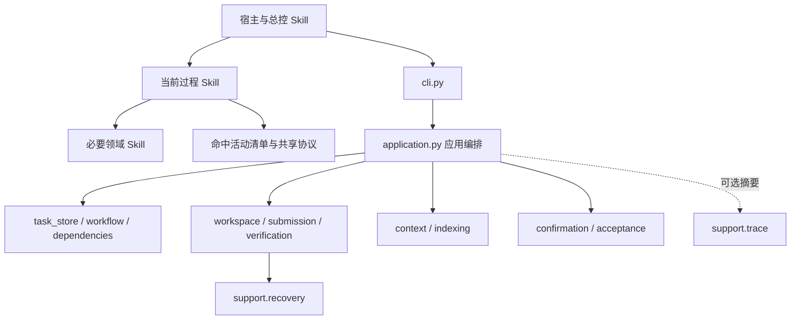

# 体系与运行机制

当前版现状说明：v6.0.0.0，2026-10-21。原目标设计保存在[历史资料](history/2026-10-18-skill-redesign.md)，不再作为当前实现状态说明。

## 层次与协作

图中关系表示职责协作，非逐条 import 图。Skill 指令描述模型应做的工作，运行时核验受管状态及记录；两者通过具体任务、内容版本和证据衔接。

| 实现位置 | 当前职责 |
|---|---|
| `cli.py`、`cli_values.py`、`presentation.py` | 命令参数、输入解析、面向人与机器的输出 |
| `application.py`、`intake.py`、`intent.py` | 应用编排、任务进入与候选意图信号 |
| `task_store.py`、`workflow.py`、`dependencies.py` | 任务存取、活动规则、实际依赖绑定 |
| `workspace.py`、`submission.py`、`verification.py` | 修改所有权、内容核验与发布协调 |
| `context.py`、`context_budget.py`、`indexing/` | 语义定位、依赖装配、预算与检索 |
| `acceptance.py`、`confirmation.py`、`artifacts.py` | 检查与材料、确认及其内容有效性 |
| `support/`、`bundle.py` | 恢复、追踪、安装更新与完整包核验 |

源码入口：[运行时目录](../hs-dev-skill/scripts/hs_dev/)。本表为静态职责定位，不表示本次逐个运行了所有模块。

## 读取与修改

第一项工程操作为 `status`；未初始化工程需要显式 `init`。在途写入等待，中断或漂移进入恢复。安全状态与任务完成度分别判断。

受管修改先申请 UUID 与 fence，保存恢复依据。外部编辑通过 operation-start、snapshot、reconcile、operation-finish 协作；reconcile 绑定活动，检查实际修改集合，登记产物并处理旧确认失效。验证与发布前后复核同一内容摘要，完成一致性核验后才能恢复 SAFE。

源文件是权威内容，索引为派生数据；直接编辑不意味着工具已核验和发布。具体约束见[执行协议](../hs-dev-skill/share/core/execution.md)。本仓库源码包本身与目标工程运行目录同名，不能为编写产品说明直接对源码包执行目标工程初始化。

## 上下文与版本

[语义上下文协议 v2](../hs-dev-skill/share/context/context-protocol.md)支持文件、Markdown 章节、Python 限定符号和行区间。必要依赖通过 requires 装配，可选 references 按预算处理；必要集合装不下时整体拒绝，不能截断冒充完整材料。

返回包含身份、内容版本、来源、coverage、body 和 usage。只有 complete 可以作为完整上下文使用；歧义、材料缺失和预算不足分别返回 needs_selection、material_missing、insufficient_budget。delta 交付依据调用方仍持有的单元及版本，新会话或压缩后需重新核实 held。

热数据是有界任务原文；温数据进入 FTS5；冷数据只索引标题、属性和位置，正文按需读取。恢复数据不进入模型检索。默认字节预算与精确 token 计数不同，未配置 tokenizer 不执行 token 硬限制。[索引协议](../hs-dev-skill/share/indexing/protocol.md)规定核验、增量更新和显式修复。

## 证据与确认

检查规则来自唯一 catalog；任务结果保存 check_id、规则摘要、状态、证据及理由。PASS 需要有效证据，NA 需要适用性理由。材料由 acceptance-material 显式登记，日志不自动成为待审材料。

stage、activity、mute 决定确认责任及粒度；人工反馈绑定材料和 view_digest，过期视图拒绝写入。确认与被消费的单元内容、证据和实际依赖绑定；同文件无关章节或单纯重建索引不应撤销未受影响确认。[统一验收协议](../hs-dev-skill/share/core/acceptance.md)为权威说明。

## 恢复、更新与追踪

[恢复](../hs-dev-skill/share/support/recovery.md)按快照、实际修改及后像检查冲突。撤销凭据不会自动恢复文件或解除漂移；任务级回退不能用来绕过操作级冲突。恢复后分别核验内容、状态、索引及必要行为。

[更新](../hs-dev-skill/share/support/update.md)使用当前完整包进行暂存、替换及核验，不自动查找最新版，不自动迁移旧工程数据。临时备份只保障本次替换过程，不承诺长期回退。

[trace](../hs-dev-skill/share/support/trace.md)默认关闭、best effort，只保留白名单摘要，用于诊断和 Skill 改进；不能充当恢复或验收权威，空结果也不能证明动作未发生。
