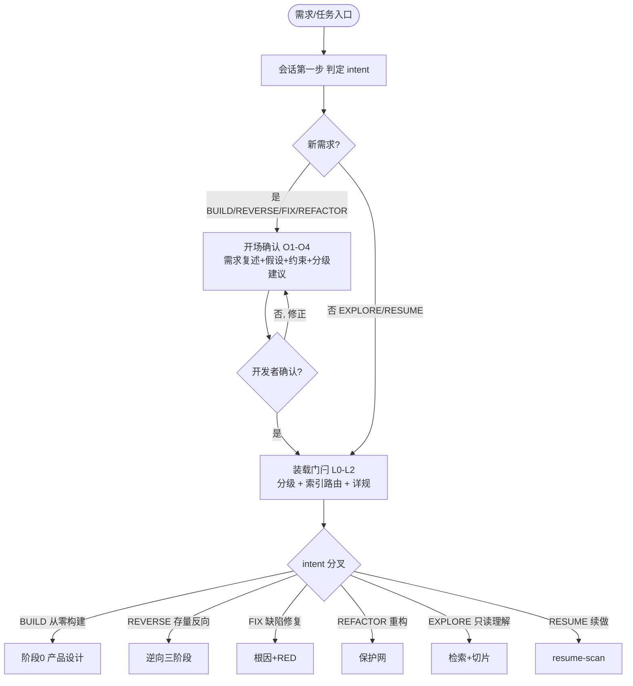
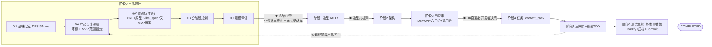
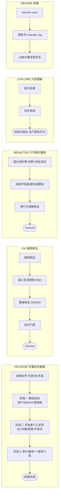

# 意图路由与阶段门禁全景（Intent Routing & Stage Gates）

**何时读**：需要看清「从任意需求入口到交付」的完整流转、门禁点与回环时；新需求分级路由时对照总图；讲解/评审流程时；每会话最多一次（只读一次，不限制据此推进）。

**分工**：分级规则 → [`right_sizing.md`](right_sizing.md)；阶段细则 → [`spec_driven_lifecycle.md`](spec_driven_lifecycle.md)；意图专属路径 → [`reverse_engineering.md`](reverse_engineering.md) / [`systematic_debugging.md`](systematic_debugging.md) / [`code_refactoring.md`](code_refactoring.md) / [`code_exploration.md`](code_exploration.md) / [`process_continuity.md`](process_continuity.md)；状态迁移 → [`task_state_machine.md`](task_state_machine.md)；开场确认 → [`opening_alignment.md`](opening_alignment.md)。

> **路由权威性**：当前子 Skill 入口和参考文档归属以 [`skill_routes.json`](../resources/skill_routes.json) 为准；各入口的计划、执行、验收与交接顺序见 [`entry_workflows.md`](entry_workflows.md)。本文流程图用于说明 L 规模生命周期和历史门禁细节；S/M 剪枝及入口职责不得覆盖主 Skill 路由和当前验收清单。

---

## 0. 顺序性结论（先读）

**每个实际执行阶段都有文档验收标准与证据，规则见 [`stage_acceptance.md`](stage_acceptance.md)。**

| 命题 | 是否成立 | 依据 |
|---|---|---|
| 前向禁止跳过实际路径内的验收 | 是 | 当前阶段适用 checklist 全部通过且验收记录有效 |
| 每阶段必须让开发者重读整篇文档 | 否 | 提交检查摘要和证据，复用已有明确确认；可合并明确列出的验收范围 |
| 模型自检或产物齐套即可自动放行 | 否 | Agent 仅提交候选结论，技术委托须明确，不能代签业务预期 |
| 允许变更后回环 | 是 | 上游语义变更使受影响下游验收失效，重验后继续 |

---

## 1. 总入口：意图路由（不同需求入口分叉）

> 开场确认 O1~O4 为 v2.43 新增（详见 [`opening_alignment.md`](opening_alignment.md)）；EXPLORE 自动锁 READONLY、RESUME 沿用 plan_log，均跳过开场确认。

---

## 2. BUILD（满配 L）：阶段链与门禁点

**门禁说明**：
- **0→1 冻结门禁**：按 DISC/PROD 清单核对理解、场景与预期，再记录业务语义签收和冻结确认单；
- **阶段 1 末 选型拍板单**、**阶段 3 DB 决策**：v2.43 新增的低成本确认点；
- 其余跃迁（1→2、2→3、3→4…）：按 TECH/ARCH/DETAIL/TASK/IMPL/DELIV 当前清单提交证据并取得有效阶段验收记录；
- 任一阶段不满足 → **停在当前阶段**（合法停点：DESIGN 前沿等待 / 询问闸门 / 冻结未过 / BLOCKED），不带病前进。

**S/M 剪枝**（同 BUILD 入口，按 `change_size`）：
- **S**：分级 → 轻量对齐（DoD+影响面 3~8 行）→ 切片装载 → 实现+单测 → 门禁子集 → Commit（禁止空跑 1→3）；
- **M**：分级 → 迷你 PRD（或 diff 节）→ 只补触达面设计 → 任务/pack → 实现 → 门禁 → Commit（阶段 1~2 默认跳过，记「沿用」一行）。

---

## 3. 其余意图专属路径

| 意图 | 顺序保证 | 特别豁免/回环 |
|---|---|---|
| **BUILD** | L 严格 0→1→2→3→4→5→6 | 0→1 冻结门禁；实现期可回切阶段 0 |
| **REVERSE** | 三阶段顺序推进；阶段二必须开发者介入 | 前期对齐防逆向方向返工 |
| **FIX** | 必须先 RED 后 GREEN（测试先行硬约束） | 根因假设可迭代 |
| **REFACTOR** | 保护网先决 → 重构 → 零漂移验证 | 漂移检出即回滚重来 |
| **EXPLORE** | 只读直通 | **豁免**任务包/PRD/Commit/门禁，可随时中断 |
| **RESUME** | 从断点继续 | 不重开满配、不重做 done 步骤 |

---

## 4. 三条回环（为什么不是严格瀑布）

1. **DESIGN 审讯循环**：G1 列前沿 → G2 出题（每轮 2~5 题）→ G3 更新文档 + 写 `_03_qa_log/` → 重算前沿 → **前沿空后提交验收，通过才冻结**（G4）；
2. **实现期回切 DESIGN**：阶段 5 暴露产品空白 → **回退阶段 0**，迷你审讯闭合后再前进（对应状态机回退，终态重开需 `--force`）；
3. **TDD 红→绿→重构**：每个 seam 内部循环，红不过不写实现。

---

## 5. 门禁点汇总（哪些必须开发者确认）

| 门禁点 | 类型 | 触发 |
|---|---|---|
| 开场确认 O1~O4 | 人工确认 | 新需求分级前（v2.43） |
| 阶段 0 冻结（业务语义签收 + 冻结确认单 + 视觉签收） | 人工确认 | 0→1 必需 |
| 阶段 1 末 选型拍板单 | 人工确认 | 选型后（v2.43） |
| 阶段 3 DB 决策（新增业务触 DB） | 人工确认 | 落 V/U 与编码前（v2.43） |
| 其余阶段跃迁 | 文档验收 | 当前阶段 checklist、有效证据与开发者验收记录 |
| 阶段 6 交付 | 执行证据 + 文档验收 | 测试全绿 + 静态零告警 + verify + DoD 回收 + 交付验收 |

---

## 6. 反模式

| 禁止 | 改为 |
|------|------|
| 跳步执行（如未冻结直接选型 / 未分级按满配） | 走阶段链 + 门禁 |
| 把"不逐阶段确认"当"可以跳过产物" | 产物齐套仍是跃迁硬前提 |
| 实现期发现 DB 变更自行落表 | 回切 DESIGN 走开发者决策 |
| 冻结后需求变更静默修改 | 走《变更请求单》（[`requirement_change.md`](requirement_change.md)） |
| 把流程图当 README 类通用文档命名 | 用本文这类 Domain+Category 有语义命名 |
