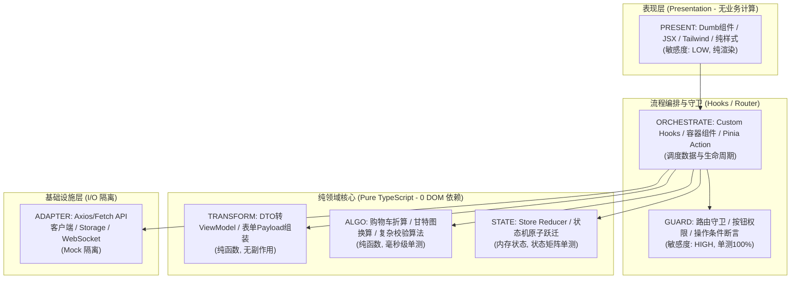

# 方法类型分类与契约画像指南 (Method Archetypes & Contract Profile)

**何时读**：
- 阶段 3 详细规格设计（编写/更新 `hs_dev_docs/_06_method_design/`）；
- 阶段 4 上下文装配（Context Pack 中按方法画像物化切片）；
- 阶段 5 编码与测试实现（依据方法属性收窄上下文、定向跑测、维护修改历史）；
- 检索命令：`python scripts/skill_ref_index.py search --scenario 方法设计` 或 `search --q 方法类型`

---

## 1. 核心思想：“文档定义代码”与 VibeCoding 效能引擎

在传统开发中，方法元数据分散在人类脑海或冗长代码注释中，导致 AI 在 VibeCoding 模式下频繁面临两大痛点：
1. **上下文膨胀与幻觉**：AI 为修改一个方法，被迫阅读数千行上下游源码，大量消耗 Token 且容易丢失约束。
2. **测试盲目与效率低下**：AI 无法感知改动的真实影响半径，要么无脑跑全量测试耗时数分钟，要么漏测高危分支。

**“文档定义代码”（Specification Drives Code）原则**：
- **代码保持纯粹**：源码实现专注于逻辑本身，不充斥冗余元数据注释；
- **文档作为单一天理源**：方法的设计属性、代码物理定位（行号与行数）、改动敏感度、依赖拓扑与历史修改原理全部沉淀在 `hs_dev_docs/_06_method_design/` 中；
- **精准投喂与秒级闭环**：AI 通过检索文档获取切片，毫秒级读取目标代码行段，执行定点测试，并反向更新文档历史记录。

---

## 2. 七大方法标准类型 (The 7 Method Archetypes)

本 Skill 将系统中所有方法抽象为 7 类原子模型，每一类具有截然不同的依赖约束、敏感度与测试策略：

| 类型代号 | 类型名称 | 核心职责 | 默认敏感度 | 副作用与外部依赖 | 推荐测试层级 |
|---|---|---|---|---|---|
| **`TRANSFORM`** | 数据填充与转换 | DTO/VO 互转、Schema 校验清洗、字段组装映射 | `LOW` | **无副作用**（纯内存映射，无 I/O） | 单元测试 (`UNIT`) |
| **`ALGO`** | 通用计算与算法 | 核心计价、哈希加解密、排序检索、数值统计公式 | `MEDIUM` ~ `CRITICAL` | **严格纯函数**（无 I/O，无全局状态修改） | 单元测试 (`UNIT`) |
| **`GUARD`** | 校验守卫与权限策略 | 越权检查、角色鉴权判定、业务前置规则断言拦截 | `HIGH` ~ `CRITICAL` | **高危拦截**（返回布尔或抛出拒绝异常） | 单元测试 / 契约测试 (`UNIT`/`CONTRACT`) |
| **`STATE`** | 状态机驱动变迁 | 生命周期流转驱动、合法变迁断言、Reducer | `CRITICAL` | **核心资产**（无外部 I/O，操作内存聚合根状态） | 状态矩阵单测 (`UNIT`) |
| **`ORCHESTRATE`** | 业务逻辑编排 | 顶层用例流程组装、串联调度各子方法、Controller/Service | `HIGH` | **胶水层**（无底层复杂运算，调度外部 I/O 与领域层） | 集成/用例测试 (`INTEGRATION`) |
| **`ADAPTER`** | 外部 I/O 适配 | DB CRUD、三方 HTTP API、Redis/MQ 读写、文件系统包装 | `MEDIUM` | **有外部副作用**（需承受网络波动与异常重试） | Mock 契约测试 (`CONTRACT`) |
| **`PRESENT`** | 展现与格式化 | 币种/时间友好显示、日志脱敏掩码、CLI/UI 视图组装 | `LOW` | **边缘展现**（格式化输出，出错不破坏核心数据） | 单元测试 (`UNIT`) |

---

## 3. 方法属性机制（六维画像）

在 `hs_dev_docs/_06_method_design/` 中，每个登记的方法均具备以下标准化属性：

1. **所属层次与模块**：自上而下的定位锚点（如 `领域核心层 / billing 模块`）。
2. **代码精准定位（物理坐标）**：标明文件相对路径、起始行号与代码行长。
   > **VibeCoding 收益**：AI 借助 `view_file(StartLine, EndLine)` 毫秒级单屏命中，无需全文扫描，Token 节省达 90%。
3. **方法类型 (`archetype`)**：7 大标准类型之一。
4. **改动敏感度与理由 (`sensitivity`)**：
   - `LOW` / `MEDIUM` / `HIGH` / `CRITICAL`
   - **独立拆行给出敏感理由**：向 AI 明确阐述破坏后果（如资损、安全越权、级联雪崩）。
5. **副作用类型与具体副作用 (`sideEffect`)**：
   - 类型：`NONE`（严格纯函数）/ `IN_MEMORY`（仅改内存状态）/ `EXTERNAL_IO`（涉及外部 I/O）。
   - **独立拆行给出具体表现**：明确是否有网络请求、DB 写入、入参浅拷贝污染等。
6. **指导测试范围与执行策略 (`testScope`)**：
   - 明确测试文件路径、测试级别（`UNIT` / `CONTRACT` / `INTEGRATION` / `E2E`）；
   - 明确覆盖约束与**精确跑测命令**（如 `npm test -- path/to/test.ts` 或 `pytest tests/test_algo.py`）；
   - **硬性禁止跑全量无关测试**。

---

## 4. 以本方法为中心的局部依赖拓扑图 (Ego Dependency Graph)

每个方法档案必须内嵌以该方法为中心（★）的 Mermaid 局部依赖图：
- **上游调用方 (Callers)**：明确标出谁在调度它，以及调用方的类型；
- **下游被调方 (Callees)**：明确标出它依赖谁，以及被调方的类型；
- **隔离禁令**：
  - `ALGO` 与 `TRANSFORM` **绝对禁止调用 `ADAPTER`**（计算不得混入 I/O）；
  - `GUARD` 只能由 `ORCHESTRATE` 调度，或在领域聚合根入口处拦截；
  - `ADAPTER` 仅做协议翻译与网络包装，不得包含业务编排。

---

## 5. 三段式历史修改记录 (Structured Changelog)

历史记录禁止简略为一句话。每次修改必须包含以下三段：
1. **需求背景**：对应的需求/任务（Task ID）与业务目标；
2. **修改原因**：为什么需要修改此处代码，原逻辑有何缺陷或不足；
3. **技术原理**：底层实现的变更机制与设计考量（防止后续迭代中被其他 AI 误当冗余代码删除）。

---

## 6. 面向 VibeCoding 的执行守则（降低 Token 与极速反馈）

AI Agent 在承接修改任务时，必须严格执行以下工作流：

```text
[1. 读文档画像] ──检索 method_design.md 提取「文件路径 + 行号范围 + 跑测命令」
        │
[2. 极窄上下文] ──仅 view_file 目标行段及对应测试文件；严禁加载全量调用链源码
        │
[3. 实施变更]   ──按方法类型与规范精准修改代码
        │
[4. 定点跑测]   ──执行文档指定的专属测试命令；严禁全量跑测；绿灯后结束
        │
[5. 同步回写]   ──更新文档中的代码行号定位与三段式历史修改记录
```

---

## 7. 前端工程化落地与实战映射 (Frontend Architecture Mapping)

前端开发是 VibeCoding 中“逻辑与样式混杂、组件爆炸、单测最难落地”的重灾区。将 7 大方法规范严格映射到现代前端（React / Vue / Svelte）中，能彻底斩断“大组件”对 Token 的消耗：



### 前端 7 大分类职责与代码位置清单

| 方法类型 | 前端真实角色与职责 | 推荐目录位置 | 依赖禁令与特征 | 跑测与测试策略 |
|---|---|---|---|---|
| **`PRESENT`** | 纯展示 Dumb 组件、格式化输出函数（如 `formatCurrency`） | `components/ui/`, `features/*/ui/` | **禁止包含复杂业务算式与 API I/O**；仅依赖 props | 快照或视觉审查；**不跑重型单测** |
| **`TRANSFORM`** | DTO ↔ ViewModel 互转、表单数据清洗与组装 | `features/*/model/mappers.ts` | **禁止异步、禁止修改入参**；纯内存数据塑形 | 纯单元测试 (`vitest` 毫秒级) |
| **`ALGO`** | 纯前端计算算法、本地折算、复杂排版换算、图表数据处理 | `utils/`, `features/*/model/calc.ts` | **严格纯函数，0 DOM 依赖，0 外部 I/O** | 纯单测，边界值与溢出断言 100% |
| **`GUARD`** | 路由前置守卫、按钮禁用判定、操作权限决策 | `guards/`, `features/*/model/policy.ts` | **只返回 boolean 或断言结果**；禁止执行业务修改 | 单测双向覆盖（放行 + 拦截） |
| **`STATE`** | 状态机驱动、Reducer、Pinia 原子 action 状态跃迁 | `stores/`, `features/*/model/state.ts` | **纯状态计算**；禁止在 reducer 内部触发网络请求 | 状态转移矩阵全用例单测 |
| **`ORCHESTRATE`** | 容器组件、Custom Hooks（如 `useOrderCheckout`） | `features/*/hooks/`, `features/*/views/` | **胶水层**；只串联上述纯函数与 Adapter，不自写算法 | 集成测试（Mock Adapter 接口） |
| **`ADAPTER`** | API Client 请求封装、LocalStorage/IndexedDB 包装 | `api/`, `services/`, `adapters/` | **禁止散落业务规则**；仅做协议转换、超时重试与异常封装 | Mock 契约测试，不发起真实外网请求 |

### 前端 VibeCoding 三大纪律：
1. **杜绝“几千行上帝组件”**：页面文件只保留 `ORCHESTRATE`（调用 hook）与 `PRESENT`（渲染标签）；业务算式强制下沉为 `ALGO`。
2. **改逻辑不读 JSX，改样式不读逻辑**：
   - 当需求为“调整折算规则”时，AI 查阅 `_06_method_design` 仅加载 `calc.ts`（L20-L45），**无需加载包含几百行 Tailwind 类名的 React 组件**，Token 节约 90%。
3. **0 DOM 依赖的高速单测**：
   - 核心业务纯函数（`ALGO` / `TRANSFORM` / `STATE` / `GUARD`）脱离浏览器 DOM 与 JSDOM 运行，`vitest run` 0.2 秒反馈，形成即时红绿闭环。
