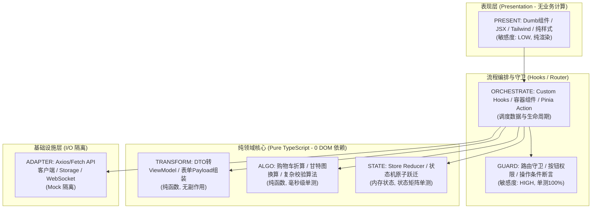

# 7. 面向 VibeCoding 的执行守则（降低 Token 与极速反馈）

**何时读**：处理7. 面向 VibeCoding 的执行守则（降低 Token 与极速反馈）时；先沿用[入口公共约束](../method_archetypes.md)，只装载本业务分册。读取复用遵循[变化感知规则](../load_latch.md#5-变化感知与装载缓存统一重读规则)。

<!-- HS_SECTION_BODY -->
## 7. 面向 VibeCoding 的执行守则（降低 Token 与极速反馈）

AI Agent 在承接修改任务时，必须严格执行以下工作流：

```text
[1. 意图检索与选型] ──执行 doc_index_db.py method-search 召回候选；确定复用/扩展/新建
        │
[2. 读文档画像]     ──从 _04_engineering_contract/_04_method_design 提取「物理定位行号 + 跑测命令」
        │
[3. 极窄上下文]     ──仅 view_file 目标行段（15~30行）及对应单测；严禁加载全量调用链源码
        │
[4. 实施精准变更]   ──按方法类型与规范修改或扩展逻辑
        │
[5. 定点跑测]       ──执行文档指定的专属测试命令；严禁全量跑测；绿灯后结束
        │
[6. 同步回写]       ──更新文档中的代码行号定位与三段式历史修改记录
```

---

## 8. 前端工程化落地与实战映射 (Frontend Architecture Mapping)

前端开发是 VibeCoding 中“逻辑与样式混杂、组件爆炸、单测最难落地”的重灾区。将 7 大方法规范严格映射到现代前端（React / Vue / Svelte）中，能彻底斩断“大组件”对 Token 的消耗：



### 前端 7 大分类职责与代码位置清单

| 方法类型 | 前端真实角色与职责 | 推荐目录位置 | 依赖禁令与特征 | 跑测与测试策略 |
|---|---|---|---|---|
| **`PRESENT`** | 纯展示 Dumb 组件、格式化输出函数（如 `formatCurrency`） | `components/ui/`, `features/*/ui/` | **禁止包含复杂业务算式与 API I/O**；仅依赖 props | 快照或视觉审查；**不跑重型单测** |
| **`TRANSFORM`** | DTO ↔ ViewModel 互转、表单数据清洗与组装 | `features/*/model/mappers.ts` | **禁止异步、禁止修改入参**；纯内存数据塑形 | 纯单元测试 (`vitest` 毫秒级) |
| **`ALGO`** | 纯前端计算算法、本地折算、复杂排版换算、图表数据处理 | `utils/`, `features/*/model/calc.ts` | **严格纯函数，0 DOM 依赖，0 外部 I/O** | 纯单测，边界值与溢出断言 100% |
| **`GUARD`** | 路由前置守卫、按钮禁用判定、操作权限决策 | `guards/`, `features/*/model/policy.ts` | **只返回 boolean 或断言结果**；禁止执行业务修改 | 单测双向覆盖（放行 + 拦截） |
| **`STATE`** | 状态机驱动、Reducer、Pinia 原子 action 状态跃迁 | `stores/`, `features/*/model/state.ts` | **纯状态计算**；禁止在 reducer 内部触发网络请求 | 状态转移矩阵全用例单测 |
| **`ORCHESTRATE`** | 容器组件、Custom Hooks（如 `useOrderCheckout`） | `features/*/hooks/`, `features/*/views/` | **胶水层**；只串联上述纯函数与 Adapter，不自写算法 | 集成测试（Mock Adapter 接口） |
| **`ADAPTER`** | API Client 请求封装、LocalStorage/IndexedDB 包装 | `api/`, `services/`, `adapters/` | **禁止散落业务规则**；仅做协议转换、超时重试与异常封装 | Mock 契约测试，不发起真实外网请求 |

### 前端 VibeCoding 三大纪律：
1. **杜绝“几千行上帝组件”**：页面文件只保留 `ORCHESTRATE`（调用 hook）与 `PRESENT`（渲染标签）；业务算式强制下沉为 `ALGO`。
2. **改逻辑不读 JSX，改样式不读逻辑**：
   - 当需求为“调整折算规则”时，AI 查阅 `_04_engineering_contract/_04_method_design` 仅加载 `calc.ts`（L20-L45），**无需加载包含几百行 Tailwind 类名的 React 组件**，Token 节约 90%。
3. **0 DOM 依赖的高速单测**：
   - 核心业务纯函数（`ALGO` / `TRANSFORM` / `STATE` / `GUARD`）脱离浏览器 DOM 与 JSDOM 运行，`vitest run` 0.2 秒反馈，形成即时红绿闭环。

### 前端方法文档模板标准：
前端方法设计文档模板见 [`resources/templates/hs_dev_docs/frontend_method_design.md`](../../resources/templates/hs_dev_docs/frontend_method_design.md)。前端核心方法必须落盘到 `hs_dev_docs/_04_engineering_contract/_04_method_design/_02_{feature}/_01_{method_name}_design.md`，明确标记 `0 DOM 依赖` 测试环境与具体行号范围。
