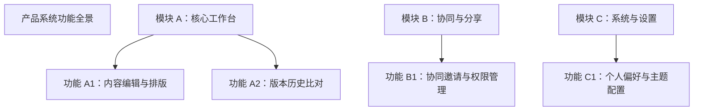

# 产品设计规范指南（设计语言与产品功能）

**何时读**：阶段 0 / `work_mode=DESIGN` / 需求规划 / UI 与功能设计；每会话最多一次。  
**核心分工**：
- **产品设计核心指南（本文）**：定义专业级产品设计能力，确立「产出只需且必须包含**产品的设计语言**和**产品的功能**」之铁律；
- **产品原型与线框** → [`product_prototype.md`](product_prototype.md)；
- **设计对齐编排 (Grill)** → [`grill_orchestration.md`](grill_orchestration.md)；
- **前端默认审美与手艺** → [`frontend_aesthetic.md`](frontend_aesthetic.md) / [`frontend_craft.md`](frontend_craft.md)；
- **项目根设计资产** → [`design_md.md`](design_md.md) + 根目录 `DESIGN.md`。

---

## 0. 核心定位与产出边界铁律

### 0.1 产出边界铁律（绝对纯净原则）
**产品设计阶段（阶段 0）的产出只需要且必须包含两大支柱：**
1. **产品的设计语言 (Product Design Language)**：视觉调性、Design Tokens、组件规范、交互反馈与全状态设计、设计禁忌与硬护栏；
2. **产品的功能 (Product Features & Functionality)**：产品定位、功能架构全景、用户角色与旅程地图、详细功能规格（输入/触发/规则/输出/边界）、界面信息架构与四态原型、产品功能验收标准 (DoD)。

> [!IMPORTANT]
> **严禁底层技术细节反向侵入产品设计**：
> 产品设计产出中**严禁**包含技术选型（如 MySQL vs PostgreSQL）、物理数据库 DDL 表结构、后端接口代码签名、内部六元组方法设计、分布式 Saga 补偿机制、代码单元测试覆盖率指标（如 85% 单测）等工程实现细节！  
> 技术架构与实现细节属于阶段 1（选型）至阶段 3（四要素详设）。产品设计只对产品价值、用户体验、界面语言与功能规格负责。

---

## 1. 支柱一：产品的设计语言 (Product Design Language)

产品设计语言定义界面的“灵魂与骨骼”，杜绝平庸拼凑与缺乏规范的“AI 默认皮”。

### 1.1 设计哲学与视觉调性 (Philosophy & Mood)
- **具象对标参照物**：禁止使用“大气、干净、现代、高级”等空洞形容词。必须给出具象对标或物理隐喻（如：“瑞士国际主义排版风格的高密度金融终端”、“复古温润纸张质感的沉浸式笔记工具”、“严谨克制的深色开发者工作台”）。
- **内容密度 (Density)**：明确界面的信息密度取向（`Airy` 宽松通透 / `Balanced` 均衡标准 / `Dense` 紧凑专业）。
- **受众与主职 (Audience & Primary Job)**：明确界面的核心受众是谁、首屏核心任务是什么。

### 1.2 Design Tokens 规范体系
设计语言必须建立在精确可落地的 Design Tokens 之上：

1. **色彩系统 (Color System)**：
   - **Primary (主色)**：品牌主色与核心视觉基准；
   - **Secondary (辅色)**：辅助平衡色；
   - **Accent / Tertiary (强调色)**：核心行为召唤色（CTA），严格执行强调色预算（首屏仅允许 3～5 处）；
   - **Neutral / Surface / Background (中性底色与表面色)**：界面的画布底色与容器背景色；
   - **Semantic (语义功能色)**：Success (成功绿)、Warning (告警黄)、Error (错误红)、Info (信息蓝)；
   - **对比度合规**：文本与背景对比度必须满足 WCAG AA 级以上（常规文本 ≥ 4.5:1，大文本 ≥ 3:1）。
2. **排版字体层级 (Typography Scale)**：
   - **字体族**：Display / Sans（正文） / Mono（数据与代码），全站字体族 ≤ 2 种；
   - **字阶梯次**：
     - `Hero / Display`: 40–56px，字重 600–700，字距 -0.02em；
     - `H1`: 32–36px，字重 600，行高 1.2；
     - `H2`: 24–28px，字重 600，行高 1.3；
     - `H3`: 18–20px，字重 600，行高 1.4；
     - `Body-Regular`: 14–16px，字重 400，行高 1.5–1.6；
     - `Caption / Small`: 12–13px，字重 400，行高 1.4；
     - `Data / Mono`: 等宽数字与代码展示。
3. **空间与间距网格 (Spacing & Grid Layout)**：
   - 基于 4px / 8px 基础步进：`2xs: 4px`、`xs: 8px`、`sm: 12px`、`md: 16px`、`lg: 24px`、`xl: 32px`、`2xl: 48px`、`3xl: 64px`；
   - 容器最大宽度约束：`max-w-[1200px]` 或 `max-w-[1440px]`，保障大屏可读性。
4. **圆角与投影层级 (Radius & Elevation)**：
   - 圆角梯度：小圆角 4px（输入框/标签/徽标）、中圆角 8px（按钮/常规卡片）、大圆角 12–16px（模态弹窗/抽屉）；
   - 投影高程：
     - `Flat`：纯色描边（1px border），无阴影；
     - `Raised`：浅微投影（卡片悬浮、下拉菜单）；
     - `Overlay`：中度投影（气泡弹出框、侧边抽屉）；
     - `Modal`：深投影配合遮罩（模态弹窗）。

### 1.3 核心组件规范与全状态覆盖 (Component Specs & States)
所有核心交互组件（Button、Input、Card、Navigation 等）必须定义完整的**状态矩阵**：
- **默认态 (Default)**：正常静态展示；
- **悬停/聚焦态 (Hover/Focus)**：鼠标移入与键盘 Tab 聚焦的高亮反馈（外发光描边、微色阶提亮）；
- **激活/按压态 (Active/Pressed)**：点击瞬时的微位移或按压色差；
- **加载态 (Loading/Skeleton)**：操作提交中的 Spinner 旋转或内容占位骨架屏；
- **禁用态 (Disabled)**：不可操作状态（灰度降低、光标禁用 `cursor-not-allowed`）；
- **错误态 (Error)**：校验未通过的警示色红框与内联错误提示。

### 1.4 交互反馈与微动效 (Interaction Feedback & Motion)
- **动效时长与曲线**：即时反馈 100ms，展开折叠 200ms，模态进出 300ms；采用弹性平滑曲线（如 `cubic-bezier(0.16, 1, 0.3, 1)`）；
- **反馈分层**：
  - 轻量反馈：Inline 校验、Tooltip 提示；
  - 瞬时全局反馈：Toast / Snackbar 浮动提示（3秒自销毁）；
  - 阻断确认：Modal 确认框（高危操作二次防误触）。

### 1.5 设计硬护栏 (Design Do's & Don'ts)
- **Do**:
  - 建立统一的 Design Tokens 并全站复用；
  - 核心操作按钮首屏唯一显著；
  - 复杂交互提供即时清晰的状态流转；
- **Don't**:
  - 严禁滥用廉价 AI 默认质感（如紫粉万能渐变、每节盲目 fade-up 上浮）；
  - 严禁未定义对比度的低对比度灰字；
  - 严禁假数据与空洞文案堆砌。

---

## 2. 支柱二：产品的功能 (Product Features & Functionality)

产品功能定义产品的“价值与行为”，从全局架构到原子交互逻辑进行严谨刻画。

### 2.1 产品定位与用户角色
- **价值主张 (Value Proposition)**：一句话说明为谁提供什么核心价值；
- **目标用户角色 (User Personas & Roles)**：明确使用者角色（如普通访客、注册会员、运营管理员），刻画各角色的使用场景与痛点。

### 2.2 功能架构全景 (Functional Architecture / Feature Tree)
使用 Mermaid 树状图呈现清晰的系统功能全景架构，划定业务功能边界：



### 2.3 用户角色与端到端核心旅程 (Core User Journeys)
梳理核心用户在系统中的完整端到端旅程流程图（主成功流与关键分支）：


### 2.4 详细功能规格矩阵 (Detailed Feature Specifications)
每个功能点必须具备严密完整的规格定义，形成功能矩阵：

| 规格维度 | 详细说明 |
|---|---|
| **功能标识与名称** | 唯一功能编号（如 `FEAT-001`）与自解释功能名 |
| **触发条件与前置状态** | 用户动作（点击/快捷键）或系统事件触发的前置依赖条件 |
| **输入要素与字段约束** | 涉及的输入项、格式校验规则（必填、字符范围、正则限制） |
| **业务处理规则矩阵** | 核心业务校验、计算逻辑、互斥规则、多状态流转约束 |
| **输出与界面响应** | 成功后的界面数据更新、视觉反馈提示、页面跳转逻辑 |
| **边界与极端用例** | 超长文本溢出、并发重复点击防抖、网络超时中断、空数据处理 |

### 2.5 界面信息架构与多态布局原型 (Information Architecture & Prototypes)
在原型设计中，必须定义清晰的信息区块划分，并强制覆盖**页面四态**：

1. **结构化线框布局**：明确顶栏、导航、主内容工作区、操作抽屉及浮动工具栏；
2. **界面四态全覆盖**：
   - **空白初始态 (Empty State)**：首次使用或筛选无结果时的引导性文案与明确的唤起主 CTA；
   - **加载骨架态 (Loading State)**：真实比例的骨架屏结构，避免突兀的白屏抖动；
   - **正常数据态 (Populated State)**：数据饱满时的典型排版与高频操作区；
   - **异常错误态 (Error State)**：清晰的错误原因说明及用户自主重试按钮。

### 2.6 产品功能验收标准 (Functional DoD / Acceptance Criteria)
验收标准必须从**最终用户与产品交互**视角制定客观断言，杜绝技术实现维度的表述：
- ✅ **正确示例**：
  - “当用户在未输入必填字段时点击提交，输入框立即呈现红框报错并高亮第一项错误，提交按钮维持可点击并阻止表单发送。”
  - “当检索结果为空时，列表区展示‘暂无匹配记录’插画，并提供‘清空筛选条件’快捷操作按钮。”
- ❌ **错误示例（技术侵入）**：
  - “单元测试覆盖率达到 85%”；
  - “通过 Saga 分布式事务回滚库存”。

---

## 3. 产出文档结构与落盘约定

在项目文档库中，阶段 0 的设计与规划产出统一落盘至 `hs_dev_docs/_01_product_design/`，结构严密：

```text
hs_dev_docs/_01_product_design/
├── _00_product_design.idx                 # 索引文件
├── _01_business_plan/                     # （可选）商业计划
├── _02_product_design/                    # 核心产品功能规格书
│   └── {feature_name}_prd.md              # 纯净产品功能：定位、架构树、旅程、规格矩阵、DoD
├── _03_product_figma/                     # 产品设计语言与界面多态原型
│   └── {feature_name}_prototype.md        # 设计语言 Tokens、组件状态、页面四态线框
└── _04_phased_roadmap/                    # 产品开发分阶段规划书（MVP 演进）
    └── {feature_name}_phased_plan.md      # MVP 假设、人机交互对齐记录、MoSCoW 分级矩阵与路线图
```

同时，在项目根目录生成或更新 **`DESIGN.md`**，作为全局视觉与交互设计语言的单一真实源。

---

## 4. 全量产品设计后的下一步：MVP 与分阶段实施

全量产品设计描绘了产品的宏观终局；**完成产品设计后，绝对禁止进行一次性全量研发 (Big Bang)**。
必须紧跟 **MVP 裁剪与分阶段实施规划（详见 [`product_roadmap.md`](product_roadmap.md)）**：
1. **触发人机交互对齐**：Agent 就 MVP 核心假设、功能裁剪边界（Must-have vs Won't-have）、交付里程碑向决策者提问并对齐；
2. **落盘规划书**：输出《产品开发分阶段规划书》(`{feature_name}_phased_plan.md`)；
3. **锁定研发范围**：后续阶段 1（选型）至阶段 6（交付）**严格收敛于当前阶段（Phase 1 MVP）**，坚决不超前开发。

---

## 5. 阶段 0 冻结门禁 (Product Freeze Gate)

进入阶段 1（选型）之前，必须通过以下产品冻结门禁校验：

| 校验维度 | 通过条件 |
|---|---|
| **设计语言完备** | 调性与隐喻具象、Design Tokens（色/字/空/圆角/阴影）明确、核心组件定义了完整状态反馈； |
| **产品功能完备** | 功能架构全景清晰、核心旅程无断点、详细规格矩阵覆盖正常与边界分支、界面覆盖四态（空/加载/正常/错误）、验收标准 (DoD) 为可验证的产品断言； |
| **分阶段规划齐套** | 完成人机交互对齐，`_04_phased_roadmap/` 存在《产品开发分阶段规划书》，明确划分 MVP 与后续阶段范围； |
| **产出纯净性** | **严格无技术杂音**：PRD、原型与规划书内无物理 DDL、无 RPC 接口签名、无分布式代码逻辑、无代码覆盖率等实现期内容； |
| **无冲突一致性** | 需求规格、设计语言规范、原型文档与分阶段规划书相互一致无矛盾。 |

门禁通过后，正式冻结阶段 0，进入技术选型与 ADR 阶段（按当前阶段范围收敛实施）。
