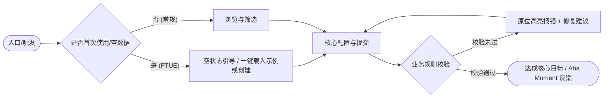

# 产品设计规范指南（产品探索 · 设计语言 · 产品功能）

**何时读**：阶段 0 / `work_mode=DESIGN` / 需求规划 / UI 与功能设计；每会话最多一次。  
**核心分工**：
- **产品设计核心指南（本文）**：融合业界标杆产品与体验方法论（`gstack` 产品推演与设计评审、`pm-skills` / `Product-Manager-Skills` 的 JTBD 与 Gherkin 规格、`ui-ux-pro-max` 的可用性心理学、`superpowers` 的多方案权衡），确立「**先产品探索定魂，再双支柱（产品的设计语言 + 产品的功能）落盘**」之铁律；
- **产品原型与双轨线框（Mermaid + ASCII）** → [`product_prototype.md`](product_prototype.md)；
- **MVP 裁剪与分阶段规划** → [`product_roadmap.md`](product_roadmap.md)；
- **设计对齐编排 (Grill)** → [`grill_orchestration.md`](grill_orchestration.md)；
- **前端默认审美与手艺** → [`frontend_aesthetic.md`](frontend_aesthetic.md) / [`frontend_craft.md`](frontend_craft.md)；
- **项目根设计资产** → [`design_md.md`](design_md.md) + 根目录 `DESIGN.md`；
- **远程产品与 UX 规则按需拉取** → [`rule_library.md`](rule_library.md)（`gstack.office-hours` / `gstack.plan-design-review` / `deanpeters.pm-prd` / `uipro.ux-design`）。

---

## 0. 核心定位、前置推演与产出边界铁律

### 0.1 产出边界铁律（绝对纯净原则）
**产品设计阶段（阶段 0）的产出只需要且必须包含两大核心支柱：**
1. **产品的设计语言 (Product Design Language)**：视觉调性与隐喻、Design Tokens、UX 认知与可用性四定律（渐进式披露/视觉动线/费茨与希克定律/微文案规范）、组件全状态矩阵、交互反馈与硬护栏；
2. **产品的功能 (Product Features & Functionality)**：产品洞察（Status Quo / JTBD / Aha Moment / FTUE）、核心交互方案比选（Trade-offs）、功能架构全景、用户角色与旅程地图、详细功能规格矩阵、双轨多态原型（Mermaid + ASCII 四态）、Gherkin 行为级验收标准 (`Given/When/Then`) 与工程规模客观评估。

> [!IMPORTANT]
> **严禁底层技术细节反向侵入产品设计**：
> 产品设计产出中**严禁**包含技术选型（如 MySQL vs PostgreSQL）、物理数据库 DDL 表结构、后端接口代码签名、内部六元组方法设计、分布式 Saga 补偿机制、代码单元测试覆盖率指标（如 85% 单测）等工程实现细节！  
> 技术架构与实现细节属于阶段 1（选型）至阶段 3（四要素详设）。产品设计只对**产品价值、用户体验、界面语言与功能规格**负责。

### 0.2 拒绝“填表式设计”：产品探索五步推演 (Product Discovery & Framing)
在动笔写功能列表或画线框前，Agent 必须先完成以下五项产品级深度推演（缺项则入 DESIGN 审讯前沿）：

| 推演维度 | 核心追问（借鉴 `gstack /office-hours` & `pm-skills`） | 产出要求 |
|---|---|---|
| **1. 现状与摩擦 (Status Quo)** | 用户今天没有本产品时，是如何凑合解决问题的（如手工 Excel、微信传文件、多系统切换）？最痛的摩擦成本在哪？ | 明确现状痛点与替代成本，拒绝臆造伪需求 |
| **2. 用户雇佣任务 (JTBD)** | 用户在什么情境下“雇佣”本产品？ | 标准句式：`When [特定触发情境], I want to [完成的核心动作], so I can [达成可感知的核心价值]` |
| **3. 惊喜时刻 (Aha Moment)** | 用户进入产品后，哪一个瞬间让他觉得“这比旧方案好十倍”？如何在 **30 秒或 3 步内** 让他触达该时刻？ | 定义核心价值感知点与最短直达路径 |
| **4. 冷启动体验 (FTUE / Onboarding)** | 首次进入系统、数据完全为空时，第一分钟如何零门槛完成首次操作？ | 提供示例数据/模板一键填入/分步引导，严禁把新用户扔在死寂白屏前 |
| **5. 形态方案比选 (Approaches & Trade-offs)** | 达成该目标有哪 **2～3 种差异化的产品/交互形态**？（如：自由画布式 vs 分步向导式 vs 极速命令流） | 对比各方案的心智负担、适用受众与优劣（Trade-offs），给出明确推荐后再定稿 |

---

## 1. 支柱一：产品的设计语言 (Product Design Language)

产品设计语言定义界面的“灵魂、骨骼与认知秩序”，杜绝平庸拼凑与缺乏规范的“AI 默认皮”。

### 1.1 设计哲学与视觉调性 (Philosophy & Mood)
- **具象对标参照物**：禁止使用“大气、干净、现代、高级”等空洞形容词。必须给出具象对标或物理隐喻（如：“瑞士国际主义网格排版的高密度金融终端”、“复古温润纸张质感的沉浸式创作桌面”、“Linear 式克制深色高对比度工作台”）。
- **内容密度 (Density)**：明确界面的信息密度取向（`Airy` 宽松通透 / `Balanced` 均衡标准 / `Dense` 紧凑专业）。
- **受众与主职 (Audience & Primary Job)**：明确界面的核心受众是谁、首屏第一核心任务是什么。

### 1.2 Design Tokens 规范体系
设计语言必须建立在精确可落地的 Design Tokens 之上：

1. **色彩系统 (Color System)**：
   - **Primary (主色)**：品牌主色与核心视觉基准；
   - **Secondary (辅色)**：辅助平衡色；
   - **Accent / Tertiary (强调色)**：核心行为召唤色（CTA），严格执行**强调色预算**（首屏仅允许 3～5 处高亮）；
   - **Neutral / Surface / Background (中性底色与表面色)**：界面的画布底色与容器背景色；
   - **Semantic (语义功能色)**：Success (成功绿)、Warning (告警黄)、Error (错误红)、Info (信息蓝)；
   - **对比度合规**：文本与背景对比度必须满足 WCAG AA 级以上（常规文本 ≥ 4.5:1，大文本 ≥ 3:1）。
2. **排版字体层级 (Typography Scale)**：
   - **字体族**：Display / Sans（正文） / Mono（数据与代码），全站字体族 ≤ 2 种；数据的数字列强制启用 `tabular-nums`（等宽数字对齐）；
   - **字阶梯次**：
     - `Hero / Display`: 40–56px，字重 600–700，字距 -0.02em；
     - `H1`: 32–36px，字重 600，行高 1.2；
     - `H2`: 24–28px，字重 600，行高 1.3；
     - `H3`: 18–20px，字重 600，行高 1.4；
     - `Body-Regular`: 14–16px，字重 400，行高 1.5–1.6（单行阅读宽度控制在 `60ch–75ch`）；
     - `Caption / Small`: 12–13px，字重 400，行高 1.4；
     - `Data / Mono`: 等宽数字与代码展示。
3. **空间与间距网格 (Spacing & Grid Layout)**：
   - 基于 4px / 8px 基础步进：`2xs: 4px`、`xs: 8px`、`sm: 12px`、`md: 16px`、`lg: 24px`、`xl: 32px`、`2xl: 48px`、`3xl: 64px`；
   - 容器最大宽度约束：`max-w-[1200px]` 或 `max-w-[1440px]`，保障大屏可读性。
4. **圆角与投影层级 (Radius & Elevation)**：
   - 圆角梯度：小圆角 4px（输入框/标签/徽标）、中圆角 8px（按钮/常规卡片）、大圆角 12–16px（模态弹窗/抽屉）；
   - 投影高程：`Flat`（1px border 无阴影）→ `Raised`（浅微投影卡片）→ `Overlay`（中度投影下拉/抽屉）→ `Modal`（深投影配合遮罩）。

### 1.3 UX 认知心理学与可用性四定律 (UX Psychology & Usability Laws)
优秀的产品设计不仅好看，更要符合人类认知规律（借鉴 `ui-ux-pro-max` 与 `gstack /plan-design-review`）：

1. **渐进式披露 (Progressive Disclosure — 严控认知负荷)**：
   - 首屏工作区只暴露 **80% 用户高频使用的 20% 核心控件**；
   - 高级筛选、低频配置、复杂参数与次要元数据必须收进**可展开折叠区、侧滑抽屉 (Drawer) 或二级浮层 (Popover)**，严禁把几十个表单项一股脑平铺在首屏。
2. **视觉层级与扫视动线 (Visual Hierarchy & Scanning Pattern)**：
   - 遵循人类 **F 型（列表/文档）或 Z 型（看板/营销）** 视觉扫视路径；
   - 每屏必须明确划分三层视觉权重：**一级锚点（Primary Anchor：唯一主标题 + 唯一高亮主 CTA）** → **二级核心内容（Secondary：核心数据卡片/表格主列）** → **三级辅助元数据（Tertiary：时间戳、状态辅文、次要操作）**。
3. **费茨定律与希克定律 (Fitts's & Hick's Law)**：
   - **费茨定律**：高频主操作按钮（CTA）具备充足可点击热区（桌面端高度 ≥ 36px，移动端触控区 ≥ 44×44px），且尽量靠近用户视线终点或上一动作焦点；危险操作（如“删除/清空”）必须与高频确认按钮保持安全物理间距或置于二级菜单；
   - **希克定律**：同一视觉分组内的并列主选项或导航项控制在 **≤ 5 个**；超出时必须进行分类聚合、分步向导或提供即时搜索过滤。
4. **真实界面微文案规范 (UX Microcopy & Honesty)**：
   - **行动按钮具象化**：禁止出现笼统的“确定”、“提交”、“是/否”；必须使用**“动词 + 核心对象”**（如“发布生产环境”、“导出月度账单”、“移入回收站”）；
   - **报错文案可行动化**：禁止“操作失败 / 参数错误 / Error 500”；必须包含**“原因 + 解决办法”**（如：“手机号格式有误，请输入 11 位中国大陆手机号”）；
   - **零虚假占位符**：原型与规范中严禁出现 `Lorem ipsum`、`测试文本123` 等敷衍字样，必须使用贴合真实业务语境的行业文案。

### 1.4 核心组件规范与全状态覆盖 (Component Specs & States)
所有核心交互组件（Button、Input、Card、Navigation 等）必须定义完整的**六态矩阵**：
- **默认态 (Default)**：正常静态展示；
- **悬停/聚焦态 (Hover/Focus)**：鼠标移入与键盘 Tab 聚焦的高亮反馈（2px focus ring 外发光描边、微色阶提亮）；
- **激活/按压态 (Active/Pressed)**：点击瞬时的微位移或按压色差；
- **加载态 (Loading/Skeleton)**：操作提交中的 Spinner 旋转或内容占位骨架屏（保持按钮原宽度防抖动）；
- **禁用态 (Disabled)**：不可操作状态（灰度降低、光标禁用 `cursor-not-allowed`，必要时 Tooltip 说明为何不可点）；
- **错误态 (Error)**：校验未通过的警示色红框与原位内联错误提示。

### 1.5 交互反馈与微动效 (Interaction Feedback & Motion)
- **动效时长与曲线**：即时反馈 `100ms`，展开折叠 `200ms`，模态/抽屉进出 `250–300ms`；采用自然减速曲线（如 `cubic-bezier(0.16, 1, 0.3, 1)`），严禁廉价弹跳或缓慢拖沓；
- **反馈分层**：
  - 轻量原位反馈：Inline 校验、Tooltip 提示、乐观更新微动效；
  - 瞬时全局反馈：Toast / Snackbar 浮动提示（3～4 秒自销毁，支持「撤销 Undo」更佳）；
  - 阻断确认：Modal 确认框（仅限不可逆高危操作，且明确写出后果）。

### 1.6 设计硬护栏 (Design Do's & Don'ts)
- **Do**：建立统一的 Design Tokens 并全站复用；首屏主操作按钮唯一显著；用真实业务样本数据检验布局（含超长名称与 0 数据）。
- **Don't**：严禁滥用廉价 AI 默认质感（如紫粉万能渐变、无意义的发光霓虹、每节盲目 fade-up 上浮、千篇一律的图标三列卡片）；严禁未定义对比度的低对比度灰字；严禁假数据与空洞文案堆砌。

---

## 2. 支柱二：产品的功能 (Product Features & Functionality)

产品功能定义产品的“价值、心智与行为契约”，从问题定义、方案博弈、全局架构到原子交互逻辑进行严谨刻画。

### 2.1 产品洞察、JTBD 与用户角色 (Product Framing & Personas)
- **现状痛点 (Status Quo)**：简述目标用户当前的替代方案与核心痛点；
- **价值主张 (Value Proposition)**：一句话说明为谁提供什么核心价值、替代什么旧方式；
- **用户雇佣任务 (JTBD)**：列出 1～3 条核心 JTBD（`When ... I want to ... so I can ...`）；
- **核心惊喜时刻 (Aha Moment) 与首次冷启动体验 (FTUE)**：明确新用户首次进入如何快速体验核心价值；
- **目标用户角色 (User Personas & Roles)**：明确使用者角色（如普通访客、高频操作员、运营管理员），刻画各角色的使用环境、高频诉求与心智模型。

### 2.2 核心方案比选与功能架构全景 (Trade-offs & Functional Architecture)
1. **核心交互/产品形态方案比选（至少 2 种方案权衡）**：
   | 维度 | 方案 A（推荐方案） | 方案 B（备选方案） | 取舍理由 (Trade-off Decision) |
   |---|---|---|---|
   | **核心交互模式** | 例：单屏主从工作台 + 侧边抽屉即时预览 | 例：多页面跳转 + 独立详情页 | 方案 A 保持上下文不丢失，适合高频连续处理 |
   | **优势 / 劣势** | 切换零延迟，首屏信息密度略高 | 单页简单，但频繁来回跳转打断心流 | 通过渐进式披露化解方案 A 的密度压力 |

2. **功能架构全景树 (Feature Tree)**：
   使用 Mermaid 树状图呈现清晰的系统功能全景架构，划定业务功能边界：
   ```mermaid
   flowchart TD
       Root["产品系统功能全景"]
       ModuleA["模块 A：核心工作台"]
       ModuleB["模块 B：协同与分享"]
       ModuleC["模块 C：系统与设置"]
       
       ModuleA --> FeatA1["功能 A1：内容编辑与排版"]
       ModuleA --> FeatA2["功能 A2：版本历史比对"]
       ModuleB --> FeatB1["功能 B1：协同邀请与权限管理"]
       ModuleC --> FeatC1["功能 C1：个人偏好与主题配置"]
   ```

### 2.3 用户角色与端到端核心旅程 (Core User Journeys)
梳理核心用户在系统中的完整端到端旅程流程图（必须包含**首次冷启动 FTUE 分支**、**主成功流**与**关键异常恢复分支**）：



### 2.4 详细功能规格矩阵 (Detailed Feature Specifications)
每个功能点必须具备严密完整的规格定义，形成功能矩阵：

| 规格维度 | 详细说明 |
|---|---|
| **功能标识与名称** | 唯一功能编号（如 `FEAT-001`）与自解释功能名 |
| **关联 JTBD 与价值** | 该功能服务于哪条用户任务、解决什么具体问题 |
| **触发条件与前置状态** | 用户动作（点击/快捷键）或系统事件触发的前置依赖条件 |
| **输入要素与字段约束** | 涉及的输入项、格式校验规则（必填、字符范围、默认值、正则限制） |
| **业务处理规则矩阵** | 核心业务校验、计算逻辑、互斥规则、多状态流转约束 |
| **输出与界面响应** | 成功后的界面数据更新、具体微文案反馈、页面/抽屉流转逻辑 |
| **边界与极端用例** | 超长文本溢出、并发重复点击防抖、网络超时中断、空数据处理、权限收回 |

### 2.5 界面信息架构与双轨多态原型 (Information Architecture & Dual-Track Prototypes)
在原型设计中（详见 [`product_prototype.md`](product_prototype.md)），必须采用**「Mermaid 区域流转拓扑 + ASCII 空间比例线框图」双轨表达**，并强制覆盖**页面四态**：

1. **双轨原型表达**：
   - **轨 1（Mermaid 拓扑）**：表达顶栏、导航、主工作区、抽屉与弹窗的区域从属及流转关系；
   - **轨 2（ASCII 比例线框）**：直观呈现真实视觉层级、控件排布比例、留白节奏与真实微文案（解决单纯 Mermaid 方框看不出界面长相的痛点）。
2. **界面四态全覆盖**：
   - **空白初始态 (Empty State / FTUE)**：首次使用或筛选无结果时的具体引导文案、示例入口与明确的唤起主 CTA；
   - **加载骨架态 (Loading State)**：真实比例的骨架屏结构，避免突兀的白屏抖动；
   - **正常数据态 (Populated State)**：数据饱满时的典型排版、视觉主次锚点与高频操作区；
   - **异常错误态 (Error State)**：人话化的错误原因说明、保留用户已填草稿及原位「一键重试」按钮。

### 2.6 产品功能验收标准：Gherkin 行为驱动断言 (Functional DoD / Acceptance Criteria)
借鉴 `deanpeters/Product-Manager-Skills` 与 BDD 规范，验收标准必须从**最终用户与产品交互**视角，采用 **`Given（前置情境）/ When（用户动作）/ Then（可观测界面结果）`** 格式编写，每个核心功能至少覆盖**主成功流、校验拦截流、异常恢复流**：
- ✅ **正确示例（Gherkin 产品交互断言）**：
  - **场景 1（Happy Path）**：`Given` 运营人员已打开商品创建抽屉并填妥必填项，`When` 点击「立即上架商品」按钮，`Then` 按钮进入 Loading 态防抖锁定，1 秒内关闭抽屉、列表首行高亮新增商品并弹出「商品已上架」Toast（含「撤销」入口）。
  - **场景 2（校验拦截）**：`Given` 用户未填写「商品售价」，`When` 点击「立即上架商品」，`Then` 售价输入框立即呈现红框并聚焦，下方显示内联文案「请填写大于 0 的商品售价」，表单不发送且已填其他字段内容完好保留。
  - **场景 3（空状态引导）**：`Given` 用户首次进入或筛选无匹配结果，`When` 列表渲染完成，`Then` 展示「暂无匹配商品」引导区，并提供「清空筛选条件」或「+ 创建首个商品」主按钮。
- ❌ **错误示例（技术侵入，绝对禁止）**：
  - “单元测试覆盖率达到 85%”；
  - “通过 Saga 分布式事务回滚 `t_order` 表库存并写入 Outbox”。

### 2.7 整体交互逻辑架构 (Overall Interaction Architecture)
详细功能不是孤立的节点，必须具备连贯的**整体交互逻辑网络**：
1. **页面与导航流转拓扑 (Navigation & View Topology)**：
   ```mermaid
   flowchart LR
     List[数据工作台主列表] -->|点击行项| Drawer[侧边详情抽屉]
     Drawer -->|点击编辑| Modal[全屏/居中编辑弹窗]
     Modal -->|校验未通过| InlineErr[原位内联报错 + 保留草稿]
     Modal -->|提交成功| Toast[轻量浮动提示 + 抽屉数据局部刷新]
   ```
2. **组件交互层级与堆叠上下文 (Hierarchy & Stacking)**：明确主工作区、侧滑抽屉 (Drawer)、模态弹窗 (Modal)、浮动气泡 (Popover)、全局提示 (Toast) 的层级与交互遮罩行为（点击遮罩关闭 / 键盘 `Esc` 响应 / **未保存脏数据退出二次拦截确认**）。
3. **异步状态迁移与反馈机制**：
   - **防抖与节流**：核心提交按钮具备 300ms–500ms 点击防抖，防止并发重复提交；
   - **乐观更新 vs 悲观确认**：高频轻量操作（收藏/排序/开关）采用乐观更新（即时渲染变更，失败回滚并提示），关键事务操作（支付/发布/删除）采用悲观确认（阻断式 Loading 等待明确结果）；
   - **草稿保护与错误自愈**：网络超时或非致命异常提供原位「一键重试」按钮，**严禁清空用户已辛苦输入的表单内容**。

### 2.8 规模与复杂度客观评估 (Scale & Complexity Assessment)
> [!IMPORTANT]
> **先交互与功能，后技术选型**：
> 绝不能在没有详细功能规格与整体交互逻辑的情况下凭空搞技术选型！只有把**功能细节（表单字段量、联动规则矩阵）**与**整体交互逻辑（路由深度、组件嵌套层级、异步实时性要求）**刻画清晰后，才能客观评估产品工程规模，从而为阶段 1 技术选型提供精准输入。

| 评估维度 | 核心考量指标 | 规模等级判定 |
|---|---|---|
| **交互复杂度** | 页面视图数、组件嵌套深度、模态/抽屉交互层级、前端状态共享跨度 | **轻量** (≤3 屏单表单) / **中度** (典型主从表与抽屉协同) / **高密** (复杂画布/实时协同) |
| **数据与规则复杂度** | 输入字段规模、动态联动规则数、数据关联依赖、边界校验数量 | **简单** (常规静态表单) / **中等** (级联校验与动态表格) / **复杂** (多步向导与海量异构数据) |
| **通信与实时性** | 单次请求响应 vs 长连接轮询 vs 双向推送协同 | **离线/标准 REST** / **SSE/长轮询** / **全双工 WebSocket** |

规模评估结论直接输出至《产品开发分阶段规划书》与 PRD，作为阶段 1（选型）评估方案量级与复杂度的权威基准。

---

## 3. 产出文档结构与落盘约定

在项目文档库中，阶段 0 的设计与规划产出统一落盘至 `hs_dev_docs/_01_product_design/`，结构严密：

```text
hs_dev_docs/_01_product_design/
├── _00_product_design.idx                 # 索引文件
├── _01_business_plan/                     # （可选）商业计划
├── _02_product_design/                    # 核心产品功能规格书
│   └── {feature_name}_prd.md              # 纯净产品功能：JTBD、方案比选、架构树、旅程、规格矩阵、Gherkin DoD、规模评估
├── _03_product_figma/                     # 产品设计语言与双轨多态原型
│   └── {feature_name}_prototype.md        # 设计语言 Tokens、UX 四定律、组件六态、Mermaid + ASCII 四态线框
└── _04_phased_roadmap/                    # 产品开发分阶段规划书（MVP 演进）
    └── {feature_name}_phased_plan.md      # MVP 假设、人机交互对齐记录、MoSCoW 分级矩阵与路线图
```

同时，在项目根目录生成或更新 **`DESIGN.md`**，作为全局视觉与交互设计语言的单一真实源。

---

## 4. 全量产品设计后的下一步：MVP 与分阶段实施

全量产品设计描绘了产品的宏观终局；**完成产品设计后，绝对禁止进行一次性全量研发 (Big Bang)**。
必须紧跟 **MVP 裁剪与分阶段实施规划（详见 [`product_roadmap.md`](product_roadmap.md)）**：
1. **触发人机交互对齐**：Agent 就 MVP 核心假设、功能裁剪边界（Must-have vs Won't-have）、交付里程碑向决策者提问并对齐；
2. **落盘规划书**：输出《产品开发分阶段规划书》(`{feature_name}_phased_plan.md`)；
3. **锁定研发范围**：后续阶段 1（选型）至阶段 6（交付）**严格收敛于当前阶段（Phase 1 MVP）**，坚决不超前开发。

---

## 5. 阶段 0 产品评审与冻结门禁 (Product Review & Freeze Gate)

### 5.1 产品与体验 10 维自审标尺（借鉴 `gstack /plan-design-review`）
在宣布阶段 0 冻结前，Agent 必须按以下 10 个维度逐项自检（任一维度不达标必须当场补强，禁止带病过关）：

1. **痛点与 JTBD 真伪**：是否写清了用户当前的凑合方案（Status Quo）与明确的 JTBD，而非自嗨式罗列功能？
2. **Aha Moment 与冷启动 (FTUE)**：新用户进首屏为空时，是否有清晰的引导/示例数据在 3 步内体验到核心价值？
3. **方案博弈 (Trade-offs)**：核心交互模式是否对比过 ≥2 种形态并给出了令人信服的取舍理由？
4. **视觉调性与具体参照**：设计语言是否有具象参照物与精确的 Design Tokens，彻底消除了“大气/现代”等空词？
5. **渐进式披露与视觉层级**：首屏是否克制了认知负荷？每屏是否有唯一主视觉锚点与清晰的三级信息层次？
6. **双轨原型表现力**：是否同时提供了 Mermaid 流转拓扑与 **ASCII 比例线框图**，让人一眼看懂界面真实布局？
7. **页面四态与组件六态**：Empty / Loading / Populated / Error 四态是否齐备？异常时是否保护了用户已输入草稿？
8. **真实微文案 (Microcopy)**：按钮是否为“具象动词+宾语”？报错是否说明了“原因+修复动作”？是否零 `Lorem ipsum`？
9. **Gherkin 验收标准 (`Given/When/Then`)**：DoD 是否全部转化为可观测的用户交互断言（含成功、校验拦截与异常恢复）？
10. **绝对纯净无技术污染**：全文是否 100% 剔除了数据库表名、SQL DDL、后端代码签名、Saga 与单测覆盖率数字？

### 5.2 阶段 0 冻结门禁表

| 校验维度 | 通过条件 |
|---|---|
| **产品探索与方案比选完备** | 明确定义了 Status Quo、JTBD、Aha Moment、FTUE 冷启动路径及核心交互形态的方案比选（Trade-offs）； |
| **设计语言与 UX 定律完备** | 调性与隐喻具象、Design Tokens（色/字/空/圆角/阴影）明确、落实 UX 认知四定律（渐进式披露/视觉层级/费茨希克/真实微文案）、核心组件定义了六态反馈； |
| **产品功能与双轨原型完备** | 功能架构全景清晰、核心旅程无断点、详细规格矩阵覆盖正常与边界分支、原型采用 **Mermaid + ASCII 比例线框** 覆盖四态（空/加载/正常/错误）、DoD 为 **Gherkin (`Given/When/Then`)** 产品断言； |
| **分阶段规划与规模评估齐套** | 完成人机交互对齐，`_04_phased_roadmap/` 存在《产品开发分阶段规划书》，明确划分 MVP 与后续阶段范围，并完成客观工程规模评估； |
| **产出纯净性** | **严格无技术杂音**：PRD、原型与规划书内无物理 DDL、无 RPC 接口签名、无分布式代码逻辑、无代码覆盖率等实现期内容； |
| **无冲突一致性** | 需求规格、设计语言规范、原型文档与分阶段规划书相互一致无矛盾。 |

门禁通过后，正式冻结阶段 0，进入技术选型与 ADR 阶段（按当前阶段范围收敛实施）。
