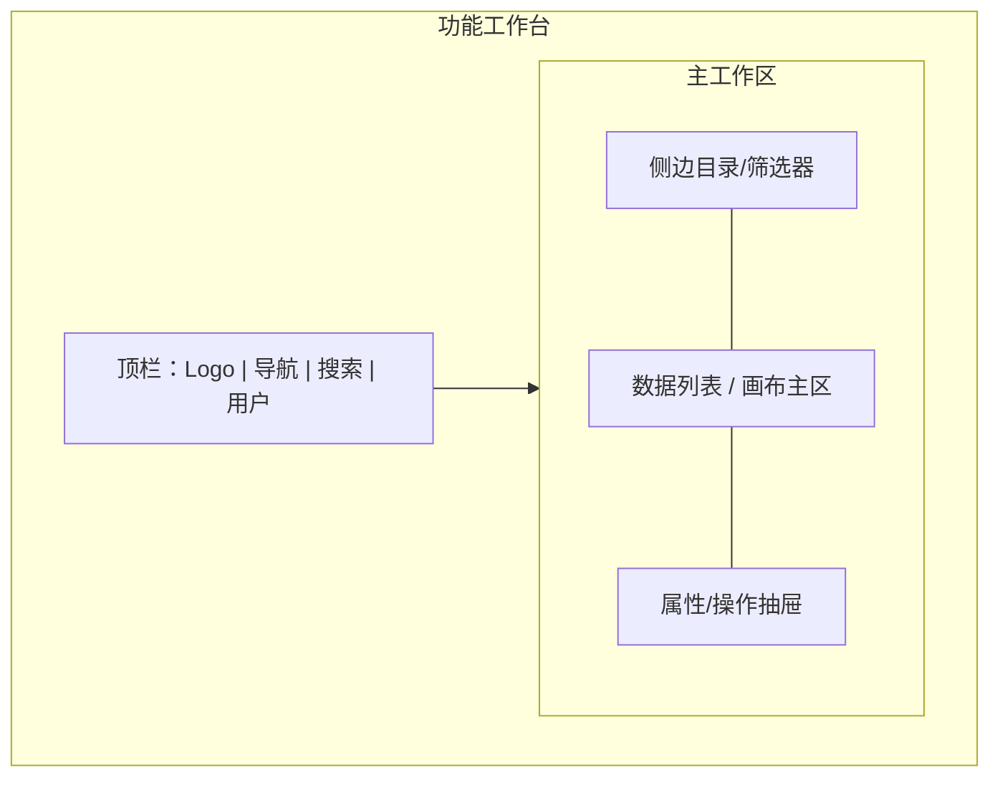

# 产品原型（设计语言与多态线框）

**何时读**：阶段 0 / DESIGN；有 UI 或信息架构；用户给了/没给原型；每会话最多一次。  
**分工**：
- **设计主线与产出铁律** → [`product_design.md`](product_design.md)（产出只包含**产品的设计语言**和**产品的功能**，严禁技术实现细节）；
- 视觉气质与项目身份 → [`design_md.md`](design_md.md) / 项目根 `DESIGN.md`；
- 前端默认审美与交互手艺 → [`frontend_aesthetic.md`](frontend_aesthetic.md) / [`frontend_craft.md`](frontend_craft.md)。

---

## 0. 核心规则

1. **产出纯净性**：原型与设计语言文档专注刻画**视觉调性、Design Tokens、组件全状态与页面多态布局**，严禁混入后端选型、数据库或代码实现细节。
2. **商业计划可选**：`_01_business_plan/` 有则读入冲突扫描；无则跳过，不阻断。  
3. **原型必有**：M/L 且触及 UI/信息架构/多屏流程时，冻结前必须存在承载设计语言与布局的原型产物。  
4. **用户未提供 → Agent 生成**；不得空着进选型/编码。  
5. **模型不能出图 → 用 Mermaid + 结构化状态矩阵展示**，效果等价于「可评审的专业原型与设计语言规格」。  
6. **S**：无 UI 语义变更可不写原型；一旦改布局/主路径 → 升 M 并补原型。

落盘：`hs_dev_docs/_01_product_design/_03_product_figma/{feature}_prototype.md`  
（目录名历史兼容；内容不要求真 Figma，采用 Markdown + Mermaid + Tokens 规范。）

---

## 1. 产物构成（设计语言 + 功能原型）

模板：`resources/templates/product_design/prototype_template.md`。

| 模块 | 核心要求 |
|---|---|
| **视觉调性与隐喻** | 具体的参照物（非空词）+ 内容密度取向 |
| **Design Tokens** | 色彩（Primary/Secondary/Accent/Canvas/Semantic）、排版层级、间距步进、圆角与投影 |
| **组件全状态** | 核心组件（Button/Input）必须定义 Default / Hover / Active / Loading / Disabled / Error 六态 |
| **空间与信息架构** | 顶栏、侧栏、主工作区、操作面板的结构划分 |
| **页面四态覆盖** | **强制覆盖四态**：正常数据态 (Populated)、空白引导态 (Empty)、加载骨架态 (Loading)、异常错误态 (Error) |
| **与 PRD 映射** | 原型交互节点与 PRD 功能点及产品 DoD 显式关联 |

有用户提供的 Figma/截图/PDF：在文档中登记链接或仓库相对路径，并**用文字+Tokens+Mermaid 提炼核心设计语言与布局**（防链接失效、便检索与落地）。

---

## 2. Mermaid 线框与多态布局约定

每屏至少一个清晰的 `subgraph`，节点代表区域或控件，严禁只画单纯业务 flowchart 冒充原型：

在原型文档中，分别绘制 **正常态**、**空状态**、**加载态** 与 **错误态** 的线框图（参见 `resources/templates/product_design/prototype_template.md`）。

---

## 3. 阶段门禁（并入阶段 0 冻结）

M/L 触及 UI/多屏时，冻结门禁包含：

| 条件 | 含义 |
|---|---|
| **原型与设计语言齐套** | `_03_product_figma/` 存在对应 `{feature}_prototype.md`，包含设计调性、Tokens、组件状态及页面四态线框，且无代码实现杂音 |

无 UI（纯 API/批处理）→ 在 PRD 写明「无 UI，豁免原型与设计语言」一行即可。

---

## 4. 反模式

| 禁止 | 改为 |
|---|---|
| 「没有设计稿只好先写代码」 | 生成 Tokens + Mermaid 线框后再冻结 |
| 只有美词没有区域划分 | 补 subgraph 空间划分与四态布局 |
| 原型里塞一堆数据库字段或 API 签名 | 移到阶段 3 详细设计；原型只保留视觉与交互规范 |
| 页面只画正常态，不管空态与报错 | 补全 Empty / Loading / Populated / Error 四态 |
