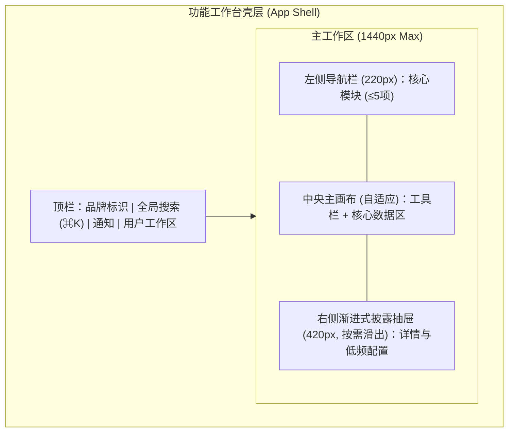

# 产品原型（设计语言与双轨高保真多态线框）

**何时读**：阶段 0 / DESIGN；有 UI 或信息架构；用户给了/没给原型；每会话最多一次。  
**分工**：
- **设计主线与产出铁律** → [`product_design.md`](product_design.md)（产出只包含**产品的设计语言**和**产品的功能**，严禁技术实现细节）；
- 视觉气质与项目身份 → [`design_md.md`](design_md.md) / 项目根 `DESIGN.md`；
- 前端默认审美与交互手艺 → [`frontend_aesthetic.md`](frontend_aesthetic.md) / [`frontend_craft.md`](frontend_craft.md)。

---

## 0. 核心规则（为什么需要双轨线框？）

单纯的 Mermaid `subgraph` 只能表达“页面有哪些区块以及怎么跳转”（**拓扑关系**），却无法直观传达**界面的空间比例、主次视觉锚点、留白密度、控件相对位置与真实微文案**。因此，本规范强制采用**「Mermaid 区域/流转拓扑 + ASCII 空间比例线框图」双轨原型表达**：

1. **产出纯净性**：原型与设计语言文档专注刻画**视觉调性、Design Tokens、UX 认知四定律、组件六态与页面四态双轨线框**，严禁混入后端选型、数据库 DDL 或代码实现细节。
2. **商业计划可选**：`_01_business_plan/` 有则读入冲突扫描；无则跳过，不阻断。  
3. **原型必有**：M/L 且触及 UI/信息架构/多屏流程时，冻结前必须存在承载设计语言与双轨布局的原型产物。  
4. **用户未提供 → Agent 生成**；不得空着进选型/编码。  
5. **双轨高表现力（无位图亦专业）**：
   - **轨 1（Mermaid 空间与交互拓扑）**：清晰表达页面壳层划分、抽屉/弹窗唤起路径与导航跳转；
   - **轨 2（ASCII 空间比例线框图）**：以字符网格精准还原首屏视觉层级（Primary/Secondary/Tertiary）、按钮具体文案、表格列与留白比例；
   - **（可选增强）单文件交互预览或 OpenPencil**：若环境支持或用户需要直观预览，可额外生成静态单页 HTML 预览或 OpenPencil 设计稿。
6. **S**：无 UI 语义变更可不写原型；一旦改布局/主路径 → 升 M 并补原型。

落盘：`hs_dev_docs/_01_product_design/_03_product_figma/{feature}_prototype.md`  
（目录名历史兼容；内容采用 Markdown + Design Tokens + Mermaid 拓扑 + ASCII 比例线框。）

---

## 1. 产物构成（设计语言 + 双轨功能原型）

模板：`resources/templates/product_design/prototype_template.md`。

| 模块 | 核心要求 |
|---|---|
| **视觉调性与隐喻** | 具体的参照物（非“现代/大气”空词）+ 内容密度取向（`Compact` / `Balanced` / `Airy`） |
| **Design Tokens** | 色彩（Primary/Secondary/Accent/Canvas/Semantic）、排版层级（含 `tabular-nums`）、间距步进、圆角与投影 |
| **UX 认知与可用性法则** | **渐进式披露**（首屏收拢低频项）、**视觉扫视动线**（F/Z 型与三级锚点）、**费茨与希克定律**、**真实微文案规范** |
| **组件全状态** | 核心组件（Button/Input/Drawer 等）必须定义 Default / Hover / Active / Loading / Disabled / Error 六态 |
| **双轨信息架构与线框** | **Mermaid 区域/流转拓扑** + **ASCII 空间比例线框图** |
| **页面四态全覆盖** | **强制覆盖四态**：正常数据态 (Populated)、空白引导态 (Empty/FTUE)、加载骨架态 (Loading)、异常错误态 (Error) |
| **与 PRD / Gherkin DoD 映射** | 原型交互节点与 PRD 功能点及 Gherkin (`Given/When/Then`) 验收断言显式关联 |

有用户提供的 Figma/截图/PDF：在文档中登记链接或仓库相对路径，并**用文字 + Tokens + Mermaid + ASCII 提炼核心设计语言与布局**（防链接失效、便检索与落地）。

---

## 2. 双轨原型绘制约定（Mermaid 拓扑 + ASCII 比例线框）

### 2.1 轨一：Mermaid 空间划分与交互流转拓扑
每屏至少一个清晰的 `subgraph`，表达容器包裹关系与抽屉/弹窗唤起流转，严禁只画单纯业务 flowchart 冒充原型：



### 2.2 轨二：ASCII 空间比例线框图（呈现真实视觉层次与微文案）
对核心主视图及关键状态，必须绘制 **ASCII 空间比例线框图**，直观展示**一级主视觉锚点（唯一主 CTA）、渐进式披露折叠项、真实业务微文案（禁 `Lorem ipsum`）与页面四态细节**：

```text
+----------------------------------------------------------------------------------+
| [Logo] 订单调度台        [ 🔍 搜索订单号/客户名 (⌘K)        ]      [🔔] [张运营 v] |
+------------------+---------------------------------------------------------------+
| ▸ 工作台概览     |  今日待处理订单 (24)                      [+ 创建采购订单] ★   |
| ● 订单调度 (24)  |  -----------------------------------------------------------  |
| ▸ 异常拦截 (2)   |  状态: [全部(24)] [待审核(6)] [履约中(18)]   [高级筛选 ▾]     |
| ▸ 报表中心       |  +---------------------------------------------------------+  |
|                  |  | 订单号       客户名称        金额(¥)     状态    操作   |  |
|                  |  |---------------------------------------------------------|  |
|                  |  | #ORD-202610  星海科技        128,000.00  ●待审核 [审核] |  |
|                  |  | #ORD-202609  远航物流         45,200.00  ○履约中 [详情] |  |
|                  |  +---------------------------------------------------------+  |
|                  |  显示 1-20 条 / 共 24 条                  [< 上一页] [下一页 >] |
+------------------+---------------------------------------------------------------+
  注：★ 为首屏唯一主强调色 CTA；[高级筛选 ▾] 采用渐进式披露默认收起低频条件。
```

在原型文档中，需完整定义 **正常数据态 (Populated)**、**空白引导态 (Empty / FTUE)**、**加载骨架态 (Loading)** 与 **异常错误态 (Error)** 的视觉结构与真实引导文案（参见 `resources/templates/product_design/prototype_template.md`）。

---

## 3. 阶段门禁（并入阶段 0 冻结）

M/L 触及 UI/多屏时，冻结门禁包含：

| 条件 | 含义 |
|---|---|
| **原型与设计语言齐套** | `_03_product_figma/` 存在对应 `{feature}_prototype.md`，包含设计调性、Tokens、UX 四定律、组件六态、**Mermaid 拓扑 + ASCII 比例线框**及页面四态，且无代码实现杂音 |

无 UI（纯 API/批处理）→ 在 PRD 写明「无 UI，豁免原型与设计语言」一行即可。

---

## 4. 反模式

| 禁止 | 改为 |
|---|---|
| 「没有设计稿只好先写代码」 | 生成 Tokens + Mermaid 拓扑 + ASCII 比例线框后再冻结 |
| 只画三四个简陋 Mermaid 方框看不出界面排布 | 补齐 **ASCII 空间比例线框图**，标明真实按钮文案、主次视觉锚点与留白 |
| 首屏平铺二三十个筛选框和低频开关 | 运用**渐进式披露**，首屏仅留高频核心项，其余收入抽屉或「高级筛选」折叠区 |
| 按钮写“提交/确定”，报错写“操作失败” | 改为具象动词（如“立即发布”）与可行动报错（“原因 + 修复指引”） |
| 原型里塞一堆数据库字段或 API 签名 | 移到阶段 3 详细设计；原型只保留视觉与交互规范 |
| 页面只画正常态，不管空态与报错 | 补全 Empty (含 FTUE 冷启动引导) / Loading / Populated / Error 四态 |
