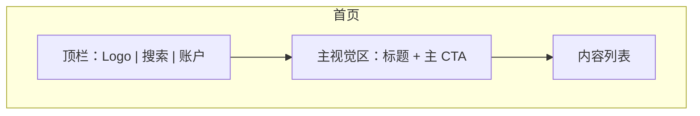

# 产品原型（必产 · 可无位图）

**何时读**：阶段 0 / DESIGN；有 UI 或信息架构；用户给了/没给原型；每会话最多一次。  
**分工**：视觉气质 → [`frontend_aesthetic.md`](frontend_aesthetic.md) / [`design_md.md`](design_md.md)；交互手艺 → [`frontend_craft.md`](frontend_craft.md)。

---

## 0. 规则

1. **商业计划可选**：`_01_business_plan/` 有则读入冲突扫描；无则跳过，不阻断。  
2. **原型必有**：M/L 且触及 UI/信息架构/多屏流程时，冻结前必须存在可展示布局的原型产物。  
3. **用户未提供 → Agent 生成**；不得空着进选型/编码。  
4. **模型不能出图 → 用 Mermaid（或 ASCII 线框 / HTML 线框）展示布局与主路径**，效果等价于「可评审的布局原型」。  
5. **S**：无 UI 语义变更可不写原型；一旦改布局/主路径 → 升 M 并补原型。

落盘：`hs_dev_docs/_01_product_design/_03_product_figma/{feature}_prototype.md`  
（目录名历史兼容；内容不要求真 Figma。）

---

## 1. 产物最小集

模板：`resources/templates/product_design/prototype_template.md`。

| 块 | 要求 |
|----|------|
| 范围 | 覆盖哪些屏/状态；非目标 |
| 主路径 | 用户从进入到成功的步骤 |
| 布局 | 每屏：区域划分（顶栏/主区/侧栏/底栏/弹层）+ 关键控件 |
| 图示 | **优先** `mermaid`：`flowchart` 表流转；`C4` 或嵌套 subgraph 表布局线框 |
| 与 PRD | 用例 ID / DoD 条目交叉引用 |

有用户提供的 Figma/截图/PDF：在文档中登记链接或仓库相对路径，并**用文字+Mermaid 提炼布局**（防链接失效、便检索）。

---

## 2. Mermaid 布局约定（无图时强制）

每屏至少一个 subgraph，节点 = 区域或控件，勿只画业务 flowchart 冒充布局：

多屏用 `flowchart LR` 连「成功路径」箭头；异常态单独 subgraph 标明入口。

---

## 3. 阶段门禁（并入阶段 0）

M/L 触及 UI/多屏时，冻结门禁额外一条：

| 条件 | 含义 |
|------|------|
| **原型齐套** | `_03_product_figma/` 有对应 `{feature}_prototype.md`，主路径 + 至少一屏布局图示可读 |

无 UI（纯 API/批处理）→ 在 PRD 写明「无 UI，豁免原型」一行即可。

---

## 4. 反模式

| 禁止 | 改为 |
|------|------|
| 「没有设计稿只好先写代码」 | 生成 Mermaid 线框后再冻结 |
| 只有美词没有区域划分 | 补 subgraph 布局 |
| 用商业计划缺失当借口跳过原型 | 商业计划可无；原型不可无（有 UI 时） |
