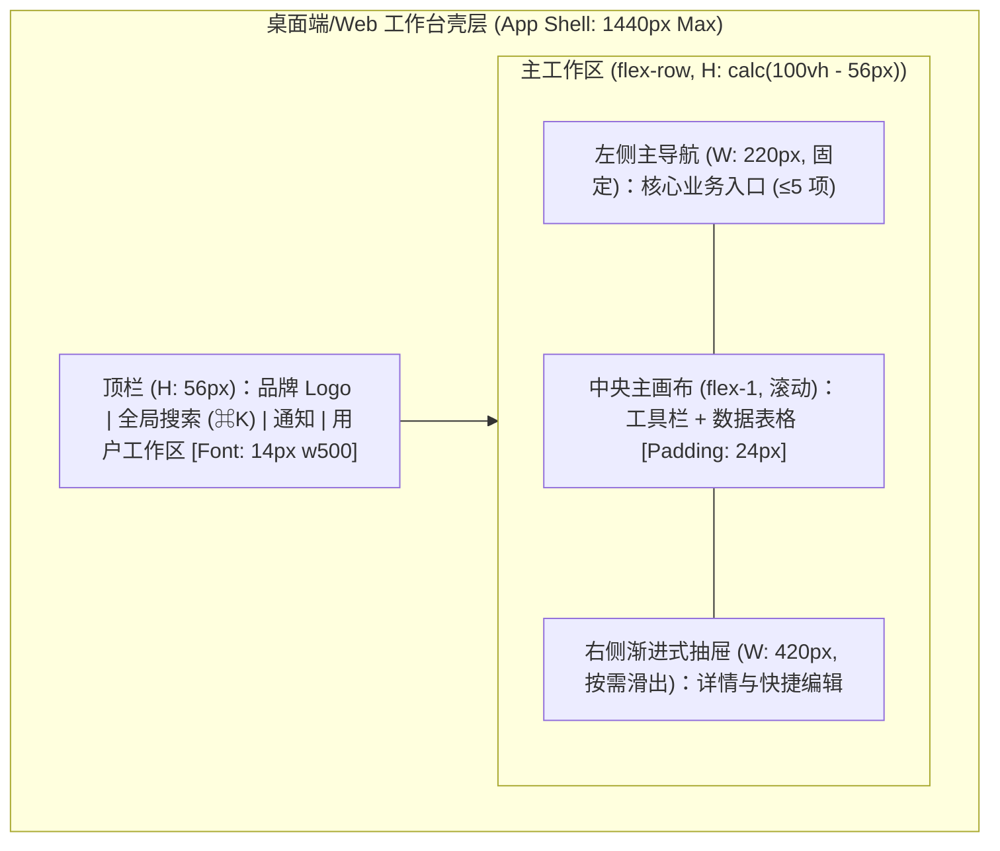

# 产品原型（设计语言与双轨高保真多态线框）

**何时读**：阶段 0 / DESIGN；有 UI 或信息架构；用户给了/没给原型；每会话最多一次。  
**分工**：
- **设计主线与产出铁律** → [`product_design.md`](product_design.md)（产出只包含**产品的设计语言**和**产品的功能**，严禁技术实现细节）；
- 视觉气质与项目身份 → [`design_md.md`](design_md.md) / 项目根 `DESIGN.md`；
- 前端默认审美与交互手艺 → [`frontend_aesthetic.md`](frontend_aesthetic.md) / [`frontend_craft.md`](frontend_craft.md)。

---

## 0. 核心规则（为什么需要双轨线框？）

单纯的 Mermaid `subgraph` 只能表达“页面有哪些区块以及怎么跳转”（**拓扑关系**），却无法直观传达**界面的空间比例、主次视觉锚点、留白密度、控件相对位置与真实微文案**。因此，本规范强制采用**「Mermaid 区域/流转拓扑 + ASCII 空间比例线框图」双轨原型表达**：

1. **产出纯净性**：原型与设计语言文档专注刻画**视觉调性、Design Tokens、UX 认知四定律、组件六态与页面四态双轨线框**，严禁混入后端选型、数据库 DDL 或代码实现细节。
2. **商业计划可选**：`_01_business_plan/` 有则读入冲突扫描；无则跳过，不阻断。  
3. **原型必有**：M/L 且触及 UI/信息架构/多屏流程时，冻结前必须存在承载设计语言与双轨布局的原型产物。  
4. **用户未提供 → Agent 生成**；不得空着进选型/编码。  
5. **三位一体原型表达（字符拓扑 + 物理标注 + 可交互 HTML 预览）**：
   - **轨 1（Mermaid 空间与交互拓扑）**：清晰表达页面壳层划分、多端布局容器（Web 栅格 / 桌面多窗格 / 移动端纵向流）、抽屉/弹窗唤起路径与导航跳转；
   - **轨 2（ASCII 空间比例线框图 · 融合 OpenPencil PenNode 语义）**：以字符网格精准还原首屏视觉层级（Primary/Secondary/Tertiary）、按钮具体文案、表格列与留白比例，内联物理参数标注（字阶/间距/Tokens）；针对专业设计交付场景，兼容 **OpenPencil PenNode Schema** 规范（Frame / Text / Component 语义层级与矢量坐标约束），支持批量设计 DSL 表达；
   - **轨 3（单文件可交互 HTML 预览 · 融合 Generative UI 动态仿真）**：
     - **落盘路径**：`hs_dev_docs/_02_feature_spec/_03_prototype_html/{feature}_prototype.html`（基于 `prototype_html_template.html` 生成）；
     - **极简独立**：零外部构建依赖，内联 Tailwind CDN + Google Fonts + 品牌 Tokens；**内网/离线环境无法访问 CDN 时，将所需样式内联为本地静态资源再交付，确保开发者双击可直读签收**；
     - **多端视口仿真**：顶部自带 1440px 桌面端 / 768px 平板 / 390px 移动端单键切换；
     - **动态交互与页面四态**：融合 Generative UI 交互组件规范，一键切换正常数据态 (Populated)、空白引导态 (FTUE)、加载骨架态 (Loading)、异常错误态 (Error)，支持表单与微动效的实时交互走查；
     - **真机/浏览器直读**：开发者直接在浏览器双击打开或本地预览，所见即所得进行可视化核准。
6. **开发者可视化确认机制 (Developer Visual Confirmation Gate)**：进入阶段 1 选型与代码开发前，开发者必须基于 HTML 预览与字符/Mermaid 线框完成可视化确认签收（Visual Sign-off），杜绝盲目编码与返工。**视觉签收只代表「好看」，业务语义（权限/规则/流程/Gherkin DoD）另有《冻结确认单》A 部分由开发者逐条确认**（见 [`product_design.md`](product_design.md) §5.2 与 `resources/templates/process/freeze_signoff.md`）。
7. **S**：无 UI 语义变更可不写原型；一旦改布局/主路径 → 升 M 并补原型。

落盘：
- 文档规约：`hs_dev_docs/_02_feature_spec/_04_prototype_wireframe/{feature}_prototype.md`（含 Tokens、Mermaid、ASCII 标注、OpenPencil 节点映射、签收单）
- 可视化原型：`hs_dev_docs/_02_feature_spec/_03_prototype_html/{feature}_prototype.html`（可交互多端四态 HTML 预览，内嵌 Generative UI 交互部件）


---

## 1. 产物构成（设计语言 + 双轨功能原型 + 可视化确认）

模板：`resources/templates/product_design/prototype_template.md`。

| 模块 | 核心要求 |
|---|---|
| **视觉调性与隐喻** | 具体的参照物（非“现代/大气”空词）+ 内容密度取向（`Compact` / `Balanced` / `Airy`） |
| **Design Tokens** | 色彩（Primary/Secondary/Accent/Canvas/Semantic）、排版层级（含 `tabular-nums`）、间距步进、圆角与投影 |
| **多端适配规范** | 明确目标前端形态：**桌面端 (Desktop)** / **移动端 (Mobile)** / **Web 端 (Responsive Web)** 的断点与布局形态 |
| **UX 认知与可用性法则** | **渐进式披露**（首屏收拢低频项）、**视觉扫视动线**（F/Z 型与三级锚点）、**费茨与希克定律**、**真实微文案规范** |
| **组件全状态** | 核心组件（Button/Input/Drawer 等）必须定义 Default / Hover / Active / Loading / Disabled / Error 六态 |
| **双轨信息架构与线框** | **Mermaid 区域/流转拓扑** + **ASCII 空间比例线框图**（内联字体/间距/布局 UI Spec 标注） |
| **页面四态全覆盖** | **强制覆盖四态**：正常数据态 (Populated)、空白引导态 (Empty/FTUE)、加载骨架态 (Loading)、异常错误态 (Error) |
| **与 PRD / Gherkin DoD 映射** | 原型交互节点与 PRD 功能点及 Gherkin (`Given/When/Then`) 验收断言显式关联 |
| **开发者可视化确认签收** | 开发者对照原型完成 6 项可视化检查（布局/字体/热区/四态等）并签字 Sign-off，作为阶段 0 冻结硬前提 |

有用户提供的 Figma/截图/PDF：在文档中登记链接或仓库相对路径，并**用文字 + Tokens + Mermaid + ASCII 提炼核心设计语言与布局**（防链接失效、便检索与落地）。

---

## 2. 双轨原型多端绘制与 UI 标注约定 (Desktop / Mobile / Web)

### 2.1 轨一：Mermaid 空间划分与交互流转拓扑
每屏至少一个清晰的 `subgraph`，表达容器包裹关系与抽屉/弹窗唤起流转，标注容器尺寸与排布方向：



### 2.2 轨二：ASCII 空间比例线框与 UI 物理参数内联标注

对核心主视图及关键状态，必须绘制 **ASCII 空间比例线框图**，并在图旁或线框内清晰标注**【字体字阶】、【间距 Padding/Gap】、【容器宽度/栅格】、【对齐与微文案】**。

#### A. Web 端 / 桌面端 (Responsive Web & Desktop Client)
适用于宽屏管理台、桌面客户端窗口（含系统菜单栏与多窗格分栏）：

```text
+----------------------------------------------------------------------------------------------------+
| [UI Spec: Window 1440px, Bg: #F7F5F2, Font: Inter / JetBrains Mono]                                |
| [Logo] 订单调度工作台                 [ 🔍 搜索订单号/客户名 (⌘K) ]          [🔔] [张运营 ▾]       |
| [Height: 56px, Border-b: 1px #E5E7EB, Padding-x: 20px, Avatar: 32x32 rounded-full]                |
+----------------------+-----------------------------------------------------------------------------+
| [Nav Col: 220px]     | [Main Area: Flex-1, Padding: 24px, Gap: 16px]                               |
| ▸ 工作台概览 (14px)  | 今日待处理订单 (24)                          [+ 创建采购订单] ★ (36px, Accent)|
| ● 订单调度 (24) ★    | [H1: 24px, w600, #1A1C1E]                    [Btn: 14px, w500, #B8422E, P: 10x16]  |
| ▸ 异常拦截 (2)       | --------------------------------------------------------------------------  |
| ▸ 报表中心           | 状态: [全部(24)] [待审核(6)] [履约中(18)]     [高级筛选 ▾] (渐进式披露折叠)  |
|                      | [Tab: 13px, Tag-h: 28px, Gap: 8px]                                          |
|                      | +------------------------------------------------------------------------+  |
|                      | | 订单号        客户名称        金额 (¥, tabular)    状态     操作       |  |
|                      | | [Table Header: 12px, Uppercase, w600, Text: #6C7278, Bg: #F7F5F2]       |  |
|                      | |------------------------------------------------------------------------|  |
|                      | | #ORD-202610   星海科技        128,000.00           ●待审核  [审核] (13px)|
|                      | | #ORD-202609   远航物流         45,200.00           ○履约中  [详情]     |  |
|                      | +------------------------------------------------------------------------+  |
|                      | 显示 1-20 条 / 共 24 条 [12px, #6C7278]               [< 上一页] [下一页 >] |
+----------------------+-----------------------------------------------------------------------------+
  [注] ★ 唯一主强调 CTA；金额列强制 tabular-nums 等宽对齐；右侧点击单行滑出 420px 抽屉 (Overlay)。
```

#### B. 移动端 (Mobile App / H5 / 小程序)
适用于窄屏手持设备（宽 375px–430px，视口高度 812px–932px，触控区域 ≥ 44×44px）：

```text
+------------------------------------------+  [Mobile Viewport: 390px x 844px]
| 09:41                        📶 5G  🔋   |  [Status Bar: 44px]
| ← 订单详情                  [更多 ⋯]     |  [Top App Bar: 48px, Title: 17px w600]
+------------------------------------------+
| 待买家付款                                |  [Hero Banner: 20px w700, #B8422E, P: 16px]
| 剩余支付时间: 14分32秒 (Mono 14px)        |
+------------------------------------------+
| 📦 配送信息                              |  [Section Card: Radius 12px, Bg: #FFF, P: 16px]
| 张三  138****0000                        |  [Body: 15px w500, #1A1C1E]
| 北京市朝阳区建国路 88 号院 1 号楼         |  [Caption: 13px w400, #6C7278, Line-h: 1.4]
+------------------------------------------+
| 🛍️ 商品清单 (共 2 件)                    |
| +--------------------------------------+ |
| | [图: 64x64]  无线降噪耳机 Pro         | |  [Item Title: 14px w500, 2 行截断]
| |              深空灰 / 官方标配       | |  [Spec: 12px, #6C7278]
| |              ¥1,299.00  x 1          | |  [Price: 15px w600, tabular-nums]
| +--------------------------------------+ |
+------------------------------------------+
| 实付金额: ¥1,299.00 (Bold 16px)           |  [Summary Line: Margin-top: 12px]
| ---------------------------------------- |
| [空白安全边距 Safe Area Bottom]           |
+------------------------------------------+
| [ 取消订单 ] (44px)   [ 立即付款 (★) ]   |  [Bottom Bar: Fixed 56px + Safe Area 34px]
| [Sec Btn: 14px, #6C]  [CTA: 16px w600]   |  [Touch Target: 44px x 140px, Radius 8px]
+------------------------------------------+
```

---

## 3. 开发者可视化确认机制 (Developer Visual Confirmation Gate)

在阶段 0（产品设计）冻结并流转至阶段 1（技术选型）或下游编码前，**开发者必须对原型文档进行可视化审阅，并填写/勾选确认清单**。

### 3.1 开发者可视化审阅 6 大检查点
1. **布局与容器结构明确**：是否清晰给出了页面/窗口的最大容器尺寸（如 1440px 或 390px）、多窗格/网格比例、弹性拉伸规则与断点响应？
2. **字体与字阶层级完整**：标题、正文、标签字阶（如 H1 24px/Body 14px/Caption 12px）是否均有清晰标注？数值/金额是否标明 `tabular-nums`？
3. **间距与设计令牌一致**：Padding/Gap 步进是否符合 Design Tokens 规范？主次颜色是否明确（首屏高亮 CTA 是否 ≤3 处）？
4. **终端平台交互特性合规**：
   - 桌面端：是否有键盘快捷键 (⌘K)、鼠标悬停/右键菜单/窗口缩放处理？
   - 移动端：底部安全区 (Safe Area)、触控热区 (≥44px)、手势返回与滑动折叠是否合理？
   - Web 端：宽窄屏响应式流转是否自然？
5. **四态 (Four States) 无死角**：是否完整包含了正常态 (Populated)、空白引导态 (Empty)、加载骨架态 (Loading)、异常错误态 (Error) 且有针对性微文案？
6. **工程实现可行性**：是否存在违反浏览器/客户端渲染规律的奇葩排版？是否可以直接映射为前端组件树与 CSS Variables / Tailwind 类？

### 3.2 阶段门禁（并入阶段 0 冻结）

M/L 触及 UI/多屏时，冻结门禁包含：

| 条件 | 含义 |
|---|---|
| **原型与设计语言齐套** | `_02_feature_spec/_04_prototype_wireframe/` 存在对应 `{feature}_prototype.md`（若含前端需配齐 `_03_prototype_html/`），包含设计调性、Tokens、UX 四定律、组件六态、**多端 Mermaid 拓扑 + ASCII 比例线框（含内联 UI 标注）**及页面四态 |
| **开发者可视化确认签收** | 原型文档末尾包含开发者核准勾选的《开发者可视化确认签收单》，6 大检查点均通过且签署 Sign-off，无技术实现阻断缺陷 |


无 UI（纯 API/批处理）→ 在 PRD 写明「无 UI，豁免原型与设计语言」一行即可。

---

## 4. 反模式

| 禁止 | 改为 |
|---|---|
| 「没有设计稿只好先写代码」 | 生成 Tokens + Mermaid 拓扑 + ASCII 比例线框后再冻结 |
| 只画三四个简陋 Mermaid 方框看不出界面排布 | 补齐 **ASCII 空间比例线框图**，标明真实按钮文案、主次视觉锚点与留白 |
| 首屏平铺二三十个筛选框和低频开关 | 运用**渐进式披露**，首屏仅留高频核心项，其余收入抽屉或「高级筛选」折叠区 |
| 按钮写“提交/确定”，报错写“操作失败” | 改为具象动词（如“立即发布”）与可行动报错（“原因 + 修复指引”） |
| 原型里塞一堆数据库字段或 API 签名 | 移到阶段 3 详细设计；原型只保留视觉与交互规范 |
| 页面只画正常态，不管空态与报错 | 补全 Empty (含 FTUE 冷启动引导) / Loading / Populated / Error 四态 |
