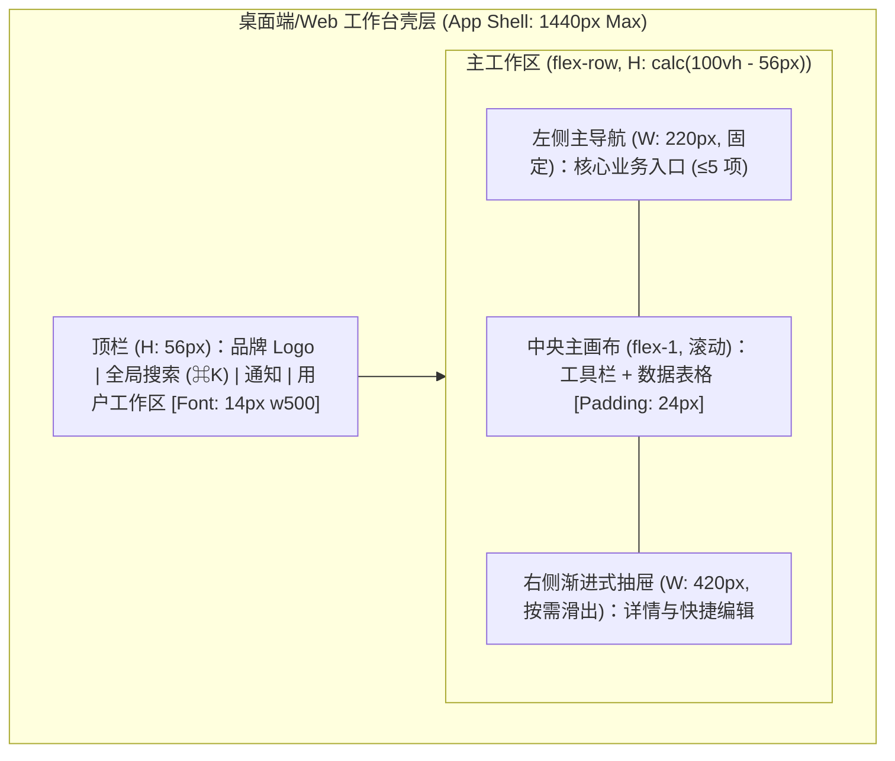

# 2. 双轨原型多端绘制与 UI 标注约定 (Desktop / Mobile / Web)

**何时读**：处理2. 双轨原型多端绘制与 UI 标注约定 (Desktop / Mobile / Web)时；先沿用[入口公共约束](../product_prototype.md)，只装载本业务分册。读取复用遵循[变化感知规则](../load_latch.md#5-变化感知与装载缓存统一重读规则)。

<!-- HS_SECTION_BODY -->
## 2. 双轨原型多端绘制与 UI 标注约定 (Desktop / Mobile / Web)

### 2.1 轨一：Mermaid 空间划分与交互流转拓扑
每屏至少一个清晰的 `subgraph`，表达容器包裹关系与抽屉/弹窗唤起流转，标注容器尺寸与排布方向：



### 2.2 轨二：ASCII 空间比例线框与 UI 物理参数内联标注

对核心主视图及关键状态，必须绘制 **ASCII 空间比例线框图**，并在图旁或线框内清晰标注**【字体字阶】、【间距 Padding/Gap】、【容器宽度/栅格】、【对齐与微文案】**。

#### A. Web 端 / 桌面端 (Responsive Web & Desktop Client)
适用于宽屏管理台、桌面客户端窗口（含系统菜单栏与多窗格分栏）：

```text
+----------------------------------------------------------------------------------------------------+
| [UI Spec: Window 1440px, Bg: #F7F5F2, Font: Inter / JetBrains Mono]                                |
| [Logo] 订单调度工作台                 [ 🔍 搜索订单号/客户名 (⌘K) ]          [🔔] [张运营 ▾]       |
| [Height: 56px, Border-b: 1px #E5E7EB, Padding-x: 20px, Avatar: 32x32 rounded-full]                |
+----------------------+-----------------------------------------------------------------------------+
| [Nav Col: 220px]     | [Main Area: Flex-1, Padding: 24px, Gap: 16px]                               |
| ▸ 工作台概览 (14px)  | 今日待处理订单 (24)                          [+ 创建采购订单] ★ (36px, Accent)|
| ● 订单调度 (24) ★    | [H1: 24px, w600, #1A1C1E]                    [Btn: 14px, w500, #B8422E, P: 10x16]  |
| ▸ 异常拦截 (2)       | --------------------------------------------------------------------------  |
| ▸ 报表中心           | 状态: [全部(24)] [待审核(6)] [履约中(18)]     [高级筛选 ▾] (渐进式披露折叠)  |
|                      | [Tab: 13px, Tag-h: 28px, Gap: 8px]                                          |
|                      | +------------------------------------------------------------------------+  |
|                      | | 订单号        客户名称        金额 (¥, tabular)    状态     操作       |  |
|                      | | [Table Header: 12px, Uppercase, w600, Text: #6C7278, Bg: #F7F5F2]       |  |
|                      | |------------------------------------------------------------------------|  |
|                      | | #ORD-202610   星海科技        128,000.00           ●待审核  [审核] (13px)|
|                      | | #ORD-202609   远航物流         45,200.00           ○履约中  [详情]     |  |
|                      | +------------------------------------------------------------------------+  |
|                      | 显示 1-20 条 / 共 24 条 [12px, #6C7278]               [< 上一页] [下一页 >] |
+----------------------+-----------------------------------------------------------------------------+
  [注] ★ 唯一主强调 CTA；金额列强制 tabular-nums 等宽对齐；右侧点击单行滑出 420px 抽屉 (Overlay)。
```

#### B. 移动端 (Mobile App / H5 / 小程序)
适用于窄屏手持设备（宽 375px–430px，视口高度 812px–932px，触控区域 ≥ 44×44px）：

```text
+------------------------------------------+  [Mobile Viewport: 390px x 844px]
| 09:41                        📶 5G  🔋   |  [Status Bar: 44px]
| ← 订单详情                  [更多 ⋯]     |  [Top App Bar: 48px, Title: 17px w600]
+------------------------------------------+
| 待买家付款                                |  [Hero Banner: 20px w700, #B8422E, P: 16px]
| 剩余支付时间: 14分32秒 (Mono 14px)        |
+------------------------------------------+
| 📦 配送信息                              |  [Section Card: Radius 12px, Bg: #FFF, P: 16px]
| 张三  138****0000                        |  [Body: 15px w500, #1A1C1E]
| 北京市朝阳区建国路 88 号院 1 号楼         |  [Caption: 13px w400, #6C7278, Line-h: 1.4]
+------------------------------------------+
| 🛍️ 商品清单 (共 2 件)                    |
| +--------------------------------------+ |
| | [图: 64x64]  无线降噪耳机 Pro         | |  [Item Title: 14px w500, 2 行截断]
| |              深空灰 / 官方标配       | |  [Spec: 12px, #6C7278]
| |              ¥1,299.00  x 1          | |  [Price: 15px w600, tabular-nums]
| +--------------------------------------+ |
+------------------------------------------+
| 实付金额: ¥1,299.00 (Bold 16px)           |  [Summary Line: Margin-top: 12px]
| ---------------------------------------- |
| [空白安全边距 Safe Area Bottom]           |
+------------------------------------------+
| [ 取消订单 ] (44px)   [ 立即付款 (★) ]   |  [Bottom Bar: Fixed 56px + Safe Area 34px]
| [Sec Btn: 14px, #6C]  [CTA: 16px w600]   |  [Touch Target: 44px x 140px, Radius 8px]
+------------------------------------------+
```

---
