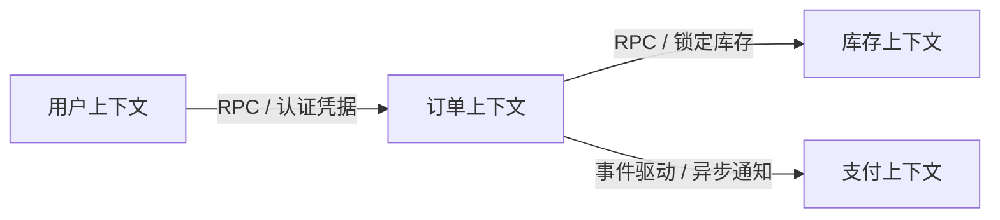

# 领域架构设计文档：{domain_name}

- **领域名称**：{domain_name}
- **架构模式**：DDD 战略与战术分层架构
- **更新日期**：{YYYY-MM-DD}

---

## 1. 战略设计：限界上下文与边界 (Bounded Context)



---

## 2. 战术设计：分层架构与职责划分

```text
┌──────────────────────────────────────────────────────────┐
│ 1. 接口与适配层 (Interfaces / Controller / Gateway)       │
│    负责协议转换、鉴权、入参校验、异常码映射                │
├──────────────────────────────────────────────────────────┤
│ 2. 应用层 (Application / Orchestrator / Saga)             │
│    负责用例编排、事务补偿控制 (Six-Tuple Method)           │
├──────────────────────────────────────────────────────────┤
│ 3. 领域层 (Domain / Aggregates / Entities / Services)     │
│    核心业务逻辑、状态流转、领域事件                         │
├──────────────────────────────────────────────────────────┤
│ 4. 基础设施层 (Infrastructure / DB Repo / RPC Client)     │
│    持久化、缓存、消息总线、三方网关                        │
└──────────────────────────────────────────────────────────┘
```

---

## 3. 核心实体与聚合根 (Aggregates & Entities)

| 实体名 | 角色 | 主键 | 核心字段 | 业务约束 |
|---|---|---|---|---|
| `{EntityName}` | 聚合根 | `id` | `status`, `amount`, `user_id` | 状态只能通过领域方法跃迁 |

---

## 4. 统一术语词典映射
- 涉及实体必须同步在 `_00_project/_02_project_word.dict.yaml` 登记。
