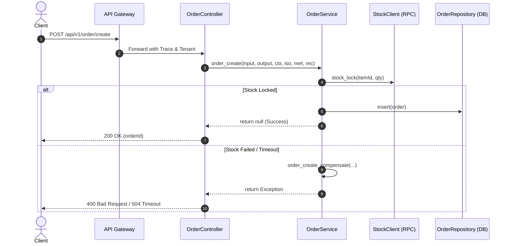

# 调用链与拓扑分析：{call_source}

## 1. 概览
- **调用源**：`{call_source}`（例如：`http:POST /api/v1/order/create`、`mq:order_paid_event`、`cron:daily_settlement`）
- **触发类型**：HTTP Request / MQ Message / Cron Job / RPC Call
- **所属端**：Backend / Frontend / Worker

---

## 2. 调用时序与拓扑图 (Call Flow)

---

## 3. 依赖方法清单 (Method Dependency List)

| 方法名 | 所属模块/服务 | 职责 | 失败策略 | 豁免注解 |
|---|---|---|---|---|
| `order_create` | `order` | 订单创建主方法 | 触发补偿 | - |
| `stock_lock` | `inventory` | 锁定库存 | 重试 2 次后熔断 | - |
| `order_insert` | `order` | 落库持久化 | 事务回滚 | - |
