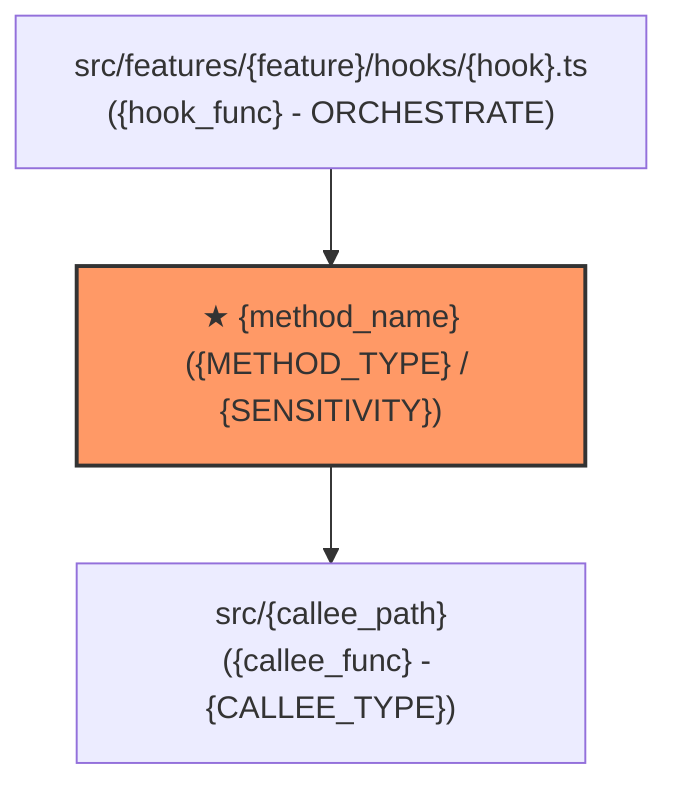

# 前端方法设计与契约画像规范模板：{method_name}

## 1. 基础与位置画像 (Location & Profile)
- **所属层次**：{前端领域核心层 (Domain Core / Model) | UI 编排与 Hook 层 (Orchestration / Hooks) | 基础设施与网络层 (Infra / API) | 纯展现层 (Presentation / UI)}
- **所属模块**：`{features/feature_name | shared/module_name}`
- **文件路径**：`src/{path_to_file}`
- **代码定位**：第 `{start_line}` 行，共 `{line_count}` 行（行范围：`{start_line}-{end_line}`）
- **方法签名**：`{export function method_name(params): ReturnType}`
- **方法类型**：`{ALGO | TRANSFORM | GUARD | STATE | ORCHESTRATE | ADAPTER | PRESENT}`
- **功能描述**：{简述该方法的业务职责、交互或计算目的}

---

## 2. 特征与属性契约 (Attributes Contract)
- **改动敏感度**：`{LOW | MEDIUM | HIGH | CRITICAL}`
- **改动敏感理由**：{阐明破坏后果，例如：涉及客户端资金分摊或核心状态机，偏差直接导致结算错误或死锁}
- **副作用类型**：`{NONE | IN_MEMORY | EXTERNAL_IO}`
- **具体副作用**：{明确是否有 DOM 操作、localStorage 读写、Store 全局更新或网络请求；纯计算写：无任何副作用，0 DOM 依赖}

---

## 3. 指导测试范围与策略 (Test Guidance & Scope)
- **测试环境**：`{Node-Environment (0 DOM) | JSDOM / Browser}`（**ALGO / TRANSFORM / GUARD / STATE 强制 0 DOM**）
- **测试文件**：`src/{path_to_test_file}`
- **测试级别**：`{UNIT | CONTRACT | INTEGRATION | E2E}`
- **覆盖约束**：{覆盖率与分支要求，例如：100% 分支覆盖率，覆盖空态、极值、精度与越权拦截}
- **跑测执行命令**：`{pnpm vitest run src/... | npm test -- ...}`（**严禁执行全量集成或无关端到端测试**）
- **上下文限制指令**：AI 仅允许加载本文件目标行段与对应测试文件，**严格禁止阅读包含大篇幅 JSX/Tailwind 的表现层组件**。

---

## 4. 以本方法为中心的依赖拓扑图 (Ego Dependency Graph)


---

## 5. 入参与出参类型契约 (Type Signature Contract)

### 5.1 入参规格 (Inputs)
| 参数名 | 类型 | 必填 | 约束与说明 |
|---|---|---|---|
| `{param1}` | `{Type}` | 是 | {说明} |
| `{param2}` | `{Type \| null}` | 否 | {说明} |

### 5.2 出参规格 (Outputs)
```typescript
export interface {MethodName}Result {
  // 明确核心出参字段与类型定义
}
```

---

## 6. 异常与边界兜底策略 (Edge Cases & Fallbacks)
- **边界与空态**：{如列表为空、NaN、Undefined 等场景的兜底返回值}
- **数值截断/精度**：{如金额计算向下取整、一分钱余数补偿逻辑}
- **网络/外部降级**：{若是 ADAPTER，说明超时重试或 Mock 兜底数据}

---

## 7. 历史修改与演变记录 (Structured Changelog)

##### `{YYYY-MM-DD}` `[{TASK_ID}]`
- **需求背景**：{本次修改对应的需求或业务背景}
- **修改原因**：{原逻辑存在的缺陷、短板或需适配的改动动机}
- **技术原理**：{本次改动的底层实现机制、算法逻辑与安全考量}
