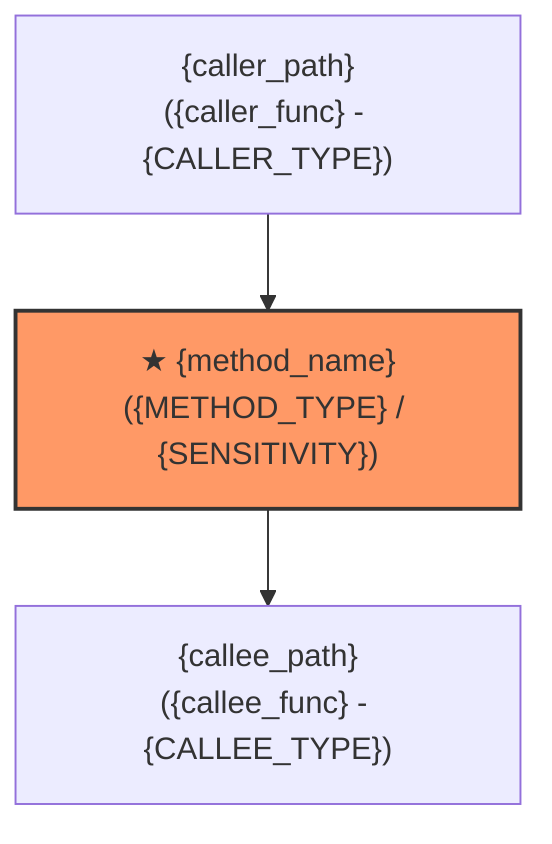

# 方法设计与契约画像模板：{method_name}

## 1. 基础与位置画像 (Location & Profile)
- **所属层次**：{领域核心层 (Domain) | 应用编排层 (Application) | 基础设施与适配层 (Infrastructure) | 接口表现层 (Presentation)}
- **所属模块**：`{module_name}`
- **文件路径**：`{file_path}`
- **代码定位**：第 `{start_line}` 行，共 `{line_count}` 行（行范围：`{start_line}-{end_line}`）
- **方法签名**：`exception {method_name}(input, output, context, isolate, metrics, recall)`
- **方法类型**：`{TRANSFORM | ALGO | GUARD | STATE | ORCHESTRATE | ADAPTER | PRESENT}`
- **功能描述**：{简述该方法的业务职责与核心处理逻辑}

---

## 2. 特征与属性契约 (Attributes Contract)
- **改动敏感度**：`{LOW | MEDIUM | HIGH | CRITICAL}`
- **改动敏感理由**：{阐明破坏后果，例如：涉及资金结算，计算偏差将直接产生资损；或纯内部展示格式化，改动影响局限}
- **副作用类型**：`{NONE | IN_MEMORY | EXTERNAL_IO}`
- **具体副作用**：{明确是否有网络 I/O、数据库操作、全局/入参状态改变，例如：无任何副作用，深拷贝纯计算}

---

## 3. 指导测试范围与策略 (Test Guidance & Scope)
- **测试文件**：`{test_file_path}`
- **测试级别**：`{UNIT | CONTRACT | INTEGRATION | E2E}`
- **覆盖约束**：{覆盖率与分支测试要求，例如：100% 分支覆盖率，覆盖边界值、零值与溢出情况}
- **跑测执行命令**：`{specific_test_command}`（**严禁执行全量集成或无关端到端测试**）
- **上下文限制指令**：AI 仅允许加载本文件目标行段与测试文件，**严格禁止阅读上游编排层及下游无关实现源码**。

---

## 4. 以本方法为中心的依赖拓扑图 (Ego Dependency Graph)

---

## 5. 六元组入参与出参规范 (Six-Tuple Specification)

### 5.1 input 入参规范
| 字段路径 | 类型 | 取值范围 / 格式 | 可空 | 描述 |
|---|---|---|---|---|
| `{entity}.id` | String | UUID / Snowflake | 否 | 实体唯一标识 |
| `{entity}.amount` | Decimal | (0, 99999999.99] | 否 | 交易金额 |

### 5.2 output 出参规范
| 字段路径 | 类型 | 取值范围 / 格式 | 可空 | 描述 |
|---|---|---|---|---|
| `{entity}.status` | String | ENUM: CREATED, PAID | 否 | 状态 |

### 5.3 context 上下文依赖
| 字段路径 | 类型 | 描述 |
|---|---|---|
| `context.trace_id` | String | 链路追踪 ID |
| `context.deadline` | Timestamp | 超时时间截点 |

### 5.4 isolate 隔离约束
| 字段路径 | 类型 | 约束说明 |
|---|---|---|
| `isolate.tenant_id` | String | 多租户隔离 ID，只读 |

---

## 6. 衍生方法规范 (Derivatives: Compensate / Fallback)

### 6.1 事务补偿方法 (Compensate Method)
- **方法名称**：`{method_name}_compensate`
- **签名**：`exception {method_name}_compensate(input, output, context, isolate, metrics, recall)`
- **触发条件**：分布式事务下游失败或 Saga 流程回滚。
- **补偿动作**：释放预占资源、还原业务状态。
- **异常挂载**：`context.last_exception` 携带失败现场信息。

### 6.2 异常降级方法 (Fallback Method)
- **方法名称**：`{method_name}_fallback`
- **签名**：`exception {method_name}_fallback(input, output, context, isolate, metrics, recall)`
- **触发条件**：主方法熔断、下游不可用且不可重试。
- **降级动作**：返回兜底缓存数据或降级提示。

---

## 7. 历史修改与演变记录 (Structured Changelog)

##### `{YYYY-MM-DD}` `[{TASK_ID}]`
- **需求背景**：{本次修改对应的需求或业务背景}
- **修改原因**：{原逻辑存在的缺陷、短板或需适配的改动动机}
- **技术原理**：{本次改动的底层实现机制、算法逻辑与安全考量}
