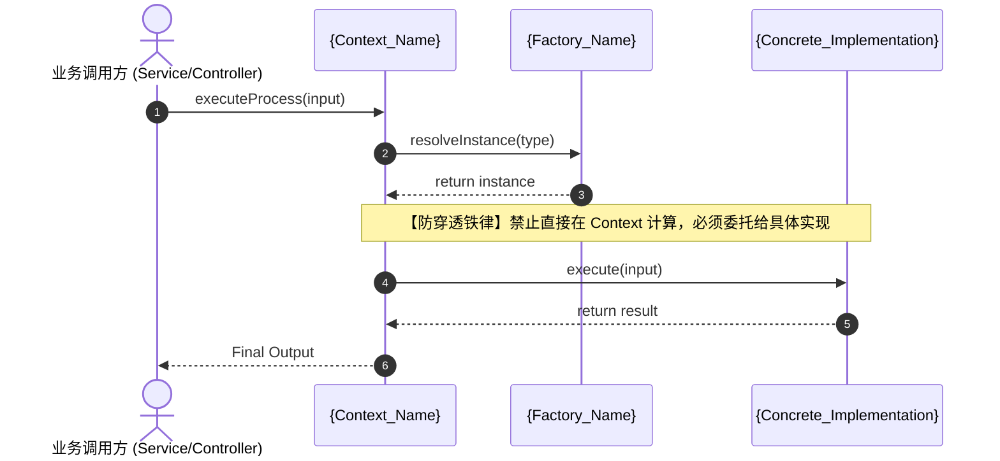

# 设计模式协同集群档案：{cluster_name}

## 1. 模式元数据 (Pattern Metadata)
- **设计模式 (Design Pattern)**：`{Strategy | Chain of Resp. | State | Builder | Adapter | Facade | Observer/Pub-Sub | Template Method}`
- **所属业务域与模块**：`{domain_name} / {module_name}`
- **引入动机与解耦目标**：{阐述为何选用此模式，消除了哪些复杂 if-else/紧密耦合，带来了什么扩展性}
- **修改敏感度**：`CRITICAL`（属于系统核心架构模式，严禁局部随意破坏）

---

## 2. 参与者矩阵与物理定位 (Participant Matrix)

| 模式角色 (Pattern Role) | 承载类 / 方法物理定位 (文件路径#行号范围) | 方法原型 (Archetype) | 核心职责与边界约束 |
|---|---|---|---|
| **Context (调用上下文)** | `{context_file_path}#{start_line}-{end_line}` | `ORCHESTRATE` | 仅负责流程调度，**绝对禁止写具体业务计算或分支逻辑** |
| **Contract (抽象契约/接口)** | `{interface_file_path}#{start_line}-{end_line}` | `CONTRACT` | 规范输入输出类型与不变量断言 |
| **Registry / Factory (路由工厂)** | `{factory_file_path}#{start_line}-{end_line}` | `ALGO` | 依据环境/租户/状态路由对应实例，无业务副作用 |
| **Concrete A (具体实现 A)** | `{concrete_a_path}#{start_line}-{end_line}` | `ALGO` / `GUARD` | 独立具体实现，遵循纯函数或严格拦截 |
| **Concrete B (具体实现 B)** | `{concrete_b_path}#{start_line}-{end_line}` | `ALGO` / `GUARD` | 平行具体实现，与 Concrete A 零交叉依赖 |

---

## 3. 协作时序与拓扑关系 (Collaboration Topology)

---

## 4. VibeCoding 防破坏红线 (Vibe-Immunity Guardrails)

### 🚨 绝对禁止项 (Prohibited Anti-Patterns)
1. **禁止内联穿透 (No Inline Bypass)**：
   - 严禁在 Context 或外部调用方中通过 `if (...) { ... }` 绕过模式直接写临时硬编码补丁；
   - 任何针对业务逻辑的改动，**必须在对应角色实现中进行，严禁破坏委托调用拓扑**。
2. **禁止擅改接口契约 (Contract Immutability)**：
   - 未经架构确认，严禁单方面修改 Contract 接口入参与出参类型；
   - 如需扩展输入，必须通过扩展参数上下文对象（Context/Snapshot）实现向后兼容。
3. **禁止具体实现间交叉依赖 (Zero Cross-Implementation Dependency)**：
   - 各 Concrete 实现类互为平行隔离关系，严禁相互引用或产生隐藏耦合。

### 规范演进路径 (Prescribed Extension Path)
- **当业务需要新增功能分支时**：
  1. 新建独立的 Concrete 实现文件，实现 Contract 接口；
  2. 在 Registry/Factory 路由表中注册新实现枚举；
  3. 为新实现编写独立的单元测试（100% PASS）；
  4. 更新本文档第 2 节的《参与者矩阵》追加新行；
  5. **Context 及其他既有实现代码保持 0 行修改（遵循开闭原则 OCP）**。
