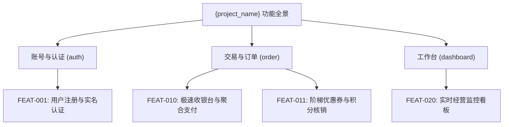

# 产品全景需求总览说明书 (Overview PRD)：{project_name}

- **项目/系统全称**：{project_name}
- **创建时间**：{YYYY-MM-DD}
- **版本**：v1.0.0
- **状态**：DRAFT / REVIEWED / FROZEN
- **宏观品味宪章继承**：`Inherits: /DESIGN.md`
- **对应架构设计**：`hs_dev_docs/_02_system_architecture/overview_architecture.md`

> [!NOTE]
> **分级拆分原则**：对于中大型项目，严禁将全量特性揉入单一万行 PRD 文档。
> 本总览 PRD 仅承载全局商业愿景、模块划分矩阵与特性索引导航；具体微观特性施工图统一分拆收敛至 `features/{feature_key}_prd.md`。

---

## 1. 系统业务全景与模块矩阵 (System Scope & Modules)

| 模块标识 | 模块名称 | 核心职责 | 包含特性清单 | 模块负责人 |
|---|---|---|---|---|
| `auth` | 账号与认证 | 登录鉴权、多租户隔离、权限角色 | `FEAT-001`, `FEAT-002` | {owner} |
| `order` | 交易与订单 | 下单提单、支付接入、订单状态机 | `FEAT-010`, `FEAT-011`, `FEAT-012` | {owner} |
| `dashboard` | 经营工作台 | 指标聚合、实时告警、数据导出 | `FEAT-020` | {owner} |

---

## 2. 全局功能特性索引映射表 (Feature Index Matrix)

> 索引核心：本表由 `doc_index_db.py` 自动化提取并建立全局检索索引。

| 特性ID | 特性名称 | 所属模块 | 优先级 | 状态 | 规格说明书路径 (PRD) | 界面原型路径 (Prototype) |
|---|---|---|---|---|---|---|
| `FEAT-001` | 用户注册与企业实名认证 | `auth` | `P0` | `active` | `features/auth_register_prd.md` | `_03_product_figma/auth_register_prototype.md` |
| `FEAT-010` | 极速收银台与聚合支付 | `order` | `P0` | `active` | `features/order_checkout_prd.md` | `_03_product_figma/order_checkout_prototype.md` |
| `FEAT-011` | 阶梯优惠券与积分核销 | `order` | `P1` | `active` | `features/order_coupon_prd.md` | `_03_product_figma/order_coupon_prototype.md` |

---

## 3. 全局功能架构树 (System Functional Architecture Tree)

---

## 4. 全局用户角色与权限动线 (Global Personas & Access Matrix)

| 角色标识 | 角色名称 | 核心诉求 | 涉及模块 |
|---|---|---|---|
| `ROLE_USER` | 普通买家 | 追求下单极速、支付安全、流程顺畅 | `order`, `auth` |
| `ROLE_ADMIN` | 运营与财务人员 | 追求核销对账精确、异常即时干预 | `dashboard`, `order` |
