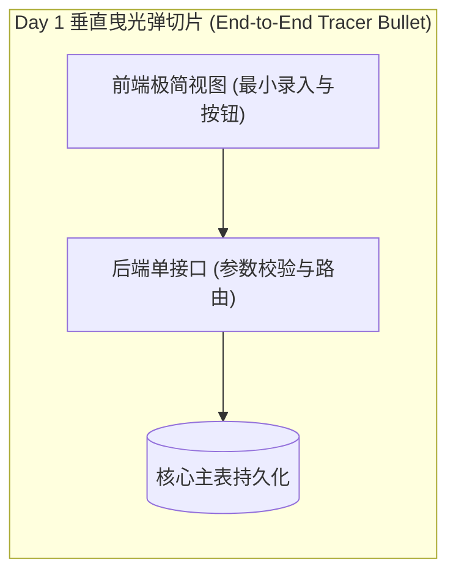
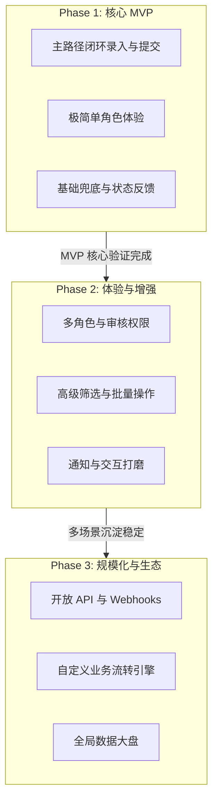

# 产品开发分阶段规划书：{feature_name}

- **需求/功能名称**：{feature_name}
- **规划编制时间**：{YYYY-MM-DD}
- **规划状态**：DRAFT / ALIGNED / FROZEN
- **产品负责人**：{owner}
- **当前实施目标**：Phase 1 (MVP)
- **关联设计与需求**：
  - 功能规格 PRD：`_02_feature_spec/_01_human_prd/{feature_name}_prd.md`
  - 设计语言与原型：`_02_feature_spec/_04_prototype_wireframe/{feature_name}_prototype.md`

> [!NOTE]
> **定位原则**：本规划书是产品设计向工程研发演进的战略桥梁。通过严密的功能分期与 MVP 裁剪，确保系统以最小成本、最快速度验证核心假设，坚决杜绝一次性全量开发 (Big Bang)。

---

## 1. 核心验证假设、团队胃口 (Appetite) 与 MVP 定位

- **单一核心验证假设 (Single Risky Assumption)**：{本次产品最核心要向市场或用户验证的价值假设，如：“通过极简的一键录入流程，能够有效提升用户在移动端的数据采集效率”}
- **团队胃口与时间箱 (Appetite & Timebox · 借鉴 Shape Up)**：
  - **胃口规格**：`[ ] Small Batch (1~3 天极速验证)` / `[ ] Medium Batch (1~2 周首发发布)`
  - **断路器原则 (Circuit Breaker)**：若遇到未知工程阻塞，**坚决砍功能保上线，绝不延长时间箱**。
- **MVP 核心成功指标**：
  1. {指标 1：核心主旅程 100% 跑通，无阻塞性卡点}
  2. {指标 2：用户在 X 分钟内独立达成核心目标}
- **本阶段总体实施策略**：**小步快跑，单点突破**。Phase 1 严格聚焦核心验证闭环，次要体验与高级特性顺延至后续阶段。

---

## 2. 人机交互对齐备忘录 (Interaction Alignment & CEO Cut)

在完成全量产品设计后，Agent 与产品决策者进行了针对性的人机交互对齐，确认结论如下：

| 对齐维度 | 核心提问内容 | 决策者确认结论与裁剪依据 |
|---|---|---|
| **单一核心假设** | MVP 最根本解决的单一痛点是什么？ | 确认聚焦于核心单一角色在单一主场景下的闭环，暂不引入次级分支。 |
| **CEO 砍半提案 (质疑与裁定)** | Agent 针对辅助功能发起必要性质疑，提出砍半裁剪建议；由开发者最终裁定是否采纳？ | 开发者最终裁定：采纳 Agent 质疑与裁剪建议，首期坚决砍掉批量导出、高级筛选、站内通知与多角色权限体系，保持 MVP 纯粹。 |
| **管理台策略** | 首期是否构建可视化配置后台？ | 遵循 **No Admin in MVP** 铁律，首期通过代码常量与种子数据硬编码解决。 |
| **团队胃口** | 本次开发的时间箱 (Appetite) 是多久？ | 设定为 {X 天 / 周}，触发断路器时优先裁剪界面动效与辅助导出。 |
| **首日切片与准出**| MVP 的首个垂直切片与最终验收断言？ | 确认 Day 1 跑通端到端垂直曳光弹切片，以 Gherkin 全绿与阶段 6 门禁为准出。 |

---

## 3. 全量功能池 MoSCoW 分级与分期矩阵

基于 PRD 的功能架构全景，对所有规划功能进行优先级分级与阶段归属划分：

| 功能编号 | 功能名称 | 所属模块 | MoSCoW 分级 | 实施阶段归属 | 裁剪/延期理由 (CEO Cut Rationale) |
|---|---|---|---|---|---|
| `FEAT-001` | {核心基础功能 1} | 核心工作台 | **Must-have** | **Phase 1 (MVP)** | 核心主路径依赖，缺失则产品无法运作 |
| `FEAT-002` | {核心业务提交} | 核心工作台 | **Must-have** | **Phase 1 (MVP)** | 价值主闭环必须项 |
| `FEAT-003` | {基础状态查看} | 流程监控 | **Must-have** | **Phase 1 (MVP)** | 结果确认必须项 |
| `FEAT-004` | {高级组合筛选} | 流程监控 | **Should-have** | **Phase 2 (增强)** | 早期数据量少，基础翻页已可满足 (CEO 砍半项) |
| `FEAT-005` | {批量导入与导出} | 辅助工具 | **Should-have** | **Phase 2 (增强)** | 增强效率特性，非核心闭环阻塞项 (CEO 砍半项) |
| `FEAT-006` | {多角色权限管控} | 系统管理 | **Could-have** | **Phase 2 (增强)** | MVP 采用单内置角色简化验证，避免权限膨胀 |
| `FEAT-007` | {开放 API 与 Webhooks} | 开放生态 | **Won't-have** | **Phase 3 (生态)** | 业务规模化放量后拓展 |
| `FEAT-008` | {自定义流转引擎} | 高级配置 | **Won't-have** | **Phase 3 (生态)** | 属于远期演进能力，本期坚决不做 |

---

## 4. 阶段一：MVP 实施细则与垂直切片路径 (Tracer Bullet Path)

### 4.1 Day 1 垂直曳光弹切片 (First Vertical Slice)
拒绝“先做完全部表结构再写后端最后接前端”的水平脱节切片，安排首日贯穿全链路：

- **验证目的**：首日或首个里程碑跑通数据流闭环，完成冒烟演示。

### 4.2 MVP 实施范围 (In-Scope)
- **目标角色**：单一核心角色（`ROLE_01 普通用户`）；
- **核心主旅程**：
  ```mermaid
  flowchart LR
    A([进入系统]) --> B[录入基础信息] --> C[系统即时校验] --> D[提交操作] --> E([完成并查看状态])
  ```
- **纳入功能清单**：`FEAT-001`、`FEAT-002`、`FEAT-003`；
- **设计语言遵循**：采用项目 Design Tokens 定义的核心主色、排版层级与核心组件基础状态。

### 4.3 MVP 明确排除项 (Out-of-Scope / Hard Non-Goals)
- ❌ **No Admin in MVP**：严禁开发可视化权限后台与配置界面；
- ❌ 不支持多角色切换与细粒度权限控制；
- ❌ 不支持复杂组合查询与图表分析；
- ❌ 不支持第三方外部系统对接与批量操作。

### 4.4 MVP 准出与验收断言 (Exit Criteria)
- [ ] Day 1 垂直曳光弹冒烟切片跑通并在控制台/界面可演示；
- [ ] 核心角色能在正常网络下 100% 顺畅完成从录入到生效的主路径；
- [ ] 异常与错误输入能得到明确的界面反馈与重试指引；
- [ ] 当前阶段通过阶段 6 质量门禁与本地提交，代码与测试全绿。


---

## 5. 阶段二：体验与能力增强阶段规划 (Phase 2)

- **实施目标**：提升日常操作效率，覆盖次级运营场景，完善多角色协同。
- **规划特性范围**：
  - `FEAT-004` 高级组合筛选与多维度排序；
  - `FEAT-005` 批量数据导出与导入；
  - `FEAT-006` 运营管理角色引入与审核权限流转；
- **启动前提**：Phase 1 MVP 成功上线并验证核心链路稳定性。

---

## 6. 阶段三：规模化与生态集成阶段规划 (Phase 3)

- **实施目标**：构建生态连接能力，支持高并发与深度定制，打造平台级壁垒。
- **规划特性范围**：
  - `FEAT-007` 开放 OpenAPI 与 Webhooks 事件通知机制；
  - `FEAT-008` 自定义可视化业务流转引擎；
  - 核心分析监控大盘与审计日志沉淀；
- **启动前提**：业务形成规模化调用诉求，核心模型经过 Phase 2 考验并稳定。

---

## 7. 演进路线图与阶段依赖关系


