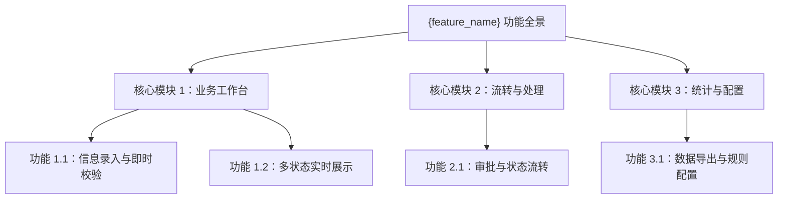
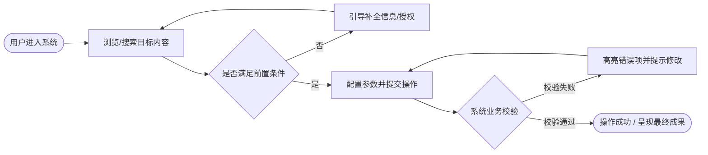

# 产品需求与功能规格说明书 (PRD)：{feature_name}

- **需求/功能名称**：{feature_name}
- **创建时间**：{YYYY-MM-DD}
- **状态**：DRAFT / REVIEWED / FROZEN
- **产品负责人**：{owner}
- **关联设计语言与原型**：`_03_product_figma/{feature_name}_prototype.md` / 根目录 `DESIGN.md`

> [!NOTE]
> **产出铁律**：本文件专精于**产品功能规格与业务逻辑**。严禁在本文中写入物理数据库 DDL、代码六元组实现、分布式 Saga 补偿或单测覆盖率等底层研发细节（由后续架构与详细设计承接）。

---

## 1. 产品定位与核心价值

- **一句话价值主张**：{为谁提供什么，解决什么核心痛点}
- **业务背景**：{详细描述本功能产生的业务背景，用户在何种场景下产生诉求}
- **核心目标 (Goals)**：
  1. {业务/产品目标 1}
  2. {业务/产品目标 2}
- **明确非目标 (Non-Goals)**：
  - {本阶段明确不做或延期的边界范围}

---

## 2. 目标用户角色与使用场景

| 角色标识 | 角色名称 | 核心特征与诉求 | 典型使用场景 |
|---|---|---|---|
| `ROLE_01` | 普通用户 | 核心功能使用者，追求操作流畅与反馈即时 | 在移动端/桌面端完成核心任务提交与查询 |
| `ROLE_02` | 运营管理员 | 管理与审核者，需要高效过滤与批量操作 | 在管理后台进行数据审核、规则配置与流转监控 |

---

## 3. 功能架构全景 (Functional Architecture)

---

## 4. 端到端用户核心旅程 (Core User Journey)

---

## 5. 详细功能规格与业务规则矩阵

### 5.1 功能项：{功能点一名称} (`FEAT-001`)

- **功能概述**：{简要描述该功能的用途}
- **触发前置条件**：{用户处于何种状态、拥有何种权限可触发}
- **输入要素与校验规则**：
  | 字段/操作项 | 类型 | 必填 | 校验规则与边界 | 默认值 |
  |---|---|---|---|---|
  | {字段名 1} | 文本/下拉/数字 | 是/否 | {如：长度 2-50 位，禁止特殊字符} | {默认值} |
  | {字段名 2} | 日期/单选 | 是/否 | {如：不可选择早于当前日期的时间} | {默认值} |

- **业务处理规则矩阵**：
  1. **规则 1（正常流转）**：{描述正常条件下的业务处理逻辑}
  2. **规则 2（互斥与约束）**：{描述多条件互斥或依赖规则}
  3. **规则 3（状态迁移）**：{描述功能触发后，业务状态如何变更}

- **界面输出与反馈展示**：
  - **成功响应**：{界面跳转、Toast 成功提示、局部数据静默刷新}；
  - **失败响应**：{精准定位出错表单项、展示友好的业务级原因文案}。

- **边界与极端场景处理 (Edge Cases)**：
  - **空数据/零结果**：{展示友好空状态插画与引导操作}；
  - **极值与溢出**：{超长字符以省略号截断并支持 Tooltip 完整查看}；
  - **高频重复触发**：{按钮提交后自动进入 2 秒防抖锁定与 Loading 态}；
  - **弱网与超时**：{超过 5 秒未响应展示网络弱提示，支持一键重试}。

---

## 6. 产品验收标准 (Functional DoD / Acceptance Criteria)

- [ ] **DoD-01 (主流程闭环)**：用户登录后能无阻碍完成核心主路径操作，成功收到明确结果反馈；
- [ ] **DoD-02 (异常友好拦截)**：输入非法格式或缺少必填项时，对应控件即时呈现错误态，给出针对性文案提示；
- [ ] **DoD-03 (交互状态完备)**：所有关键提交动作具备防抖与 Loading 态，空数据与弱网场景展示设计好的兜底态；
- [ ] **DoD-04 (端体验一致性)**：多端或不同屏幕分辨率下功能逻辑一致，界面布局自适应。
