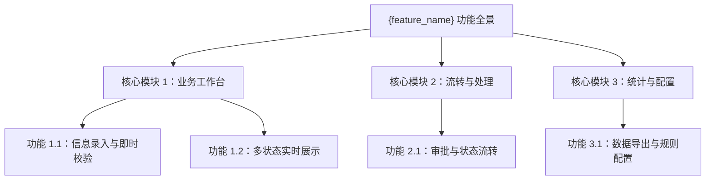
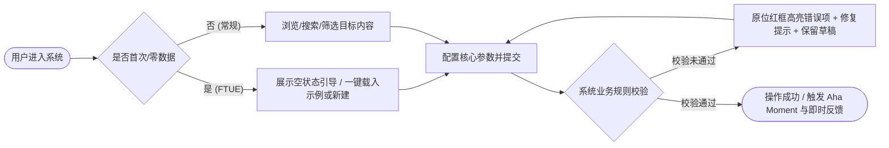

# 产品需求与功能规格说明书 (PRD)：{feature_name}

- **需求/功能名称**：{feature_name}
- **创建时间**：{YYYY-MM-DD}
- **状态**：DRAFT / REVIEWED / FROZEN
- **产品负责人**：{owner}
- **宏观品味宪章继承**：`Inherits: /DESIGN.md`（遵循已锁定的视觉调性、Design Tokens、Anti-Slop 护栏与 10 星体验标准；严禁在此重新定义全站色彩或字体）
- **关联设计语言与原型**：`_03_product_figma/{feature_name}_prototype.md`
- **面向 VibeCoding 契约**：`_02_product_design/{feature_name}_vibe_spec.md`
- **关联分阶段规划**：`_04_phased_roadmap/{feature_name}_phased_plan.md`

> [!NOTE]
> **产出铁律**：本文件专精于**微观特性产品洞察、用户体验与功能规格**。宏观品味与全局设计语言继承自项目根目录 `DESIGN.md`；严禁在本文中写入物理数据库 DDL、代码六元组签名、底层技术选型或单元测试覆盖率数字等研发实现细节（由后续架构与详细设计承接）。

---

## 1. 产品洞察与核心价值界定 (Product Framing & Discovery)

- **现状与摩擦 (Status Quo & Friction)**：{用户今天没有本功能时如何凑合解决？如手工表格/多系统来回复制；最痛的时间与心智损耗在哪？}
- **一句话价值主张 (Value Proposition)**：{为哪类核心用户提供什么不可替代的能力，将什么体验提升了多少倍}
- **用户雇佣任务 (JTBD - Jobs to be Done)**：
  - **JTBD-01**：`When` {特定触发情境}，`I want to` {完成的核心动作}，`so I can` {达成可感知的核心价值}。
  - **JTBD-02**：`When` {特定触发情境}，`I want to` {完成的核心动作}，`so I can` {达成可感知的核心价值}。
- **核心惊喜时刻 (Aha Moment)**：{用户进入产品后，前 30 秒或 3 步内完成什么动作会发出“太好用了”的感叹？}
- **首次冷启动体验 (FTUE / Onboarding)**：{新用户首次进入且无历史数据时，如何通过预置模板/示例数据/引导按钮在 1 分钟内跑通首单？}
- **核心目标 (Goals)**：
  1. {用户价值/业务目标 1}
  2. {用户价值/业务目标 2}
- **明确非目标 (Non-Goals)**：
  - {本阶段明确不做或延期的边界范围，防止范围蔓延}

---

## 2. 目标用户角色与心智模型 (User Personas & Mental Models)

| 角色标识 | 角色名称 | 核心心智与诉求 | 高频使用场景与环境 |
|---|---|---|---|
| `ROLE_01` | 普通/核心用户 | 追求零学习成本、反馈即时、不丢失草稿 | 在桌面/移动端快速完成核心任务创建、查看与流转 |
| `ROLE_02` | 运营/管理员 | 追求高密度信息扫视、高效筛选与批量处理 | 在工作台进行异常监控、规则配置与多状态审核 |

---

## 3. 核心交互方案比选与功能架构全景 (Approaches & Functional Architecture)

### 3.1 核心产品/交互形态方案比选 (Approaches & Trade-offs)
| 评估维度 | 方案 A（推荐采纳） | 方案 B（备选弃用） | 决策理由 (Trade-off Rationale) |
|---|---|---|---|
| **交互形态** | {如：单屏主从列表 + 右侧渐进式披露抽屉} | {如：列表点击跳转独立新页面编辑} | 方案 A 保持列表筛选上下文不丢失，适合高频连续处理 |
| **优势与代价** | 零跳转心流连贯；需控制抽屉宽度与首屏密度 | 单页结构简单；但来回跳转打断操作节奏 | 通过渐进式披露收起低频项，兼顾清爽度与高效率 |

### 3.2 功能架构全景 (Functional Architecture)

---

## 4. 端到端用户核心旅程 (Core User Journey)

包含**首次冷启动 (FTUE)**、**常规主成功路径**与**校验异常原位恢复路径**：

---

## 5. 详细功能规格与业务规则矩阵

### 5.1 功能项：{功能点一名称} (`FEAT-001`)

- **功能概述与关联 JTBD**：{简要描述该功能的用途，服务于 `JTBD-01`}
- **触发前置条件**：{用户处于何种状态、拥有何种权限可触发}
- **输入要素与校验规则（区分首屏高频项与渐进式披露折叠项）**：
  | 字段/操作项 | 披露层级 | 类型 | 必填 | 校验规则与边界 | 默认值与微文案提示 |
  |---|---|---|---|---|---|
  | {字段名 1} | 首屏必填 | 文本/数字 | 是 | {如：长度 2-50 位，禁止特殊字符} | {占位提示：请输入具体的...} |
  | {字段名 2} | 高级折叠 | 日期/单选 | 否 | {如：不可选择早于当前日期的时间} | {默认今天} |

- **业务处理规则矩阵**：
  1. **规则 1（正常流转）**：{描述正常条件下的业务处理逻辑}
  2. **规则 2（互斥与约束）**：{描述多条件互斥或依赖规则}
  3. **规则 3（状态迁移）**：{描述功能触发后，业务状态如何变更}

- **界面输出与微文案响应**：
  - **成功响应**：{如：关闭抽屉，列表首行高亮新记录，弹出 Toast「已创建『xxx』，[撤销]」}；
  - **失败响应**：{精准定位首个出错表单项并滚动聚焦，展示「原因 + 解决建议」内联文案}。

- **边界与极端场景处理 (Edge Cases)**：
  - **空数据/零结果**：{区分“首次使用无数据”与“搜索筛选无结果”，分别提供创建引导或「清空筛选条件」快捷按钮}；
  - **极值与溢出**：{超长字符以省略号截断并支持悬停 Tooltip 完整查看}；
  - **高频重复触发**：{按钮提交后立即进入防抖锁定与 Loading 态，维持原按钮宽度}；
  - **弱网超时与草稿保护**：{超过 5 秒未响应展示弱网提示与「重试」按钮，严禁清空用户已填表单内容}。

---

## 6. 整体交互逻辑与工程规模评估 (Interaction Topology & Scale Assessment)

### 6.1 页面流转与组件堆叠层级
- **导航与视图拓扑**：主列表工作区 ↔ 右侧详情/编辑抽屉 (Drawer) ↔ 危险操作二次确认弹窗 (Modal)；
- **脏数据防丢失保护**：当用户在抽屉或弹窗中修改了表单但未保存，点击遮罩层或按 `Esc` 时，必须拦截并提示「有未保存的更改，是否放弃修改？」。

### 6.2 规模与复杂度客观评估（阶段 1 技术选型输入基准）
| 评估维度 | 本期特征描述 | 规模判定 |
|---|---|---|
| **交互复杂度** | {如：2 个核心主视图 + 1 个侧滑抽屉 + 局部状态联动} | 轻量 / **中度** / 高密 |
| **数据与规则复杂度** | {如：核心表单 8 个字段，含 2 处级联校验与状态流转} | 简单 / **中等** / 复杂 |
| **通信与实时性** | {如：标准请求响应为主，状态变更采用局部刷新} | **标准交互** / 准实时推送 / 实时协同 |

---

## 7. 产品验收标准：Gherkin 行为驱动断言 (Functional DoD / Acceptance Criteria)

所有验收标准均采用 **`Given（前置情境）/ When（用户动作）/ Then（可观测界面结果）`** 编写：

- [ ] **DoD-01（主成功流 Happy Path）**：
  - `Given` 用户已进入工作台并打开新建面板填妥所有必填项，
  - `When` 点击「{具象动词+宾语，如：立即创建订单}」主按钮，
  - `Then` 按钮立即呈现 Loading 防抖态，完成后列表实时新增该记录，并弹出「{成功微文案}」全局提示。
- [ ] **DoD-02（首次冷启动与空态引导 FTUE）**：
  - `Given` 新用户首次进入且系统无任何历史记录（或筛选结果为空），
  - `When` 页面加载完成，
  - `Then` 主画布呈现定制化空状态引导说明与「+ 创建首条记录 / 载入示例数据」主按钮，无空白死胡同。
- [ ] **DoD-03（校验拦截与草稿保护 Validation & Edge）**：
  - `Given` 用户在表单中漏填必填项或输入非法格式，
  - `When` 触发提交动作，
  - `Then` 首个错误字段立即红框聚焦并展示「原因 + 修复方法」内联提示，表单阻止提交且用户已填合法字段内容 100% 保留。
- [ ] **DoD-04（异常恢复与端体验一致性 Recovery & Responsive）**：
  - `Given` 提交或加载过程中发生网络超时，
  - `When` 系统捕获异常响应，
  - `Then` 界面原位展示友好错误说明与「重新加载 / 重试提交」按钮，且在不同分辨率下布局自适应无错位。
