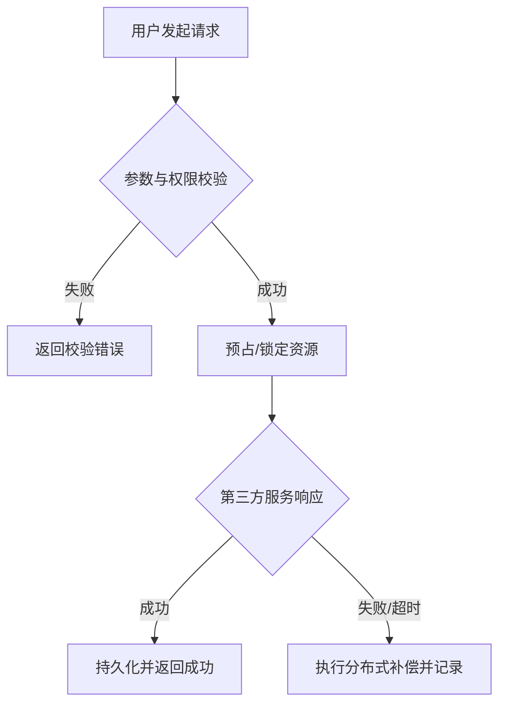

# 产品需求规格说明书 (PRD)：{feature_name}

- **需求名称**：{feature_name}
- **创建时间**：{YYYY-MM-DD}
- **状态**：DRAFT / REVIEWED / APPROVED
- **负责人**：{owner}

---

## 1. 业务背景与用户痛点
{详细描述该功能解决的核心业务痛点，用户在什么场景下使用}

---

## 2. 用户画像与核心用例 (Use Cases)

| 用例 ID | 角色 | 触发动作 | 预期结果 |
|---|---|---|---|
| `UC_001` | 普通用户 | 点击下单并支付 | 扣减库存、生成支付流水、返回支付凭证 |
| `UC_002` | 系统定时器 | 扫描超时未支付订单 | 触发库存释放 Saga 补偿 |

---

## 3. 详细功能流程与业务规则

### 业务规则矩阵
1. **规则 1**：...
2. **规则 2**：...

---

## 4. 非功能性需求 (NFR)
- **并发与吞吐**：预期峰值 QPS ≥ {qps}，响应时延 P99 ≤ {latency_ms}ms。
- **数据一致性**：最终一致性（Saga 模式） / 强一致性。
- **异常容错**：第三方渠道超时重试不超过 2 次，支持安全幂等。

---

## 5. 验收标准与完成定义 (DoD)
- [ ] 1. 主流程端到端跑通，通过 E2E 冒烟测试；
- [ ] 2. 核心方法单测覆盖率 ≥ 85%，补偿与降级分支 100% 覆盖；
- [ ] 3. 契约测试与 Mock 比对通过。
