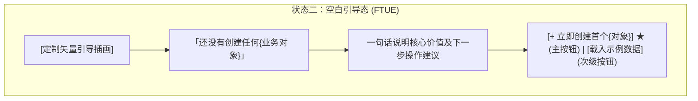
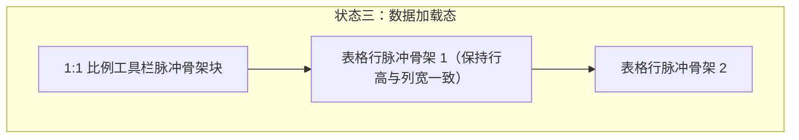
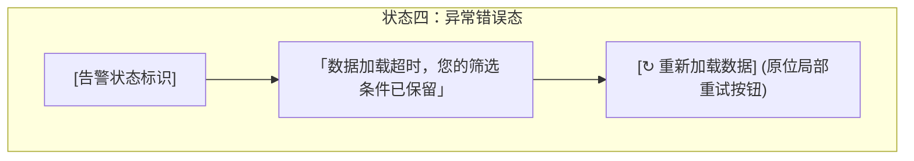

#### 状态二：空白引导态 (Empty State & FTUE 冷启动)
首次进入系统或筛选结果为 0 时，提供清晰的冷启动引导与一键动作，杜绝空白死胡同：

```text
+----------------------------------------------------------------------------------+
|  [UI Spec: Empty State Container, Min-H: 360px, Align: Center]                   |
|  {模块主标题} (0)                                                                |
|  +----------------------------------------------------------------------------+  |
|  |                                                                            |  |
|  |                       [ 📭 引导插画: 80x80px ]                              |  |
|  |                 还没有创建任何{业务对象} [H2: 18px w600 #1A1C1E]           |  |
|  |     创建后可在此实时追踪流转状态，或先载入示例数据体验 [Body: 14px #6C7278]  |  |
|  |                                                                            |  |
|  |          [ + 立即创建首个{对象} ] ★ (36px Accent)   [ 载入示例数据 ] (36px)  |  |
|  |                                                                            |  |
|  +----------------------------------------------------------------------------+  |
+----------------------------------------------------------------------------------+
```



#### 状态三：数据加载态 (Loading / Skeleton State)
与正常数据态保持 1:1 物理尺寸对齐的骨架屏，消除加载完成时的布局抖动 (CLS = 0)：

```text
+----------------------------------------------------------------------------------+
|  [UI Spec: 1:1 Pulse Skeleton, Animation: pulse 1.5s ease-in-out infinite]       |
|  [░░░░░░░░░░ 标题骨架: H 24px W 140px]        [░░░░░░░░░ 按钮骨架: H 36px W 120px]|
|  ------------------------------------------------------------------------------  |
|  +----------------------------------------------------------------------------+  |
|  | ░░░░░░░░░    ░░░░░░░░░░░░░░░░░░░░      ░░░░░░░░     ░░░░░░░     ░░░░░░░░   |  |
|  | ░░░░░░░░░    ░░░░░░░░░░░░░░░░          ░░░░░░░░     ░░░░░░░     ░░░░░░░░   |  |
|  | ░░░░░░░░░    ░░░░░░░░░░░░░░░░░░░       ░░░░░░░░     ░░░░░░░     ░░░░░░░░   |  |
|  | [Row Height: 48px matching real table rows, CLS = 0]                       |  |
|  +----------------------------------------------------------------------------+  |
+----------------------------------------------------------------------------------+
```



#### 状态四：异常错误态 (Error State)
网络中断或服务异常时，保留页面壳层与用户已输入筛选条件，提供人话说明与原位重试：

```text
+----------------------------------------------------------------------------------+
|  [UI Spec: Error Recovery State, Preservation of Form State]                     |
|  {模块主标题}                                                                    |
|  +----------------------------------------------------------------------------+  |
|  |                       [ ⚠️ 异常提示标识: 48x48px ]                          |  |
|  |              数据加载超时，网络连接似乎不稳定 [H2: 18px w600 #D9383A]      |  |
|  |          您的筛选条件已保留，请检查网络后点击下方按钮重试 [Body: 14px #6C7]  |  |
|  |                                                                            |  |
|  |                    [ ↻ 重新加载数据 ] (36px, Secondary, Pointer)           |  |
|  +----------------------------------------------------------------------------+  |
+----------------------------------------------------------------------------------+
```



---
