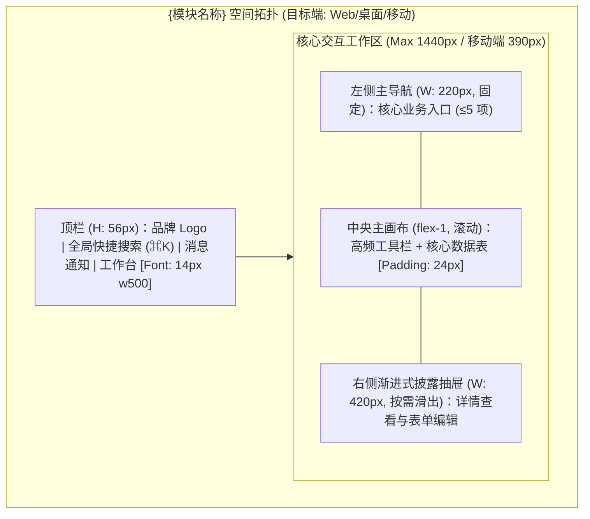

## 5. 双轨页面信息架构与多端四态原型 (Dual-Track Multi-Platform Prototypes & UI Specs)

> **多端适用声明**：本项目目标前端形态为：`[ ] Web 端 (Responsive)` / `[ ] 移动端 (Mobile App/H5)` / `[ ] 桌面端 (Desktop Client)`
> 必须根据目标端型绘制对应的 Mermaid 空间拓扑与内联 UI 标注的 ASCII 比例线框图。

### 5.1 轨一：页面空间划分与流转拓扑 (Mermaid)

### 5.2 轨二：页面核心四态 ASCII 空间比例线框与 UI 物理参数内联标注
