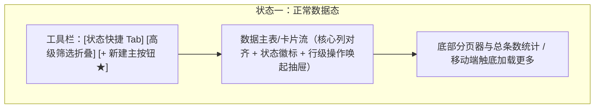

#### 状态一：正常数据态 (Populated State)
展示真实空间比例、容器尺寸、主次视觉锚点（★ 为唯一主 CTA）、字体字阶与渐进式披露折叠项：

##### [模式 A：Web 端 / 桌面端 (Desktop / Responsive Web: 1440px)]
```text
+----------------------------------------------------------------------------------------------------+
| [UI Spec: Canvas 1440px Max, Bg: #F7F5F2, Font: Inter / JetBrains Mono]                            |
| [Logo] {系统名称}                      [ 🔍 搜索名称/编号 (⌘K) ]              [🔔] [管理员 ▾]       |
| [Height: 56px, Border-b: 1px #E5E7EB, Padding-x: 20px, Avatar: 32x32 rounded-full]                |
+----------------------+-----------------------------------------------------------------------------+
| [Nav Col: 220px]     | [Main Area: Flex-1, Padding: 24px, Gap: 16px]                               |
| ▸ 工作台概览 (14px)  | {模块主标题} (共 24 项)                       [+ 新建{对象}] ★ (36px, Accent)|
| ● 核心工作台 ★       | [H1: 24px, w600, #1A1C1E]                    [Btn: 14px, w500, #B8422E, P: 10x16]  |
| ▸ 审批中心 (3)       | --------------------------------------------------------------------------  |
| ▸ 报表中心           | 状态: [全部(24)] [进行中(6)] [已完成(18)]     [高级筛选 ▾] (渐进式披露折叠)  |
|                      | [Tab: 13px, Tag-h: 28px, Gap: 8px]                                          |
|                      | +------------------------------------------------------------------------+  |
|                      | | 编号         名称              核心指标 (tabular)   状态    操作       |  |
|                      | | [Table Header: 12px, Uppercase, w600, Text: #6C7278, Bg: #F7F5F2]       |  |
|                      | |------------------------------------------------------------------------|  |
|                      | | #ID-1024     示例业务记录 A     98.5% (Mono)         ●正常   [详情] (13px)|
|                      | | #ID-1023     示例业务记录 B     86.0% (Mono)         ○待审   [审核]     |  |
|                      | +------------------------------------------------------------------------+  |
|                      | 显示 1-20 条 / 共 24 条 [12px, #6C7278]               [< 上一页] [下一页 >] |
+----------------------+-----------------------------------------------------------------------------+
  [注] ★ 唯一主强调 CTA；数字与金额列强制 tabular-nums 等宽对齐；点击单行唤起 420px 详情抽屉 (Overlay)。
```

##### [模式 B：移动端 (Mobile App / H5: 390px)]（若包含移动端则必填）
```text
+------------------------------------------+  [Mobile Viewport: 390px x 844px]
| 09:41                        📶 5G  🔋   |  [Status Bar: 44px]
| ← {模块标题}                [ 🔍 ] [ ⋯ ]  |  [Top App Bar: 48px, Title: 17px w600]
+------------------------------------------+
| 状态: [全部(24)] [待审(6)] [已完(18)]     |  [Scrollable Filter Tabs: Height 36px]
+------------------------------------------+
| +--------------------------------------+ |  [Card List: Gap 12px, Padding: 16px]
| | #ID-1024  示例业务记录 A      ●正常  | |  [Card 1: Radius 12px, Bg: #FFF, P: 16px]
| | 指标: 98.5% (Mono 14px)              | |  [Title: 15px w600, Status: 12px Badge]
| | 更新于: 10分钟前 (Caption 12px)      | |  [Sub: 13px, #6C7278]
| +--------------------------------------+ |
+------------------------------------------+
| [ + 新建{对象} ] ★                      |  [Bottom Floating Bar: 56px + Safe Area 34px]
| [CTA: 44px Touch Target, #B8422E, 16px]  |  [Full Width Button, Radius 8px]
+------------------------------------------+
```


