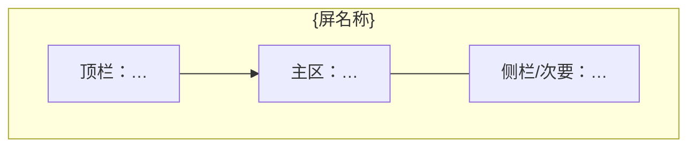

# 产品原型：{feature_name}

- **功能**：{feature_name}
- **来源**：用户提供 / Agent 生成
- **介质**：Figma 链接 / 截图路径 / Mermaid 线框（无位图）
- **关联 PRD**：`_02_product_design/{feature_name}_prd.md`
- **状态**：DRAFT / REVIEWED / APPROVED

---

## 1. 范围与非目标

- **范围**：…
- **非目标**：…

---

## 2. 主路径（成功）

1. …
2. …

---

## 3. 屏布局（线框）

### 3.1 {屏名称}

关键控件与文案要点：
- …

---

## 4. 与 PRD / DoD 映射

| 原型节点 | 用例 / DoD |
|----------|------------|
| … | UC_001 / DoD-1 |
