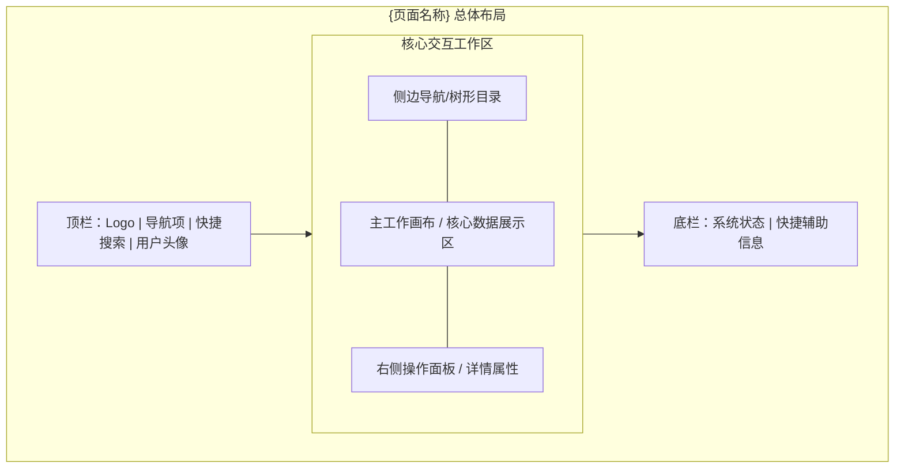
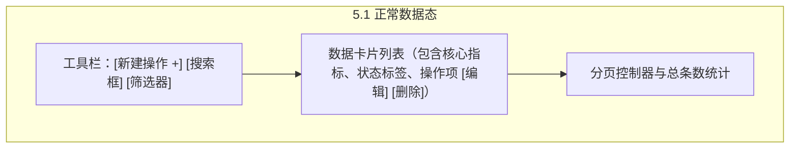
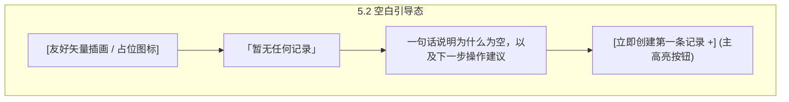
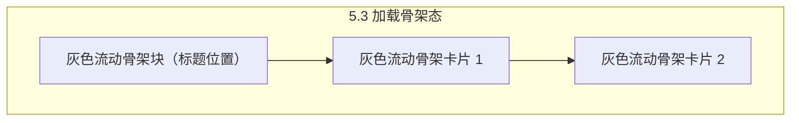
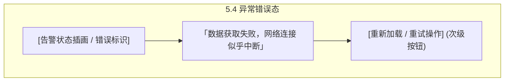

# 产品设计语言与界面原型规范：{feature_name}

- **功能模块**：{feature_name}
- **创建时间**：{YYYY-MM-DD}
- **介质形式**：Mermaid 结构化线框 / 交互说明 / Design Tokens 规范
- **关联 PRD**：`_02_product_design/{feature_name}_prd.md`
- **项目根契约**：根目录 `DESIGN.md`
- **状态**：DRAFT / REVIEWED / FROZEN

> [!NOTE]
> **产出铁律**：本文件专精于**产品的设计语言与界面多态原型**。严禁在本文中写入底层技术实现细节，专注呈现美学质感、Design Tokens、组件状态与用户交互线框。

---

## 1. 视觉调性与设计哲学 (Aesthetic & Mood)

- **设计隐喻与参照物**：{具体参照物，如：高信息密度的数据驾驶舱 / 暖纸色克制排版的极简文档空间}
- **受众与核心心智**：{目标用户感知，如：专业、精准、沉着、零干扰}
- **内容密度 (Density)**：`Compact`（紧凑高密） / `Balanced`（平衡标准） / `Airy`（宽松通透）

---

## 2. Design Tokens 规范定义

### 2.1 色彩体系 (Color Palette)
| Token 标识 | 角色定义 | Hex 色值 | 使用场景与对比度约束 |
|---|---|---|---|
| `color.primary` | 品牌主色 | `#1A1C1E` | 标题文本、主要强调边界、品牌标识 |
| `color.secondary` | 辅助次级色 | `#6C7278` | 次级说明文案、图标非高亮态 |
| `color.accent` | 行动强调色 (CTA) | `#B8422E` | 核心提交按钮、焦点高亮；严格预算（首屏 3-5 处） |
| `color.bg.canvas` | 画布底色 | `#F7F5F2` | 页面最底层背景画布 |
| `color.bg.surface` | 容器表面色 | `#FFFFFF` | 卡片、面板、模态弹窗表面 |
| `color.semantic.success` | 成功语义色 | `#1B873F` | 成功通知、达成标识（WCAG AA 达标） |
| `color.semantic.warning` | 告警语义色 | `#C47D00` | 警告提示、临界状态 |
| `color.semantic.error` | 错误语义色 | `#D9383A` | 校验失败红框、阻断性提示 |

### 2.2 排版层级 (Typography Hierarchy)
- **字体族**：Sans: `Inter, -apple-system, sans-serif`；Mono: `JetBrains Mono, monospace`
- **字阶规范**：
  - `Hero / Display`: 48px / 行高 1.1 / 字重 600 / 字距 -0.02em
  - `H1`: 32px / 行高 1.2 / 字重 600 / 页面主标题
  - `H2`: 24px / 行高 1.3 / 字重 600 / 核心区块卡片标题
  - `H3`: 18px / 行高 1.4 / 字重 600 / 小节/弹窗标题
  - `Body-Regular`: 14px–16px / 行高 1.6 / 字重 400 / 正文内容
  - `Caption`: 12px / 行高 1.4 / 字重 400 / 辅助提示与时间戳

### 2.3 间距与圆角高程 (Spacing, Radius & Depth)
- **间距步进**：`4px` (2xs) / `8px` (xs) / `12px` (sm) / `16px` (md) / `24px` (lg) / `32px` (xl)
- **圆角梯度**：
  - 微圆角 `4px`：输入框、Tag 徽标、Tooltip
  - 中圆角 `8px`：常规操作按钮、信息卡片
  - 大圆角 `12px`–`16px`：模态弹窗、底栏抽屉
- **投影高程**：
  - `Flat`: 1px 细边框 (`#E5E7EB`)，无阴影
  - `Raised`: `0 2px 4px rgba(0,0,0,0.06)`（悬浮卡片）
  - `Overlay`: `0 8px 16px rgba(0,0,0,0.12)`（下拉菜单、Popover）
  - `Modal`: `0 20px 40px rgba(0,0,0,0.2)`（配合半透明背景遮罩）

---

## 3. 核心组件全状态矩阵 (Component State Matrix)

### 3.1 核心按钮 (Action Button)
| 状态 (State) | 视觉表现与样式响应 | 交互行为 |
|---|---|---|
| **默认态 (Default)** | 背景 `color.accent`，文字纯白，中圆角 8px，内边距 10px 20px | 正常可交互，指针为 `pointer` |
| **悬停态 (Hover)** | 亮度提升 8%，微阴影展开，过渡动画 150ms | 鼠标移入即时反馈 |
| **按压态 (Active)** | 缩放 98%，色彩微暗沉，按压质感 | 鼠标按下瞬间 |
| **加载态 (Loading)** | 保持当前尺寸，隐藏原文本，居中展示 Spinner 转圈 | 提交进行中，屏蔽重复点击（防抖） |
| **禁用态 (Disabled)** | 背景不透明度 40%，文字浅灰，光标 `not-allowed` | 表单校验未通过时呈现 |

### 3.2 表单输入框 (Input Field)
- **默认态**：1px 浅灰边框，白色背景，占位符文案清晰；
- **聚焦态 (Focus)**：边框变为 `color.primary`，2px 外光晕轮廓，占位符微上浮；
- **错误态 (Error)**：边框变为 `color.semantic.error`，输入框正下方出现内联红色提示文本；
- **禁用态 (Disabled)**：背景置灰 (`#F3F4F6`)，禁止输入。

---

## 4. 页面信息架构与布局线框 (Information Architecture & Layout)

### 4.1 页面空间划分

---

## 5. 页面核心四态全覆盖设计 (The Four States)

针对关键页面，必须严格设计四种状态的界面表现：

### 5.1 状态一：正常数据态 (Populated State)
用户完成初始化后的标准界面，展示主要信息层级与交互列表。

### 5.2 状态二：空白引导态 (Empty State)
首次进入系统或查询结果为 0 时的界面，杜绝简单白屏。

### 5.3 状态三：数据加载态 (Loading / Skeleton State)
数据请求过程中的占位骨架屏，保持结构稳定不跳动。

### 5.4 状态四：异常错误态 (Error State)
网络中断、服务异常或严重校验失败时的优雅兜底。

---

## 6. 与 PRD / DoD 映射矩阵

| 原型区块 / 交互节点 | 关联 PRD 功能点 | 关联 DoD 断言 |
|---|---|---|
| `ActionBar` + `DataTable` | `FEAT-001` (核心信息展示) | `DoD-01` (主流程闭环) |
| `EmptyCTA` | `FEAT-001` (引导创建) | `DoD-03` (空态交互友好) |
| 输入框与表单错误态 | `FEAT-001` (校验规则) | `DoD-02` (异常拦截并高亮) |
| `RetryBtn` 错误恢复 | `FEAT-001` (异常处理) | `DoD-03` (兜底重试机制) |
