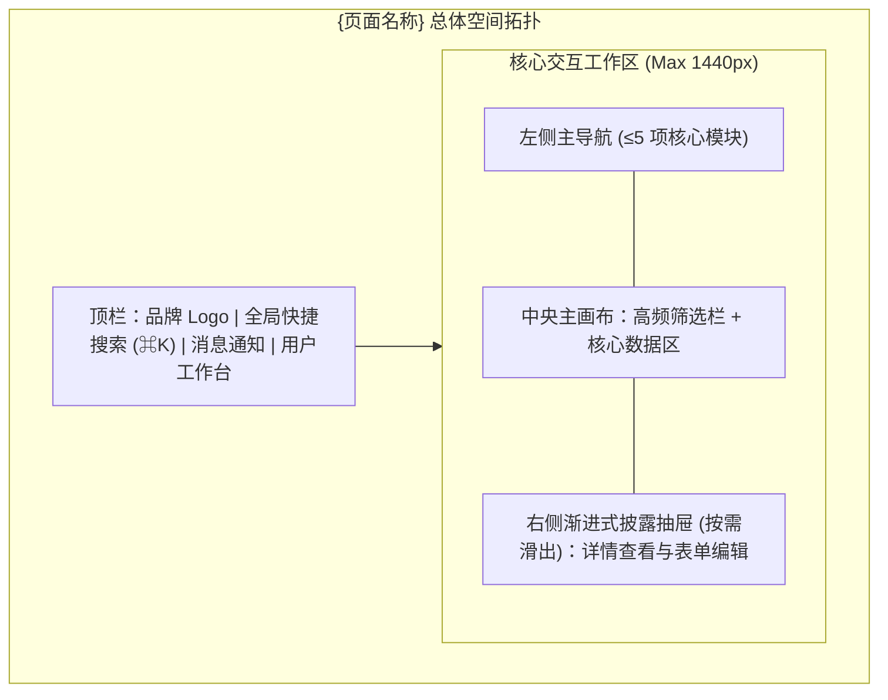
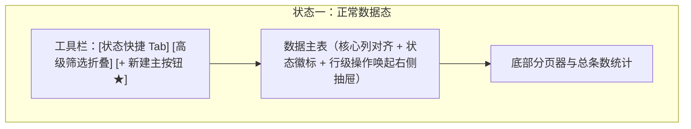
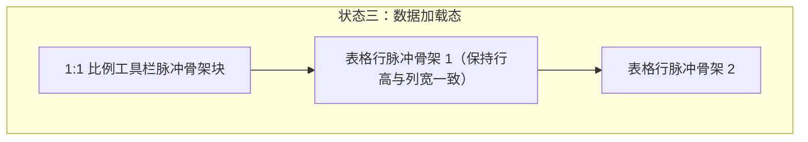

# 产品设计语言与界面原型规范：{feature_name}

- **功能模块**：{feature_name}
- **创建时间**：{YYYY-MM-DD}
- **介质形式**：双轨原型（Mermaid 拓扑 + ASCII 空间比例线框） / UX 四定律 / Design Tokens 规范
- **关联 PRD**：`_02_product_design/{feature_name}_prd.md`
- **宏观品味宪章继承**：`Inherits: /DESIGN.md`
- **状态**：DRAFT / REVIEWED / FROZEN

> [!NOTE]
> **产出铁律**：本文件专精于**模块特定功能流的 UX 可用性法则与双轨多态界面原型**。
> - **品味继承**：本项目全局调性、基准 Design Tokens、Anti-Slop 禁令均直接继承根目录 `DESIGN.md`，本文件仅定义该模块**特化/局部的组件状态与界面流**，严禁在多模块间重复定义冲突的全局规范。
> - **职责边界**：严禁在本文中写入底层技术实现细节，专注呈现局部流转、认知层级、组件六态与四态线框。

---

## 1. 视觉调性与设计哲学 (Aesthetic & Mood)
> 继承自 `/DESIGN.md`，此处仅记录该特性的**特化场景隐喻**（若与全局一致可直接标注“全量继承 `/DESIGN.md`”）：

- **设计隐喻与具体参照物**：{具象参照物，若无特化则填“继承 /DESIGN.md”；如特化：“在 Linear 框架下叠加 GitHub Actions 风格的单次全屏排障视角”}
- **受众与核心心智**：{目标用户感知，如：专业、精准、沉着、零干扰}
- **内容密度 (Density)**：`Compact`（紧凑高密） / `Balanced`（平衡标准） / `Airy`（宽松通透）

---

## 2. Design Tokens 规范定义
> 基础 Tokens 全量继承 `/DESIGN.md`。仅在此声明该功能独有的扩展语义 Token（若无新增，保留“全量继承全局 Token”）：


### 2.1 色彩体系 (Color Palette)
| Token 标识 | 角色定义 | Hex 色值 | 使用场景与对比度约束 |
|---|---|---|---|
| `color.primary` | 品牌主色 | `#1A1C1E` | 标题文本、主要强调边界、品牌标识 |
| `color.secondary` | 辅助次级色 | `#6C7278` | 次级说明文案、图标非高亮态 |
| `color.accent` | 行动强调色 (CTA) | `#B8422E` | 唯一核心主操作按钮、焦点高亮；严格预算（首屏 ≤3 处） |
| `color.bg.canvas` | 画布底色 | `#F7F5F2` | 页面最底层背景画布 |
| `color.bg.surface` | 容器表面色 | `#FFFFFF` | 卡片、面板、模态弹窗表面 |
| `color.semantic.success` | 成功语义色 | `#1B873F` | 成功通知、达成标识（WCAG AA 达标） |
| `color.semantic.warning` | 告警语义色 | `#C47D00` | 警告提示、临界状态 |
| `color.semantic.error` | 错误语义色 | `#D9383A` | 校验失败红框、阻断性提示 |

### 2.2 排版层级 (Typography Hierarchy)
- **字体族**：Sans: `Inter, -apple-system, sans-serif`；Mono: `JetBrains Mono, monospace`（数字与金额列强制启用 `tabular-nums` 等宽对齐）
- **字阶规范**：
  - `Hero / Display`: 48px / 行高 1.1 / 字重 600 / 字距 -0.02em
  - `H1`: 32px / 行高 1.2 / 字重 600 / 页面主标题
  - `H2`: 24px / 行高 1.3 / 字重 600 / 核心区块卡片标题
  - `H3`: 18px / 行高 1.4 / 字重 600 / 小节/抽屉标题
  - `Body-Regular`: 14px–16px / 行高 1.6 / 字重 400 / 正文内容（行宽约束 `60ch–75ch`）
  - `Caption`: 12px / 行高 1.4 / 字重 400 / 辅助提示与时间戳

### 2.3 间距与圆角高程 (Spacing, Radius & Depth)
- **间距步进**：`4px` (2xs) / `8px` (xs) / `12px` (sm) / `16px` (md) / `24px` (lg) / `32px` (xl)
- **圆角梯度**：微圆角 `4px`（输入框/徽标）、中圆角 `8px`（常规按钮/卡片）、大圆角 `12px`–`16px`（模态弹窗/抽屉）
- **投影高程**：`Flat` (1px 细边框 `#E5E7EB`) → `Raised` (`0 2px 4px rgba(0,0,0,0.06)`) → `Overlay` (`0 8px 16px rgba(0,0,0,0.12)`) → `Modal` (`0 20px 40px rgba(0,0,0,0.2)`)

---

## 3. UX 认知心理学与可用性四定律落地规范

1. **渐进式披露 (Progressive Disclosure)**：
   - **首屏显露（核心 20%）**：{列出首屏直接可见的核心指标、高频搜索与唯一主按钮}；
   - **按需折叠/抽屉（次级 80%）**：{列出收进「高级筛选 ▾」、侧边详情抽屉或二级菜单的低频配置项}。
2. **视觉层级与扫视动线 (Visual Hierarchy)**：
   - **一级视觉锚点 (Primary)**：{如：右上角高亮主 CTA `[+ 创建记录]` 与核心数据表头}；
   - **二级核心信息 (Secondary)**：{如：列表主字段名称、状态徽标、金额列}；
   - **三级弱化元数据 (Tertiary)**：{如：创建人、更新时间、分页统计辅文}。
3. **费茨定律与希克定律 (Fitts's & Hick's Law)**：
   - 主操作按钮高度 ≥ 36px（移动端触控 ≥ 44×44px）；危险操作（如「删除」）移入行尾二级菜单并与确认键保持安全间距；
   - 顶栏/侧栏同级并列主导航项严格控制在 ≤ 5 项。
4. **真实界面微文案规范 (UX Microcopy)**：
   - 主按钮文案采用「具象动词 + 宾语」（如 `立即发布商品`，禁写笼统的 `提交/确定`）；
   - 错误提示采用「原因 + 修复动作」（如 `库存数量必须为大于 0 的整数，请重新输入`）。

---

## 4. 核心组件全状态矩阵 (Component State Matrix)

### 4.1 核心按钮 (Action Button)
| 状态 (State) | 视觉表现与样式响应 | 交互行为 |
|---|---|---|
| **默认态 (Default)** | 背景 `color.accent`，文字纯白，中圆角 8px，内边距 10px 20px | 正常可交互，指针为 `pointer` |
| **悬停/聚焦态 (Hover/Focus)** | 亮度提升 8%，键盘聚焦呈现 2px `color.accent` 外发光环，过渡 150ms | 鼠标移入或 Tab 键聚焦即时反馈 |
| **按压态 (Active)** | 缩放 98%，色彩微暗沉，按压质感 | 鼠标按下瞬间 |
| **加载态 (Loading)** | 锁定原按钮宽度，显示 Spinner 旋转与「处理中...」 | 提交进行中，防抖屏蔽重复点击 |
| **禁用态 (Disabled)** | 背景不透明度 40%，文字浅灰，光标 `not-allowed` | 前置条件未满足时呈现，悬停 Tooltip 说明原因 |
| **错误/重试验态 (Error)** | 边框高亮告警色，文案切换为「重试提交」 | 请求失败后支持原位一键重试 |

### 4.2 表单输入框 (Input Field)
- **默认态**：1px 浅灰边框，白色背景，具体示例占位符文案；
- **聚焦态 (Focus)**：边框变为 `color.primary`，2px 外光晕轮廓；
- **错误态 (Error)**：边框变为 `color.semantic.error`，输入框正下方展示内联红色修复建议文本，保留已输入值；
- **禁用/只读态 (Disabled)**：背景置灰 (`#F3F4F6`)，禁止编辑。

---

## 5. 双轨页面信息架构与四态全覆盖原型 (Dual-Track Prototypes & The Four States)

### 5.1 轨一：页面空间划分与流转拓扑 (Mermaid)


### 5.2 轨二：页面核心四态 ASCII 空间比例线框与 Mermaid 对照

#### 状态一：正常数据态 (Populated State)
展示真实空间比例、主次视觉锚点（★ 为唯一主 CTA）与渐进式披露折叠项：

```text
+----------------------------------------------------------------------------------+
| [Logo] {系统名称}          [ 🔍 搜索名称/编号 (⌘K)         ]     [🔔] [管理员 v] |
+------------------+---------------------------------------------------------------+
| ● 核心工作台     |  {模块主标题} (共 24 项)                    [+ 新建{对象}] ★  |
| ▸ 流转审批 (3)   |  -----------------------------------------------------------  |
| ▸ 统计报表       |  状态: [全部(24)] [进行中(6)] [已完成(18)]    [高级筛选 ▾]    |
| ▸ 系统配置       |  +---------------------------------------------------------+  |
|                  |  | 编号         名称               核心指标   状态   操作  |  |
|                  |  |---------------------------------------------------------|  |
|                  |  | #ID-1024     示例业务记录 A      98.5%     ●正常  [详情]|  |
|                  |  | #ID-1023     示例业务记录 B      86.0%     ○待审  [审核]|  |
|                  |  +---------------------------------------------------------+  |
|                  |  显示 1-20 条 / 共 24 条                  [< 上一页] [下一页 >] |
+------------------+---------------------------------------------------------------+
```



#### 状态二：空白引导态 (Empty State & FTUE 冷启动)
首次进入系统或筛选结果为 0 时，提供清晰的冷启动引导与一键动作，杜绝空白死胡同：

```text
+----------------------------------------------------------------------------------+
|  {模块主标题} (0)                                                                |
|  +----------------------------------------------------------------------------+  |
|  |                                                                            |  |
|  |                              [ 📭 引导插画 ]                               |  |
|  |                        还没有创建任何{业务对象}                            |  |
|  |          创建后可在此实时追踪流转状态，或先载入示例数据体验完整流程        |  |
|  |                                                                            |  |
|  |                 [ + 立即创建首个{对象} ] ★    [ 载入示例数据 ]             |  |
|  |                                                                            |  |
|  +----------------------------------------------------------------------------+  |
+----------------------------------------------------------------------------------+
```


#### 状态三：数据加载态 (Loading / Skeleton State)
与正常数据态保持 1:1 物理尺寸对齐的骨架屏，消除加载完成时的布局抖动 (CLS = 0)：

```text
+----------------------------------------------------------------------------------+
|  [░░░░░░░░░░ 标题骨架]                                      [░░░░░░░░░ 按钮骨架] |
|  ------------------------------------------------------------------------------  |
|  +----------------------------------------------------------------------------+  |
|  | ░░░░░░░░░    ░░░░░░░░░░░░░░░░░░░░      ░░░░░░░░     ░░░░░░░     ░░░░░░░░   |  |
|  | ░░░░░░░░░    ░░░░░░░░░░░░░░░░          ░░░░░░░░     ░░░░░░░     ░░░░░░░░   |  |
|  | ░░░░░░░░░    ░░░░░░░░░░░░░░░░░░░       ░░░░░░░░     ░░░░░░░     ░░░░░░░░   |  |
|  +----------------------------------------------------------------------------+  |
+----------------------------------------------------------------------------------+
```



#### 状态四：异常错误态 (Error State)
网络中断或服务异常时，保留页面壳层与用户已输入筛选条件，提供人话说明与原位重试：

```text
+----------------------------------------------------------------------------------+
|  {模块主标题}                                                                    |
|  +----------------------------------------------------------------------------+  |
|  |                              [ ⚠️ 异常提示 ]                               |  |
|  |                        数据加载超时，网络连接似乎不稳定                    |  |
|  |                  您的筛选条件已保留，请检查网络后点击下方按钮重试          |  |
|  |                                                                            |  |
|  |                          [ ↻ 重新加载数据 ]                                |  |
|  +----------------------------------------------------------------------------+  |
+----------------------------------------------------------------------------------+
```


---

## 6. 与 PRD / Gherkin DoD 映射矩阵

| 原型区块 / 交互节点 | 关联 PRD 功能点 | 关联 Gherkin DoD 断言 |
|---|---|---|
| `ActionBar` + `DataTable` + 右侧抽屉 | `FEAT-001` (核心信息展示与创建) | `DoD-01` (Happy Path 主流程闭环) |
| `EmptyCTA` (创建首个对象 / 载入示例) | `FEAT-001` (FTUE 冷启动引导) | `DoD-02` (首次冷启动与空态引导) |
| 输入框内联错误态 + 脏数据退出拦截 | `FEAT-001` (校验规则与草稿保护) | `DoD-03` (校验拦截与草稿不丢失) |
| `RetryBtn` 原位错误恢复 + 骨架屏 | `FEAT-001` (异常处理与体验稳定性) | `DoD-04` (异常自愈恢复与响应式) |
